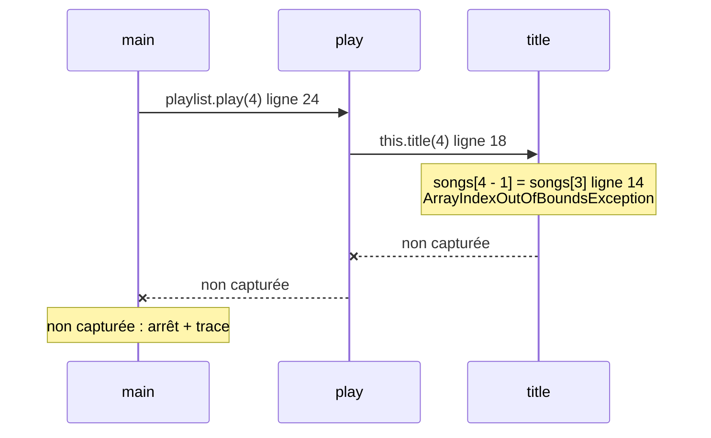
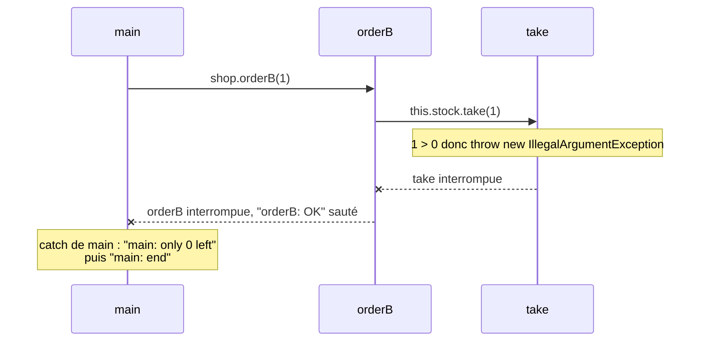
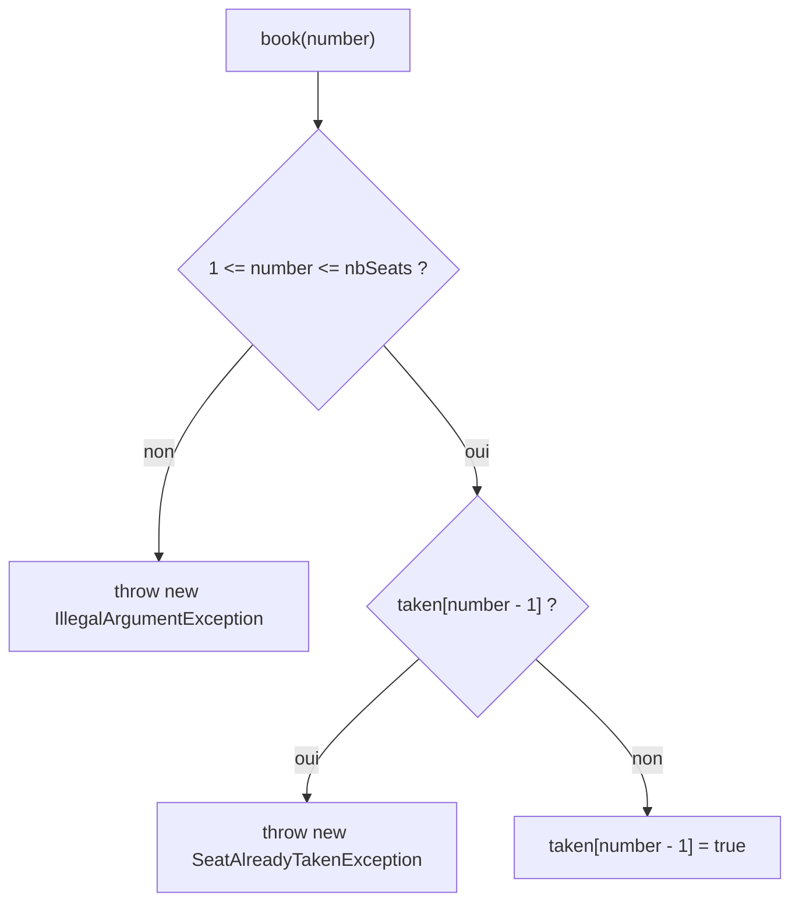

# ✅ 04 — Exceptions : corrigé

> ⚠️ Corrigé rédigé pour réviser : tout le code a été **compilé** et **exécuté** (Java 21), les affichages ci-dessous sont des **sorties réelles**, et les tests JUnit 5 passent (**13 tests réussis**).
> 📄 [Retour à l'énoncé](./enonce.md) · 📚 [Cours 04 — Exceptions](../../01-Cours/04-exceptions.md)

---

## Exercice 1 — Partager l'addition au restaurant ⭐

### Q1

```bash
$ java -classpath classes exo1.BillSplitter
A
share(): start
share(): end
part = 15
C
A
share(): start
B : / by zero
C
A
share(): start
share(): end
part = 20
C
end of main
```

💡 Au 2e tour (`people[i] = 0`), `total / people` lance une `ArithmeticException` : on quitte `share`, puis le `try` (pas de `part = ...`), on exécute le `catch`, et on **continue** après : `C`, puis le 3e tour.

### Q2 — sans `try` / `catch`

```bash
A
share(): start
share(): end
part = 15
C
A
share(): start
Exception in thread "main" java.lang.ArithmeticException: / by zero
	at exo1.BillSplitter2.share(BillSplitter2.java:7)
	at exo1.BillSplitter2.main(BillSplitter2.java:17)
```

💡 Personne ne capture : l'exception remonte jusqu'à `main` et **arrête** le programme. Ni `C` du 2e tour, ni le 3e tour, ni `end of main`.

### Q3 — avec `catch (NullPointerException e)`

```bash
A
share(): start
share(): end
part = 15
C
A
share(): start
Exception in thread "main" java.lang.ArithmeticException: / by zero
	at exo1.BillSplitter3.share(BillSplitter3.java:7)
	at exo1.BillSplitter3.main(BillSplitter3.java:18)
```

💡 Même résultat qu'en Q2 : le `catch` existe, mais il n'est **pas du bon type**. Une `ArithmeticException` n'est pas une `NullPointerException` → non capturée.

### Q4

💡 L'exception est lancée **à la ligne** `int result = total / people;` : on quitte `share` **immédiatement**, les lignes suivantes (`"share(): end"`, `return`) ne sont jamais exécutées. Le `try`/`catch` est dans `main`, pas dans `share`.

---

## Exercice 2 — La playlist qui plante ⭐

### Q1

| Exécution | Classe de l'exception | Née dans… | Ligne |
|---|---|---|---|
| `4` | `ArrayIndexOutOfBoundsException` | `title` | 14 |
| `3` | `NullPointerException` | `title` | 14 |
| `deux` | `NumberFormatException` | `Integer.parseInt` (code de Java), appelée par **notre** `main` | 24 de `Playlist.java` |
| *(rien)* | `ArrayIndexOutOfBoundsException` | `main` | 24 |

### Q2



💡 `main` (ligne 24) appelle `play`, qui (ligne 18) appelle `title`. Le numéro 4 donne l'**indice** `4 - 1 = 3`, or le tableau a 3 cases (indices 0 à 2).

### Q3

💡 Dans les 4 cas, l'exception n'est **capturée nulle part** : le programme s'arrête **avant** la ligne `System.out.println("end of playlist");`.

### Q4

💡 On cherche la **première** ligne `at` qui concerne **notre** code : `at exo2.Playlist.main(Playlist.java:24)`. C'est là qu'on a appelé `Integer.parseInt("deux")` avec une chaîne qui n'est pas un entier.

### Q5

```bash
$ java -classpath classes exo2.Playlist 2
now playing: RESPECT
now playing: IMAGINE
end of playlist
```

💡 Le n° 2 correspond à `songs[1] = "Imagine"` : aucune exception, le programme va jusqu'au bout.

---

## Exercice 3 — Rupture de stock ⭐⭐

### Q1

```bash
$ java -classpath classes exo3.Shop
take(3)
taken, 2 left
orderA: OK
orderA: end
take(3)
orderA: sorry, only 2 left
orderA: end
take(2)
taken, 0 left
orderB: OK
take(1)
main: only 0 left
main: end
```

💡 2e commande : `take` lance l'exception, capturée **dans `orderA`** → `"orderA: OK"` sauté, mais `"orderA: end"` affiché. 4e commande : l'exception traverse `take` **et** `orderB`, capturée dans `main` → `"main: all orders done"` sauté.

### Q2



💡 Sont interrompues : `take` (le `this.quantity = ...` et `"taken..."` sautés) et `orderB`. Capture dans le `catch` de `main`.

### Q3

```java
package exo3;

public class Shop2 {
    private Stock stock;

    public Shop2(Stock stock) {
        this.stock = stock;
    }

    public void orderB(int n) throws IllegalArgumentException {
        this.stock.take(n);
        System.out.println("orderB: OK");
    }

    public static void main(String[] args) {
        Shop2 shop = new Shop2(new Stock(2));
        shop.orderB(2);
        shop.orderB(1);
        System.out.println("main: end");
    }
}
```

```bash
$ java -classpath classes exo3.Shop2
take(2)
taken, 0 left
orderB: OK
take(1)
Exception in thread "main" java.lang.IllegalArgumentException: only 0 left
	at exo3.Stock.take(Stock.java:17)
	at exo3.Shop2.orderB(Shop2.java:11)
	at exo3.Shop2.main(Shop2.java:18)
```

💡 Plus aucun `catch` sur le chemin : l'exception arrête le programme, `"main: end"` n'est **pas** affiché. La trace donne le chemin inverse des appels.

### Q4

💡 **Non**, pas obligatoire : `IllegalArgumentException` est une `RuntimeException` (cours § 13), le compilateur ne l'exige pas. On l'écrit quand même (avec `@throws` dans la javadoc) car elle fait partie du **contrat** : l'utilisateur de `orderB` sait qu'il doit s'y attendre.

---

## Exercice 4 — Le minuteur de cuisson ⭐⭐

### Q1

```bash
$ java -classpath classes exo4.CookingTimerV0 douze
Exception in thread "main" java.lang.NumberFormatException: For input string: "douze"
	at java.base/java.lang.NumberFormatException.forInputString(NumberFormatException.java:67)
	at java.base/java.lang.Integer.parseInt(Integer.java:662)
	at java.base/java.lang.Integer.parseInt(Integer.java:778)
	at exo4.CookingTimerV0.main(CookingTimerV0.java:5)
$ java -classpath classes exo4.CookingTimerV0
Exception in thread "main" java.lang.ArrayIndexOutOfBoundsException: Index 0 out of bounds for length 0
	at exo4.CookingTimerV0.main(CookingTimerV0.java:5)
$ java -classpath classes exo4.CookingTimerV0 3.5
Exception in thread "main" java.lang.NumberFormatException: For input string: "3.5"
	at java.base/java.lang.NumberFormatException.forInputString(NumberFormatException.java:67)
	at java.base/java.lang.Integer.parseInt(Integer.java:662)
	at java.base/java.lang.Integer.parseInt(Integer.java:778)
	at exo4.CookingTimerV0.main(CookingTimerV0.java:5)
```

💡 `"3.5"` n'est pas un **entier** : `parseInt` refuse. Sans argument, `args[0]` n'existe pas (`args.length == 0`).

### Q2

```java
package exo4;

public class CookingTimer {
    public static final int DEFAULT_MINUTES = 10;

    public static void main(String[] args) {
        int minutes;
        try {
            minutes = Integer.parseInt(args[0]);
        } catch (ArrayIndexOutOfBoundsException e) {
            System.out.println("no argument");
            minutes = CookingTimer.DEFAULT_MINUTES;
        } catch (NumberFormatException e) {
            System.out.println(args[0] + " is not an integer");
            minutes = CookingTimer.DEFAULT_MINUTES;
        }
        System.out.println("timer set for " + minutes + " minutes");
    }
}
```

```bash
$ java -classpath classes exo4.CookingTimer douze
douze is not an integer
timer set for 10 minutes
$ java -classpath classes exo4.CookingTimer
no argument
timer set for 10 minutes
$ java -classpath classes exo4.CookingTimer 12
timer set for 12 minutes
```

💡 Chaque `catch` contient un **code correctif** (valeur par défaut) : le programme ne s'arrête plus. Les **deux** `catch` affectent `minutes`, sinon *variable minutes might not have been initialized*.

### Q3

```java
package exo4;

public class CookingTimerOneCatch {
    public static void main(String[] args) {
        int minutes;
        try {
            minutes = Integer.parseInt(args[0]);
        } catch (ArrayIndexOutOfBoundsException | NumberFormatException e) {
            System.out.println("invalid or missing argument");
            minutes = 10;
        }
        System.out.println("timer set for " + minutes + " minutes");
    }
}
```

💡 `catch (A | B e)` : **même** traitement pour les deux types (forme 2 du cours, § 8).

### Q4 — ❌ ne compile pas

```bash
CookingTimerBad.java:8: error: exception NumberFormatException has already been caught
        } catch (NumberFormatException e) {
          ^
1 error
```

💡 Le **premier** `catch` qui correspond est choisi. `catch (Exception e)` capture **tout** : le second `catch` est inaccessible. Toujours du **plus précis au plus général**.

### Q5

```bash
$ java -classpath classes exo4.CookingTimerIAE douze
caught: java.lang.NumberFormatException
timer set for 10 minutes
$ java -classpath classes exo4.CookingTimerIAE
Exception in thread "main" java.lang.ArrayIndexOutOfBoundsException: Index 0 out of bounds for length 0
	at exo4.CookingTimerIAE.main(CookingTimerIAE.java:7)
```

💡 `NumberFormatException` est une **sorte d'**`IllegalArgumentException` → capturée, et `getClass().getName()` donne sa classe **exacte**. `ArrayIndexOutOfBoundsException` n'en est pas une → non capturée.

---

## Exercice 5 — Le thermostat buggé ⭐⭐

### Q1 — les 5 erreurs (messages réels de `javac`)

| Ligne | Message du compilateur | Correction |
|---|---|---|
| (A) | `error: ';' expected` | `throws` dans la **signature** : `... int t) throws IllegalArgumentException {` |
| (B) | `error: illegal start of expression` | `throw` dans le **corps** : `throw new IllegalArgumentException(...)` |
| (C) | `error: cannot find symbol ... symbol: method IllegalArgumentException(String)` | il manque `new` : `throw new IllegalArgumentException("too cold: " + t);` |
| (D) | `error: variable t might not have been initialized` | affecter `t` **aussi** dans le `catch` |
| (E) | `error: 'void' type not allowed here` | lambda : `() -> th.setTemperature(35)` |

💡 (C) : sans `new`, Java croit qu'on appelle une **méthode** nommée `IllegalArgumentException`. (E) : sans `() ->`, `th.setTemperature(35)` est exécuté **avant** `assertThrows` (et ici, il ne renvoie même rien).

### Q2

💡 Non : un `println` ne **corrige** rien, et `t` reste sans valeur. Code correctif : `t = Thermostat.DEFAULT;` dans le `catch`.

### Q3

```java
package exo5;

public class Thermostat {
    public static final int MIN = 5;
    public static final int MAX = 30;
    public static final int DEFAULT = 19;

    private int temperature;

    public Thermostat() {
        this.temperature = Thermostat.DEFAULT;
    }

    public int getTemperature() {
        return this.temperature;
    }

    /** sets the temperature of this thermostat
     * @param t the new temperature
     * @throws IllegalArgumentException if t is lower than MIN or greater than MAX
     */
    public void setTemperature(int t) throws IllegalArgumentException {
        if (t < Thermostat.MIN || t > Thermostat.MAX) {
            throw new IllegalArgumentException("out of range: " + t);
        }
        this.temperature = t;
    }

    /** @return the integer value of s, or DEFAULT if s is not an integer */
    public int parseTemperature(String s) {
        int t;
        try {
            t = Integer.parseInt(s);
        } catch (NumberFormatException e) {
            t = Thermostat.DEFAULT;
        }
        return t;
    }
}
```

### Q4

```java
package exo5;

import static org.junit.jupiter.api.Assertions.*;
import org.junit.jupiter.api.*;

public class ThermostatTest {

    @Test
    public void setTemperatureThrowsExceptionWhenTooHot() {
        Thermostat th = new Thermostat();
        th.setTemperature(30);                       // valide : ne lève rien
        assertThrows(IllegalArgumentException.class, () -> th.setTemperature(35));
        assertEquals(30, th.getTemperature());       // inchangée
    }

    @Test
    public void setTemperatureThrowsExceptionWhenTooCold() {
        Thermostat th = new Thermostat();
        th.setTemperature(5);
        assertThrows(IllegalArgumentException.class, () -> th.setTemperature(4));
        assertEquals(5, th.getTemperature());
    }

    @Test
    public void parseTemperatureReturnsDefaultWhenNotANumber() {
        Thermostat th = new Thermostat();
        assertEquals(21, th.parseTemperature("21"));
        assertEquals(Thermostat.DEFAULT, th.parseTemperature("chaud"));
    }
}
```

💡 L'appel valide **à la limite** (`30`, `5`) vérifie qu'on ne lève pas d'exception « à tort » ; l'`assertEquals` final vérifie que l'état est **inchangé**.

---

## Exercice 6 — Le distributeur de billets ⭐⭐

### Q1

```java
package exo6;

public class InsufficientBalanceException extends Exception {
    public InsufficientBalanceException(String msg) {
        super(msg);
    }
}
```

💡 Nom `NatureDuProblèmeException`, constructeur qui transmet le message (récupéré ensuite par `e.getMessage()`).

### Q2 — javadoc

```java
/** withdraws amount euros from this account, in banknotes of 10 euros
 * @param amount the amount to withdraw
 * @throws IllegalArgumentException if amount is not a positive multiple of BANKNOTE
 * @throws InsufficientBalanceException if amount is greater than the balance
 *         (the balance is then unchanged)
 */
```

### Q3 — tests

```java
package exo6;

import static org.junit.jupiter.api.Assertions.*;
import org.junit.jupiter.api.*;

public class BankAccountTest {

    @Test
    public void withdrawDecreasesBalance() throws InsufficientBalanceException {
        BankAccount account = new BankAccount("timoleon", 100);
        account.withdraw(30);
        assertEquals(70, account.getBalance());
    }

    @Test
    public void withdrawWholeBalanceIsPossible() throws InsufficientBalanceException {
        BankAccount account = new BankAccount("timoleon", 100);
        account.withdraw(100);
        assertEquals(0, account.getBalance());
    }

    @Test
    public void withdrawThrowsExceptionWhenBalanceTooLow() {
        BankAccount account = new BankAccount("timoleon", 100);
        assertThrows(InsufficientBalanceException.class, () -> account.withdraw(110));
        assertEquals(100, account.getBalance());
    }

    @Test
    public void withdrawThrowsExceptionWhenAmountNotMultipleOf10() {
        BankAccount account = new BankAccount("timoleon", 100);
        assertThrows(IllegalArgumentException.class, () -> account.withdraw(25));
        assertThrows(IllegalArgumentException.class, () -> account.withdraw(0));
        assertThrows(IllegalArgumentException.class, () -> account.withdraw(-20));
        assertEquals(100, account.getBalance());
    }
}
```

💡 Les tests qui appellent `withdraw` **hors** d'un `assertThrows` doivent déclarer `throws InsufficientBalanceException` (exception non-`Runtime`). Un `assertThrows` peut contenir plusieurs appels séparés pour plusieurs cas.

### Q4

```java
package exo6;

public class BankAccount {
    public static final int BANKNOTE = 10;

    private String owner;
    private int balance;

    public BankAccount(String owner, int balance) {
        this.owner = owner;
        this.balance = balance;
    }

    public String getOwner() {
        return this.owner;
    }

    public int getBalance() {
        return this.balance;
    }

    /** withdraws amount euros from this account, in banknotes of 10 euros
     * @param amount the amount to withdraw
     * @throws IllegalArgumentException if amount is not a positive multiple of BANKNOTE
     * @throws InsufficientBalanceException if amount is greater than the balance
     *         (the balance is then unchanged)
     */
    public void withdraw(int amount) throws IllegalArgumentException, InsufficientBalanceException {
        if (amount <= 0 || amount % BankAccount.BANKNOTE != 0) {
            throw new IllegalArgumentException("invalid amount: " + amount);
        }
        if (amount > this.balance) {
            throw new InsufficientBalanceException("balance too low: " + this.balance);
        }
        this.balance = this.balance - amount;
    }
}
```

💡 On **vérifie d'abord**, on **débite ensuite** : si une exception est lancée, `this.balance = ...` n'est jamais exécuté → solde inchangé.

### Q5

```java
package exo6;

public class CashMachine {
    public static void main(String[] args) {
        BankAccount account = new BankAccount("timoleon", 100);
        try {
            int amount = Integer.parseInt(args[0]);
            account.withdraw(amount);
            System.out.println("take your " + amount + " euros");
        } catch (NumberFormatException e) {
            System.out.println("amount must be an integer");
        } catch (IllegalArgumentException e) {
            System.out.println("amount must be a positive multiple of 10");
        } catch (InsufficientBalanceException e) {
            System.out.println("sorry: " + e.getMessage());
        }
        System.out.println("balance: " + account.getBalance());
    }
}
```

```bash
$ java -classpath classes exo6.CashMachine 30
take your 30 euros
balance: 70
$ java -classpath classes exo6.CashMachine 110
sorry: balance too low: 100
balance: 100
$ java -classpath classes exo6.CashMachine 25
amount must be a positive multiple of 10
balance: 100
$ java -classpath classes exo6.CashMachine cent
amount must be an integer
balance: 100
```

💡 `parseInt` est **dans** le `try` : sa `NumberFormatException` est donc capturée. (Sans argument, on obtiendrait encore une `ArrayIndexOutOfBoundsException` : à toi d'ajouter un `catch` si tu veux.)

### Q6 — compile ou pas ?

| Cas | Résultat | Message réel |
|---|---|---|
| (a) `throws` sans `InsufficientBalanceException` | ❌ | `unreported exception InsufficientBalanceException; must be caught or declared to be thrown` (sur le `throw`) |
| (b) pas de `catch (InsufficientBalanceException e)` dans `main` | ❌ | même message, sur `account.withdraw(amount);` |
| (c) `catch (IllegalArgumentException e)` avant `catch (NumberFormatException e)` | ❌ | `exception NumberFormatException has already been caught` |

💡 (a), (b) : une exception qui n'est **pas** une `RuntimeException` doit être **capturée** ou **annoncée** (`throws`). (c) : du plus précis au plus général.

---

## Exercice 7 — La borne de commande ⭐⭐

### Q1 et Q2

```java
package exo7;

import java.io.IOException;

public class OrderKiosk {
    public static final int MAX = 10;

    /** checks that quantity is a valid number of burgers
     * @param quantity the quantity to check
     * @throws IllegalArgumentException if quantity is not between 1 and MAX
     */
    public static void checkQuantity(int quantity) throws IllegalArgumentException {
        if (quantity < 1 || quantity > OrderKiosk.MAX) {
            throw new IllegalArgumentException("quantity out of range: " + quantity);
        }
    }

    public static void main(String[] args) {
        int quantity = 0;
        boolean done = false;
        while (!done) {
            try {
                System.out.print("How many burgers (1-" + OrderKiosk.MAX + ")? ");
                quantity = Input.readInt();
                OrderKiosk.checkQuantity(quantity);
                done = true;
            } catch (IOException e) {
                System.out.println("Please type a number.");
            } catch (IllegalArgumentException e) {
                System.out.println("Between 1 and " + OrderKiosk.MAX + " please.");
            }
        }
        System.out.println("Order: " + quantity + " burger(s)");
    }
}
```

💡 Deux sources d'erreur, deux `catch` : `IOException` (pas un nombre) et `IllegalArgumentException` (nombre hors limites, lancée par **notre** méthode). `Input.readInt()` vide la mauvaise saisie (`skip(".*")`) avant de relancer.

### Q3

```bash
$ printf 'deux\n0\n12\n3\n' | java -classpath classes exo7.OrderKiosk
How many burgers (1-10)? Please type a number.
How many burgers (1-10)? Between 1 and 10 please.
How many burgers (1-10)? Between 1 and 10 please.
How many burgers (1-10)? Order: 3 burger(s)
```

💡 Ici les saisies viennent de `printf` (elles ne s'affichent donc pas à l'écran). `deux` → `IOException` ; `0` et `12` → `IllegalArgumentException` ; `3` → `done = true`, fin de boucle.

### Q4

💡 Si `readInt` ou `checkQuantity` lance une exception, on quitte le `try` **avant** `done = true;` → `done` reste `false` → on **recommence**. Placé avant, la boucle s'arrêterait même avec une saisie invalide.

---

## Exercice 8 — Réservation au cinéma (style DS) ⭐⭐⭐

### Q1

```java
package exo8;

public class SeatAlreadyTakenException extends Exception {
    public SeatAlreadyTakenException(String msg) {
        super(msg);
    }
}
```

### Q2 — javadoc de `book`

```java
/** books seat number
 * @param number the number of the seat to book
 * @throws IllegalArgumentException if number is not a valid seat number
 * @throws SeatAlreadyTakenException if seat number is already taken
 */
```

### Q3 — tests (classe complète, avec aussi les tests des autres méthodes)

| Cas testé | Attendu |
|---|---|
| place libre | réservée, une place libre de moins |
| place déjà prise | `SeatAlreadyTakenException`, place **toujours** prise, nb de places libres inchangé |
| numéros `0` et `11` (salle de 10) | `IllegalArgumentException`, rien ne change |
| `cancel` | la place redevient réservable |
| `firstFreeSeat` | saute les places prises, `0` si complet |

```java
package exo8;

import static org.junit.jupiter.api.Assertions.*;
import org.junit.jupiter.api.*;

public class CinemaTest {

    @Test
    public void newCinemaHasOnlyFreeSeats() {
        Cinema cinema = new Cinema(10);
        assertEquals(10, cinema.nbFreeSeats());
        assertFalse(cinema.isTaken(1));
        assertFalse(cinema.isTaken(10));
    }

    @Test
    public void bookFreeSeatMakesItTaken() throws SeatAlreadyTakenException {
        Cinema cinema = new Cinema(10);
        cinema.book(3);
        assertTrue(cinema.isTaken(3));
        assertEquals(9, cinema.nbFreeSeats());
    }

    @Test
    public void bookTakenSeatThrowsException() throws SeatAlreadyTakenException {
        Cinema cinema = new Cinema(10);
        cinema.book(3);
        assertThrows(SeatAlreadyTakenException.class, () -> cinema.book(3));
        assertTrue(cinema.isTaken(3));
        assertEquals(9, cinema.nbFreeSeats());
    }

    @Test
    public void bookInvalidSeatThrowsException() {
        Cinema cinema = new Cinema(10);
        assertThrows(IllegalArgumentException.class, () -> cinema.book(0));
        assertThrows(IllegalArgumentException.class, () -> cinema.book(11));
        assertEquals(10, cinema.nbFreeSeats());
    }

    @Test
    public void cancelFreesTheSeat() throws SeatAlreadyTakenException {
        Cinema cinema = new Cinema(10);
        cinema.book(3);
        cinema.cancel(3);
        assertFalse(cinema.isTaken(3));
        cinema.book(3);                       // de nouveau possible
        assertTrue(cinema.isTaken(3));
    }

    @Test
    public void firstFreeSeatSkipsTakenSeats() throws SeatAlreadyTakenException {
        Cinema cinema = new Cinema(3);
        assertEquals(1, cinema.firstFreeSeat());
        cinema.book(1);
        cinema.book(2);
        assertEquals(3, cinema.firstFreeSeat());
        cinema.book(3);
        assertEquals(0, cinema.firstFreeSeat());
    }
}
```

### Q4

```java
package exo8;

public class Cinema {
    private boolean[] taken;

    /** creates a cinema room with nbSeats free seats, numbered from 1 to nbSeats */
    public Cinema(int nbSeats) {
        this.taken = new boolean[nbSeats];
    }

    public int getNbSeats() {
        return this.taken.length;
    }

    /** @throws IllegalArgumentException if number is not between 1 and getNbSeats() */
    private void checkNumber(int number) throws IllegalArgumentException {
        if (number < 1 || number > this.taken.length) {
            throw new IllegalArgumentException("no seat number " + number);
        }
    }

    /** @return true if and only if seat number is taken
     * @throws IllegalArgumentException if number is not a valid seat number
     */
    public boolean isTaken(int number) throws IllegalArgumentException {
        this.checkNumber(number);
        return this.taken[number - 1];
    }

    /** books seat number
     * @param number the number of the seat to book
     * @throws IllegalArgumentException if number is not a valid seat number
     * @throws SeatAlreadyTakenException if seat number is already taken
     */
    public void book(int number) throws IllegalArgumentException, SeatAlreadyTakenException {
        this.checkNumber(number);
        if (this.taken[number - 1]) {
            throw new SeatAlreadyTakenException("seat " + number + " is already taken");
        }
        this.taken[number - 1] = true;
    }

    /** frees seat number (no effect if the seat is free)
     * @throws IllegalArgumentException if number is not a valid seat number
     */
    public void cancel(int number) throws IllegalArgumentException {
        this.checkNumber(number);
        this.taken[number - 1] = false;
    }

    /** @return the number of free seats */
    public int nbFreeSeats() {
        int count = 0;
        for (int i = 0; i < this.taken.length; i++) {
            if (!this.taken[i]) {
                count++;
            }
        }
        return count;
    }

    /** @return the smallest number of a free seat, 0 if the room is full */
    public int firstFreeSeat() {
        for (int i = 0; i < this.taken.length; i++) {
            if (!this.taken[i]) {
                return i + 1;
            }
        }
        return 0;
    }
}
```

💡 `checkNumber` **lance** l'exception ; `isTaken`, `book`, `cancel` la **laissent passer** (`throws`). `new boolean[n]` initialise toutes les cases à `false` (places libres).



### Q5

```java
package exo8;

public class CinemaMain {
    public static void main(String[] args) {
        Cinema cinema = new Cinema(10);
        for (int i = 0; i < args.length; i++) {
            try {
                int number = Integer.parseInt(args[i]);
                cinema.book(number);
                System.out.println("seat " + number + ": booked");
            } catch (SeatAlreadyTakenException e) {
                int other = cinema.firstFreeSeat();
                System.out.println(e.getMessage() + ", seat " + other + " is free");
            } catch (NumberFormatException e) {
                System.out.println(args[i] + ": not a seat number");
            } catch (IllegalArgumentException e) {
                System.out.println(e.getMessage());
            }
        }
        System.out.println(cinema.nbFreeSeats() + " free seats left");
    }
}
```

```bash
$ java -classpath classes exo8.CinemaMain 3 5 3 12 abc 1 0
seat 3: booked
seat 5: booked
seat 3 is already taken, seat 1 is free
no seat number 12
abc: not a seat number
seat 1: booked
no seat number 0
7 free seats left
```

💡 Le `try` est **dans** le `for` : une erreur sur un argument n'empêche pas de traiter les suivants. `NumberFormatException` est placée **avant** `IllegalArgumentException` (sinon : erreur de compilation, cf. exercice 6).

---

## ⚠️ Erreurs fréquentes

| Erreur | Pourquoi c'est faux | Correction |
|---|---|---|
| `throws new XxxException()` dans le corps | confusion `throw` / `throws` | `throw new ...` dans le corps, `throws` dans la signature |
| `throw XxxException("...")` | il manque `new` : il faut lancer un **objet** | `throw new XxxException("...")` |
| Croire que la fin du `try` s'exécute après l'exception | on **quitte** le `try` immédiatement | mettre ce qui dépend du succès **dans** le `try` (ex. `done = true;` en dernier) |
| `catch` d'un type qui ne correspond pas | l'exception n'est pas capturée → arrêt | capturer le **bon** type (ou un type plus général) |
| `catch (Exception e)` ou `catch (IllegalArgumentException e)` avant un sous-type | `has already been caught` | du **plus précis** au **plus général** |
| Débiter / réserver **avant** de vérifier | l'état est modifié même en cas d'exception | vérifier, `throw`, **puis** modifier |
| Oublier `throws MaException` (classe `extends Exception`) | `unreported exception ... must be caught or declared to be thrown` | annoncer avec `throws` ou capturer |
| Méthode de test sans `throws` alors qu'elle appelle `book`/`withdraw` | même erreur de compilation dans le test | `public void test...() throws MaException` |
| `assertThrows(X.class, obj.m())` | l'appel est fait **avant** l'assertion | `assertThrows(X.class, () -> obj.m())` |
| `catch` qui ne fait qu'un `println` | rien n'est corrigé, variable parfois non initialisée | code **correctif** (valeur par défaut, nouvel essai…) |
| Lire la trace de bas en haut | on cherche le lieu de naissance au mauvais endroit | 1er `at` = lieu de naissance ; chercher la 1re ligne de **notre** code |

---

📄 [Retour à l'énoncé](./enonce.md)

🏠 [Sommaire des exercices](../README.md)
