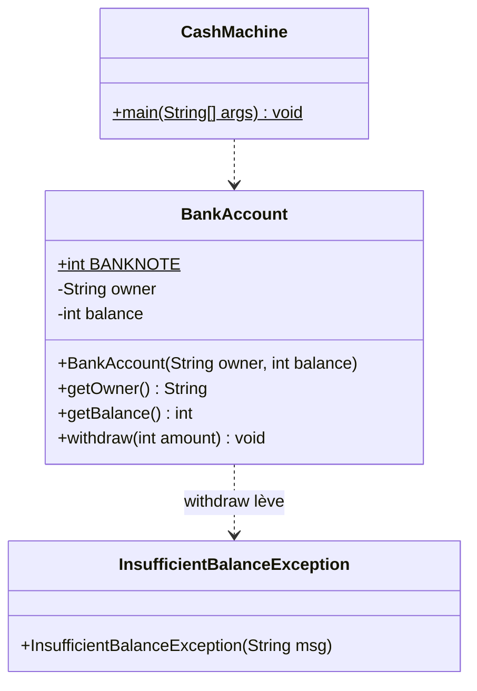
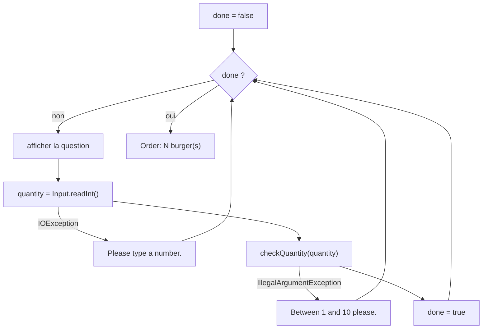
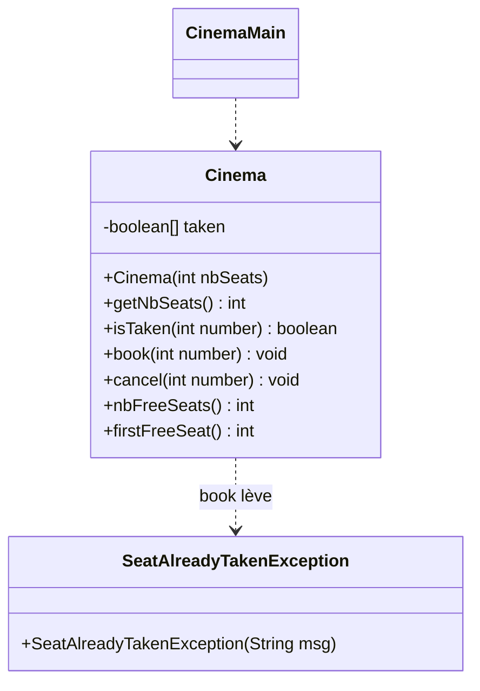

# 🏋️ 04 — Exceptions : exercices d'entraînement

> 🎯 **Objectifs** : prévoir le flux d'un `try`/`catch`, lire une trace de pile, utiliser `throw` / `throws`, écrire sa classe d'exception, tester avec `assertThrows`.
> 📚 Cours : [04 — Exceptions](../../01-Cours/04-exceptions.md)
> ✅ Corrigé : [./corrige.md](./corrige.md) — essaie d'abord seul !

## 🗺️ Les exercices

| N° | Titre | Niveau | Durée | Notions |
|---|---|---|---|---|
| 1 | Partager l'addition au restaurant | ⭐ | 10 min | flux `try`/`catch`, « que s'affiche-t-il ? » |
| 2 | La playlist qui plante | ⭐ | 10 min | lire une trace de pile |
| 3 | Rupture de stock | ⭐⭐ | 15 min | propagation, `throws`, qui capture ? |
| 4 | Le minuteur de cuisson | ⭐⭐ | 15 min | `args`, `NumberFormatException`, plusieurs `catch` |
| 5 | Le thermostat buggé | ⭐⭐ | 15 min | trouve les erreurs, `assertThrows` |
| 6 | Le distributeur de billets | ⭐⭐ | 25 min | sa classe d'exception, `throw`/`throws`, tests |
| 7 | La borne de commande | ⭐⭐ | 15 min | réessayer après une erreur de saisie |
| 8 | Réservation au cinéma (style DS) | ⭐⭐⭐ | 40 min | javadoc `@throws` + tests + code + `main` |

📌 Rappel des commandes (cf. cours) : `javac -d classes src/exoN/*.java` puis `java -classpath classes exoN.LaClasse arguments`.

---

## Exercice 1 — Partager l'addition au restaurant ⭐

À la fin d'un repas, on partage l'addition (60 €) entre les convives. Mais un jour, tout le monde est parti avant de payer : 0 convive… Que fait le programme ?

```java
package exo1;

public class BillSplitter {

    public int share(int total, int people) {
        System.out.println("share(): start");
        int result = total / people;
        System.out.println("share(): end");
        return result;
    }

    public static void main(String[] args) {
        BillSplitter splitter = new BillSplitter();
        int[] people = {4, 0, 3};
        for (int i = 0; i < people.length; i++) {
            try {
                System.out.println("A");
                int part = splitter.share(60, people[i]);
                System.out.println("part = " + part);
            } catch (ArithmeticException e) {
                System.out.println("B : " + e.getMessage());
            }
            System.out.println("C");
        }
        System.out.println("end of main");
    }
}
```

- [ ] **Q1.** Qu'affiche `java -classpath classes exo1.BillSplitter` ? Écris **toutes** les lignes, dans l'ordre.
- [ ] **Q2.** On **supprime** le `try`/`catch` (on garde seulement les instructions du `try` puis `System.out.println("C");`). Qu'affiche maintenant le programme ?
- [ ] **Q3.** On remet le `try`/`catch`, mais avec `catch (NullPointerException e)` à la place de `catch (ArithmeticException e)`. Qu'affiche le programme ?
- [ ] **Q4.** Pourquoi `"share(): end"` n'est-il **jamais** affiché quand `people[i]` vaut `0`, même dans la version de Q1 ?

<details><summary>💡 Indice</summary>

- Diviser un entier par 0 lance une `ArithmeticException` (message : `/ by zero`).
- Dès qu'une exception est lancée, on **quitte** le bloc en cours : la suite n'est **pas** exécutée.
- Un `catch` ne capture **que** les exceptions de **son** type.

</details>

---

## Exercice 2 — La playlist qui plante ⭐

Une application de musique joue les titres d'une playlist par leur **numéro** (1, 2, 3…). Le titre n° 3 n'a pas encore été téléchargé (`null`).

```java
package exo2;

public class Playlist {
    private String[] songs;

    public Playlist() {
        this.songs = new String[3];
        this.songs[0] = "Respect";
        this.songs[1] = "Imagine";
        // this.songs[2] reste à null
    }

    public String title(int number) {
        return this.songs[number - 1].toUpperCase();          // ligne 14
    }

    public void play(int number) {
        System.out.println("now playing: " + this.title(number));   // ligne 18
    }

    public static void main(String[] args) {
        Playlist playlist = new Playlist();
        playlist.play(1);                                      // ligne 23
        playlist.play(Integer.parseInt(args[0]));              // ligne 24
        System.out.println("end of playlist");
    }
}
```

Voici quatre exécutions **réelles** :

```bash
$ java -classpath classes exo2.Playlist 4
now playing: RESPECT
Exception in thread "main" java.lang.ArrayIndexOutOfBoundsException: Index 3 out of bounds for length 3
	at exo2.Playlist.title(Playlist.java:14)
	at exo2.Playlist.play(Playlist.java:18)
	at exo2.Playlist.main(Playlist.java:24)
```

```bash
$ java -classpath classes exo2.Playlist 3
now playing: RESPECT
Exception in thread "main" java.lang.NullPointerException: Cannot invoke "String.toUpperCase()" because "this.songs[...]" is null
	at exo2.Playlist.title(Playlist.java:14)
	at exo2.Playlist.play(Playlist.java:18)
	at exo2.Playlist.main(Playlist.java:24)
```

```bash
$ java -classpath classes exo2.Playlist deux
now playing: RESPECT
Exception in thread "main" java.lang.NumberFormatException: For input string: "deux"
	at java.base/java.lang.NumberFormatException.forInputString(NumberFormatException.java:67)
	at java.base/java.lang.Integer.parseInt(Integer.java:662)
	at java.base/java.lang.Integer.parseInt(Integer.java:778)
	at exo2.Playlist.main(Playlist.java:24)
```

```bash
$ java -classpath classes exo2.Playlist
now playing: RESPECT
Exception in thread "main" java.lang.ArrayIndexOutOfBoundsException: Index 0 out of bounds for length 0
	at exo2.Playlist.main(Playlist.java:24)
```

- [ ] **Q1.** Pour **chaque** trace : quelle est la **classe** de l'exception ? Dans quelle **méthode** et à quelle **ligne** est-elle **née** ?
- [ ] **Q2.** Pour la 1re trace, donne la **chaîne d'appels** (qui a appelé qui ?) et explique pourquoi l'indice vaut `3`.
- [ ] **Q3.** Pourquoi `"end of playlist"` n'apparaît-il dans **aucune** exécution ?
- [ ] **Q4.** Dans la 3e trace, les premières lignes `at java.base/...` ne viennent pas de notre code. À quelle ligne de **notre** code faut-il regarder ?
- [ ] **Q5.** Que s'afficherait-il avec l'argument `2` ?

<details><summary>💡 Indice</summary>

- On lit la trace **de haut en bas** : 1re ligne = classe + message ; 1er `at` = lieu de naissance ; `at` suivants = méthodes appelantes.
- La 4e exécution n'a **aucun** argument : que vaut `args.length` ?

</details>

---

## Exercice 3 — Rupture de stock ⭐⭐

Une boutique en ligne prend des articles dans son stock. Si on commande plus que ce qu'il reste, `take` **lance** une exception. Deux façons de commander : `orderA` **capture** elle-même, `orderB` **laisse passer** (`throws`).

```java
package exo3;

public class Stock {
    private int quantity;

    public Stock(int quantity) {
        this.quantity = quantity;
    }

    /** removes n items from this stock
     * @param n number of items to remove
     * @throws IllegalArgumentException if n is greater than the quantity in stock
     */
    public void take(int n) throws IllegalArgumentException {
        System.out.println("take(" + n + ")");
        if (n > this.quantity) {
            throw new IllegalArgumentException("only " + this.quantity + " left");
        }
        this.quantity = this.quantity - n;
        System.out.println("taken, " + this.quantity + " left");
    }
}
```

```java
package exo3;

public class Shop {
    private Stock stock;

    public Shop(Stock stock) {
        this.stock = stock;
    }

    public void orderA(int n) {
        try {
            this.stock.take(n);
            System.out.println("orderA: OK");
        } catch (IllegalArgumentException e) {
            System.out.println("orderA: sorry, " + e.getMessage());
        }
        System.out.println("orderA: end");
    }

    public void orderB(int n) throws IllegalArgumentException {
        this.stock.take(n);
        System.out.println("orderB: OK");
    }

    public static void main(String[] args) {
        Shop shop = new Shop(new Stock(5));
        shop.orderA(3);
        shop.orderA(3);
        try {
            shop.orderB(2);
            shop.orderB(1);
            System.out.println("main: all orders done");
        } catch (IllegalArgumentException e) {
            System.out.println("main: " + e.getMessage());
        }
        System.out.println("main: end");
    }
}
```

- [ ] **Q1.** Qu'affiche `java -classpath classes exo3.Shop` ?
- [ ] **Q2.** Pour la 4e commande (`orderB(1)`), quelles méthodes sont **interrompues** ? Où l'exception est-elle **capturée** ?
- [ ] **Q3.** On écrit maintenant `Shop2`, identique mais **sans** `try`/`catch` dans `main`, avec un stock de 2 : `shop.orderB(2); shop.orderB(1); System.out.println("main: end");`. Qu'affiche le programme ? (Le `throw` est ligne 17 de `Stock.java`, l'appel à `take` ligne 11 de `Shop2.java`, l'appel `shop.orderB(1)` ligne 18.)
- [ ] **Q4.** Le mot-clé `throws IllegalArgumentException` de `orderB` est-il **obligatoire** pour que le code compile ? Pourquoi l'écrire quand même ?

<details><summary>💡 Indice</summary>

- Une exception non capturée dans une méthode **remonte** à la méthode appelante.
- Relis le § 13 du cours : `IllegalArgumentException` est une `RuntimeException`.

</details>

---

## Exercice 4 — Le minuteur de cuisson ⭐⭐

On règle un minuteur en donnant le nombre de minutes sur la ligne de commande : `java exo4.CookingTimer 12`. Première version, naïve :

```java
package exo4;

public class CookingTimerV0 {
    public static void main(String[] args) {
        int minutes = Integer.parseInt(args[0]);
        System.out.println("timer set for " + minutes + " minutes");
    }
}
```

📌 Javadoc de `Integer.parseInt(String s)` : *Throws: NumberFormatException - if the string does not contain a parsable integer.* (`NumberFormatException` est une sorte d'`IllegalArgumentException`.)

- [ ] **Q1.** Que se passe-t-il avec `java exo4.CookingTimerV0 douze` ? Avec `java exo4.CookingTimerV0` (sans argument) ? Avec `3.5` ?
- [ ] **Q2.** Écris `CookingTimer` : sans argument, affiche `no argument` ; si l'argument n'est pas un entier, affiche `<argument> is not an integer` ; dans les deux cas, le minuteur est réglé sur une constante `DEFAULT_MINUTES = 10`. Puis affiche toujours `timer set for N minutes`. Utilise **deux** `catch`.
- [ ] **Q3.** Même chose, mais avec **un seul** `catch` qui capture les deux exceptions (message unique `invalid or missing argument`).
- [ ] **Q4.** **Compile ou pas ?** Justifie.

```java
try {
    minutes = Integer.parseInt(args[0]);
} catch (Exception e) {
    minutes = 10;
} catch (NumberFormatException e) {
    minutes = 5;
}
```

- [ ] **Q5.** On n'écrit qu'un seul `catch (IllegalArgumentException e)` qui affiche `"caught: " + e.getClass().getName()` et règle 10 minutes. Qu'affiche le programme avec `douze` ? Et sans argument ?

<details><summary>💡 Indice</summary>

- Sans argument, `args` est un tableau de longueur 0 : `args[0]` lance une `ArrayIndexOutOfBoundsException`.
- `catch (A | B e)` capture A **ou** B avec le même traitement.
- Un `catch` capture aussi les **sous-types** de son exception (cf. hiérarchie, § 3 du cours).

</details>

---

## Exercice 5 — Le thermostat buggé ⭐⭐

Un thermostat connecté accepte une température entre 5 et 30 °C. Un stagiaire a écrit ce code… qui ne compile pas. **5 erreurs** se cachent dans la classe et dans le test.

```java
public class Thermostat {
    private int temperature;

    public void setTemperature(int t) throw IllegalArgumentException {          // (A)
        if (t < 5 || t > 30) {
            throws new IllegalArgumentException("out of range: " + t);           // (B)
        }
        this.temperature = t;
    }

    public void reset(int t) {
        if (t < 5) {
            throw IllegalArgumentException("too cold: " + t);                    // (C)
        }
        this.temperature = t;
    }

    public int parseTemperature(String s) {
        int t;
        try {
            t = Integer.parseInt(s);
        } catch (NumberFormatException e) {
            System.out.println("not a number");
        }
        return t;                                                                // (D)
    }
}
```

```java
@Test
public void setTemperatureThrowsExceptionWhenTooHot() {
    Thermostat th = new Thermostat();
    assertThrows(IllegalArgumentException.class, th.setTemperature(35));         // (E)
}
```

- [ ] **Q1.** Pour chaque ligne (A) à (E), explique l'erreur et corrige-la.
- [ ] **Q2.** Pour (D), le `println` dans le `catch` est-il une bonne pratique ? Propose un **code correctif** : renvoyer une constante `DEFAULT = 19` si `s` n'est pas un entier.
- [ ] **Q3.** Écris la classe `exo5.Thermostat` corrigée (constantes `MIN = 5`, `MAX = 30`, `DEFAULT = 19`, température initiale `DEFAULT`, accesseur `getTemperature()`), avec la **javadoc** de `setTemperature`.
- [ ] **Q4.** Écris 3 méthodes de test : trop chaud, trop froid (en vérifiant que la température est **inchangée** et qu'une valeur limite valide ne lève rien), et `parseTemperature`.

<details><summary>💡 Indice</summary>

- `throw` (instruction + **objet**) ≠ `throws` (déclaration dans la signature).
- Le compilateur refuse une variable locale qui pourrait ne pas être initialisée.
- `assertThrows` attend une **lambda** `() -> ...`.

</details>

---

## Exercice 6 — Le distributeur de billets ⭐⭐

Au distributeur, on retire de l'argent en **billets de 10 €**. Si le montant n'est pas un multiple positif de 10 → `IllegalArgumentException`. Si le solde est insuffisant → une exception **à nous** : `InsufficientBalanceException`.



📌 Pour écrire sa propre classe d'exception, on utilise (cf. [08 — Héritage § 9](../../01-Cours/08-heritage.md)) :

```java
public class NatureDuProblemeException extends Exception {
    public NatureDuProblemeException(String msg) { super(msg); }
}
```

- [ ] **Q1.** Écris la classe `exo6.InsufficientBalanceException`.
- [ ] **Q2.** Écris la **javadoc** de `withdraw(int amount)` (le solde doit rester **inchangé** en cas d'exception).
- [ ] **Q3.** Écris **4 méthodes de test** pour `withdraw` : retrait normal, retrait de **tout** le solde (cas limite), solde insuffisant, montant invalide (25, 0, −20).
- [ ] **Q4.** Écris le code de `BankAccount` (constante `BANKNOTE = 10`).
- [ ] **Q5.** Écris `CashMachine.main` : un compte `"timoleon"` avec 100 € ; le montant est le 1er argument. Résultats attendus :

| Commande | Affichage attendu |
|---|---|
| `java exo6.CashMachine 30` | `take your 30 euros` puis `balance: 70` |
| `java exo6.CashMachine 110` | `sorry: balance too low: 100` puis `balance: 100` |
| `java exo6.CashMachine 25` | `amount must be a positive multiple of 10` puis `balance: 100` |
| `java exo6.CashMachine cent` | `amount must be an integer` puis `balance: 100` |

- [ ] **Q6.** **Compile ou pas ?** (a) on enlève `InsufficientBalanceException` du `throws` de `withdraw` ; (b) on enlève le `catch (InsufficientBalanceException e)` du `main` ; (c) on place `catch (IllegalArgumentException e)` **avant** `catch (NumberFormatException e)`.

<details><summary>💡 Indice</summary>

- Vérifie **d'abord** les cas d'erreur, **ensuite** modifie le solde.
- `InsufficientBalanceException` hérite de `Exception` mais **pas** de `RuntimeException` : elle **doit** être capturée ou annoncée.
- Dans un test, un appel **valide** à `withdraw` oblige à ajouter `throws InsufficientBalanceException` à la méthode de test.
- `NumberFormatException` est une sorte d'`IllegalArgumentException`.

</details>

---

## Exercice 7 — La borne de commande ⭐⭐

À la borne d'un fast-food, on tape le nombre de burgers voulus (entre 1 et 10). Si on tape n'importe quoi, la borne **redemande** au lieu de planter. On dispose de la classe `Input` du cours :

```java
package exo7;

import java.util.Scanner;

public class Input {
    private static Scanner scanner = new Scanner(System.in);

    public static int readInt() throws java.io.IOException {
        try {
            return Input.scanner.nextInt();
        } catch (Exception e) {
            Input.scanner.skip(".*");
            throw new java.io.IOException();
        }
    }
}
```



- [ ] **Q1.** Écris `public static void checkQuantity(int quantity) throws IllegalArgumentException` (constante `MAX = 10`) avec sa javadoc.
- [ ] **Q2.** Écris le `main` de `exo7.OrderKiosk` qui redemande **tant que** la saisie est incorrecte (boucle `while (!done)` du cours, **deux** `catch`).
- [ ] **Q3.** Qu'affiche le programme si l'utilisatrice tape successivement `deux`, `0`, `12`, `3` ?
- [ ] **Q4.** Pourquoi `done = true;` doit-il être la **dernière** instruction du `try` ?

<details><summary>💡 Indice</summary>

- `Input.readInt()` lance une `IOException` (du paquetage `java.io`) si la saisie n'est pas un entier.
- Si une exception survient, les instructions suivantes du `try` ne sont **pas** exécutées.

</details>

---

## Exercice 8 — Réservation au cinéma (style DS) ⭐⭐⭐

> ⏱️ 40 min, comme en DS. Tests et javadoc **seulement** quand c'est demandé ; pour les tests, seulement les **méthodes** de test.

Une petite salle de cinéma a des places numérotées de **1** à **n**. On peut réserver une place, annuler, compter les places libres. Réserver une place **déjà prise** lève une `SeatAlreadyTakenException` ; un numéro **invalide** lève une `IllegalArgumentException`.



| Méthode | Rôle |
|---|---|
| `Cinema(int nbSeats)` | crée une salle de `nbSeats` places, toutes libres |
| `isTaken(int number)` | `true` ssi la place est prise ; `IllegalArgumentException` si numéro invalide |
| `book(int number)` | réserve la place ; `SeatAlreadyTakenException` si déjà prise, `IllegalArgumentException` si numéro invalide |
| `cancel(int number)` | libère la place (sans effet si libre) ; `IllegalArgumentException` si numéro invalide |
| `nbFreeSeats()` | nombre de places libres |
| `firstFreeSeat()` | plus petit numéro libre, **0** si la salle est complète |

⚠️ Place n° `number` ↔ case `taken[number - 1]`.

- [ ] **Q1.** Code de `exo8.SeatAlreadyTakenException`.
- [ ] **Q2.** **Javadoc** de `book(int number)`.
- [ ] **Q3.** **Méthodes de test** de `book` (au moins : place libre, place déjà prise, numéros invalides `0` et `n + 1`).
- [ ] **Q4.** Code **complet** de `Cinema` (une méthode privée `checkNumber` évite de répéter la vérification du numéro).
- [ ] **Q5.** `CinemaMain` : crée une salle de **10** places et tente de réserver chaque numéro passé en argument. Exemple attendu :

```bash
$ java -classpath classes exo8.CinemaMain 3 5 3 12 abc 1 0
seat 3: booked
seat 5: booked
seat 3 is already taken, seat 1 is free
no seat number 12
abc: not a seat number
seat 1: booked
no seat number 0
7 free seats left
```

<details><summary>💡 Indice</summary>

- Message de l'exception : `"seat " + number + " is already taken"` ; celui de `IllegalArgumentException` : `"no seat number " + number`. On les récupère avec `e.getMessage()`.
- Dans le `main`, l'ordre des `catch` compte : `NumberFormatException` **avant** `IllegalArgumentException`.
- Le `try` doit être **dans** la boucle `for`, pour continuer avec l'argument suivant.

</details>

---

🔗 Pour aller plus loin : [TP4 — hôtel](../../03-TP/TP4-hotel/ENONCE.md) · [DS1 2023-2024](../../04-Examens/DS1-2023-2024/sujet.md)

🏠 [Sommaire des exercices](../README.md)
