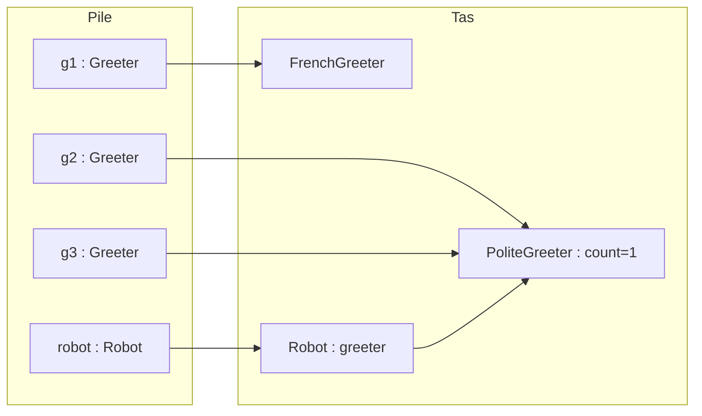

# ✅ 05 — Polymorphisme et interfaces : corrigé

> ⚠️ Corrigé rédigé pour réviser : tout le code a été **compilé** et **exécuté** (Java 21) ; les réponses « que s'affiche-t-il ? » / « compile ou pas ? » viennent d'exécutions et de compilations **réelles** ; les tests JUnit 5 passent (**5 tests réussis**).
> 📄 [Retour à l'énoncé](./enonce.md) · 📚 [Cours 05 — Polymorphisme et interfaces](../../01-Cours/05-polymorphisme-et-interfaces.md)

---

## Exercice 1 — La ferme qui fait du bruit ⭐

### Q1

```java
package exo1;

public interface Noisy {
    /** @return the noise made by this animal */
    public String makeNoise();
}
```

💡 Une interface liste les **messages acceptés** (signatures publiques), **sans** corps.

### Q2

```java
package exo1;

public class Dog implements Noisy {
    public String makeNoise() {
        return "Woof!";
    }

    public String fetch() {
        return "the dog brings back the ball";
    }
}
```

```java
package exo1;

public class Cat implements Noisy {
    public String makeNoise() {
        return "Meow!";
    }
}
```

```java
package exo1;

public class Cow implements Noisy {
    private String name;

    public Cow(String name) {
        this.name = name;
    }

    public String makeNoise() {
        return this.name + " says Moo!";
    }
}
```

💡 Chaque classe **promet** (`implements`) de fournir `makeNoise()`, en `public`. `Dog` garde en plus sa méthode **propre** `fetch()`.

### Q3, Q4 et Q5

```java
package exo1;

public class Duck implements Noisy {
    public String makeNoise() {
        return "Quack!";
    }
}
```

```java
package exo1;

public class Farm {

    /** @return the noises of all the animals, separated by a space */
    public static String concert(Noisy[] animals) {
        String result = "";
        for (int i = 0; i < animals.length; i++) {
            result = result + animals[i].makeNoise() + " ";
        }
        return result;
    }

    public static void main(String[] args) {
        Noisy[] farm = new Noisy[4];
        farm[0] = new Dog();
        farm[1] = new Cat();
        farm[2] = new Cow("Marguerite");
        farm[3] = new Dog();
        for (int i = 0; i < farm.length; i++) {
            System.out.println(farm[i].makeNoise());
        }
        Dog rex = new Dog();
        System.out.println(rex.fetch());
        Noisy[] pond = { new Duck(), new Duck(), new Dog() };
        System.out.println(Farm.concert(pond));
    }
}
```

```bash
$ java -classpath classes exo1.Farm
Woof!
Meow!
Marguerite says Moo!
Woof!
the dog brings back the ball
Quack! Quack! Woof! 
```

💡 Q3 : `Noisy[]` accepte tous les animaux (upcast implicite) **et** autorise `makeNoise()` ; à chaque tour, c'est le code de la **classe de l'objet** qui s'exécute.
💡 Q4 : `concert` renvoie `"Quack! Quack! Woof! "` (avec un espace final).
💡 Q5 : **aucune** classe existante à modifier : on **ajoute** `Duck implements Noisy`, et `Farm.concert` fonctionne déjà.

### Q6

```bash
T.java:5: error: cannot find symbol
        System.out.println(farm[0].fetch());
                                  ^
  symbol:   method fetch()
  location: interface Noisy
```

💡 `farm[0]` est de type `Noisy`, qui ne déclare pas `fetch()` → **ne compile pas**, même si l'objet est un `Dog`. `((Dog) farm[1]).fetch()` **compile** (downcast), mais à l'exécution `farm[1]` est un `Cat` → `java.lang.ClassCastException: class exo1.Cat cannot be cast to class exo1.Dog`.

---

## Exercice 2 — Le robot d'accueil ⭐

### Q1

```bash
$ java -classpath classes exo2.RobotMain
Bonjour Alice
Good morning Bob (#1)
Good morning Chloe (#2)
Good morning Dan (#3)
Good morning Eve (#4)
Hello Fred
Hello Gus
Good morning Gus (#5)
Good morning Gus (#1)
```

| Ligne | Objet qui répond | Pourquoi |
|---|---|---|
| (1) | `FrenchGreeter` | le robot a reçu `g1` |
| (2) (3) (4) (5) | le **même** `PoliteGreeter` | `robot.greeter`, `g2` et `g3` le désignent : compteur 1, 2, 3, 4 |
| (6) | `EnglishGreeter` | `setGreeter(g1)` avec le **nouveau** `g1` |
| (7) | `EnglishGreeter`, 1er `PoliteGreeter` (#5), **nouveau** `PoliteGreeter` (#1) | chaque objet a **son** compteur |

### Q2

💡 **Deux** objets `PoliteGreeter` (`new PoliteGreeter()` écrit deux fois). Juste après `g3 = g2;`, le premier est désigné par **3** références : `g2`, `g3` et l'attribut `greeter` du robot.



### Q3

💡 `g1 = new EnglishGreeter();` fait pointer la **variable** `g1` vers un nouvel objet, mais l'attribut `greeter` du robot désigne **toujours** le `PoliteGreeter` (affecté par `setGreeter(g2)`). Il faut `robot.setGreeter(g1)` (ligne 6).

### Q4

💡 **Non** : `greeter` est de type `Greeter`, l'objet peut être de n'importe quelle classe qui l'implémente. Le compilateur vérifie seulement que `Greeter` **autorise** `greet(String)` et que le retour est un `String` (vérification **statique**). Le choix du code se fait **à l'exécution** : **late binding**.

---

## Exercice 3 — Canards, poissons et avions ⭐⭐

```java
package exo3;

public class Duck implements Swimmer, Flyer {
    public void swim() { System.out.println("duck swims"); }
    public void fly() { System.out.println("duck flies"); }
    public void quack() { System.out.println("Quack!"); }
}
```

### Q1 — résultats réels

| | Instruction | Compile ? | Exécution |
|---|---|---|---|
| a | `s.swim();` | ✅ | `duck swims` |
| b | `s.fly();` | ❌ `cannot find symbol ... method fly()` | — |
| c | `f.quack();` | ❌ `cannot find symbol ... method quack()` | — |
| d | `Duck d = s;` | ❌ `incompatible types: Swimmer cannot be converted to Duck` | — |
| e | `Duck d = (Duck) s; d.quack();` | ✅ | `Quack!` |
| f | `((Flyer) s).fly();` | ✅ | `duck flies` |
| g | `((Flyer) nemo).fly();` | ✅ | 💥 `ClassCastException: class exo3.Fish cannot be cast to class exo3.Flyer` |
| h | `((Duck) jet).quack();` | ✅ | 💥 `ClassCastException: class exo3.Plane cannot be cast to class exo3.Duck` |
| i | `Swimmer x = new Swimmer();` | ❌ `Swimmer is abstract; cannot be instantiated` | — |
| j | `Plane p = (Plane) donald;` | ❌ `incompatible types: Duck cannot be converted to Plane` | — |
| k | `Flyer f2 = nemo;` | ❌ `incompatible types: Swimmer cannot be converted to Flyer` | — |
| l | `Object o = donald; o.swim();` | ❌ `cannot find symbol ... method swim()` | — |
| m | `System.out.println(s == f);` | ✅ | `true` |
| n | `Fish fi = (Fish) s;` | ✅ | 💥 `ClassCastException: class exo3.Duck cannot be cast to class exo3.Fish` |
| o | `f.fly(); jet.fly();` | ✅ | `duck flies` puis `plane flies` |

💡 b, c, l : le message n'est pas dans le **type de la référence** (`Swimmer`, `Flyer`, `Object`).
💡 d, k : pour passer à un type **plus spécifique** ou « à côté », il faut un **cast explicite**.
💡 g, h, n : le cast **compile** (l'objet *pourrait* être du bon type) mais échoue **à l'exécution** : la vraie classe ne convient pas.
💡 j : `Duck` et `Plane` sont deux **classes** sans lien : le compilateur sait qu'un `Duck` ne peut **jamais** être un `Plane` → refusé dès la compilation.
💡 m : `s` et `f` sont deux références (de types différents) vers le **même** objet.

### Q2

💡 `Duck` : `Duck`, `Swimmer`, `Flyer` (et `Object`). `Fish` : `Fish`, `Swimmer` (et `Object`).

### Q3

| Upcast (implicite, **sûr**) | Downcast (explicite, **risqué**, vérifié à l'exécution) |
|---|---|
| `Swimmer s = donald;`, `Flyer f = donald;`, `Swimmer nemo = new Fish();`, `Flyer jet = new Plane();`, `Object o = donald;` | e, f, g, h, n (f et e réussissent, g, h, n lèvent `ClassCastException`) |

📌 `(Flyer) s` n'est ni un upcast ni un downcast « en ligne droite » : on passe d'une interface à une autre. Le compilateur l'accepte, la vérification se fait **à l'exécution** comme un downcast.

---

## Exercice 4 — Les moyens de paiement ⭐⭐

### Q1

```java
package exo4;

public class Cash implements PaymentMethod {
    private int inWallet;

    public Cash(int inWallet) {
        this.inWallet = inWallet;
    }

    public String getName() {
        return "cash";
    }

    public boolean pay(int amount) {
        if (amount > this.inWallet) {
            return false;
        }
        this.inWallet = this.inWallet - amount;
        return true;
    }
}
```

```java
package exo4;

public class CreditCard implements PaymentMethod {
    private int limit;
    private int spent;

    public CreditCard(int limit) {
        this.limit = limit;
        this.spent = 0;
    }

    public String getName() {
        return "credit card";
    }

    public boolean pay(int amount) {
        if (this.spent + amount > this.limit) {
            return false;
        }
        this.spent = this.spent + amount;
        return true;
    }
}
```

```java
package exo4;

public class GiftCard implements PaymentMethod {
    private String shop;
    private int balance;

    public GiftCard(String shop, int balance) {
        this.shop = shop;
        this.balance = balance;
    }

    public String getName() {
        return "gift card " + this.shop;
    }

    public boolean pay(int amount) {
        if (amount > this.balance) {
            return false;
        }
        this.balance = this.balance - amount;
        return true;
    }
}
```

💡 Même message `pay(amount)`, **trois** comportements : chaque classe a ses attributs et **sa** règle.

### Q2 et Q3

```java
package exo4;

public class Checkout {

    /** pays amount with pm and displays the result
     * @return true if the payment is accepted
     */
    public boolean checkout(PaymentMethod pm, int amount) {
        boolean ok = pm.pay(amount);
        if (ok) {
            System.out.println(amount + " euros paid by " + pm.getName());
        } else {
            System.out.println(pm.getName() + " refused for " + amount + " euros");
        }
        return ok;
    }

    /** tries the payment methods of wallet in order, until one accepts to pay amount
     * @return the name of the payment method used, or null if all refused
     */
    public String payWithFirstAccepted(PaymentMethod[] wallet, int amount) {
        for (int i = 0; i < wallet.length; i++) {
            if (wallet[i].pay(amount)) {
                return wallet[i].getName();
            }
        }
        return null;
    }

    public static void main(String[] args) {
        Checkout till = new Checkout();
        PaymentMethod cash = new Cash(20);
        PaymentMethod card = new CreditCard(100);
        till.checkout(cash, 15);
        till.checkout(cash, 15);
        till.checkout(card, 15);
        PaymentMethod[] wallet = { cash, new GiftCard("Fnac", 30), card };
        System.out.println(till.payWithFirstAccepted(wallet, 25));
        System.out.println(till.payWithFirstAccepted(wallet, 80));
        System.out.println(till.payWithFirstAccepted(wallet, 10));
        System.out.println(till.payWithFirstAccepted(wallet, 200));
        till.checkout(new MealVoucher(), 12);
    }
}
```

```bash
$ java -classpath classes exo4.Checkout
15 euros paid by cash
cash refused for 15 euros
15 euros paid by credit card
gift card Fnac
credit card
null
null
12 euros paid by meal voucher
```

| Appel | `cash` (20) | carte cadeau (30) | `card` (plafond 100) | Résultat |
|---|---|---|---|---|
| `checkout(cash, 15)` | 20 → **5** | | | payé |
| `checkout(cash, 15)` | 5 : refus | | | refusé |
| `checkout(card, 15)` | | | dépensé 0 → **15** | payé |
| `pay...(wallet, 25)` | 5 : refus | 30 → **5** | | `gift card Fnac` |
| `pay...(wallet, 80)` | refus | 5 : refus | 15 + 80 = **95** ≤ 100 | `credit card` |
| `pay...(wallet, 10)` | refus | refus | 95 + 10 = 105 > 100 : refus | `null` |
| `pay...(wallet, 200)` | refus | refus | refus | `null` |

💡 `cash` et `card` sont les **mêmes objets** dans `checkout` et dans `wallet` : leur état est partagé. La caisse ne fait **aucun** test sur la classe : c'est le **late binding** qui choisit la bonne règle.

### Q4

```java
package exo4;

public class MealVoucher implements PaymentMethod {
    public static final int DAILY_MAX = 25;

    public String getName() {
        return "meal voucher";
    }

    public boolean pay(int amount) {
        return amount <= MealVoucher.DAILY_MAX;
    }
}
```

💡 **Rien** à modifier dans `Checkout` : elle manipule l'abstraction `PaymentMethod`. Résultat : `12 euros paid by meal voucher` (dernière ligne de l'exécution ci-dessus).

---

## Exercice 5 — La maison connectée ⭐⭐

### Q1

```java
package exo5;

public interface Device {
    public boolean isOn();
    public void turnOn();
    public void turnOff();
}
```

```java
package exo5;

public class Lamp implements Device, Dimmable {
    private boolean on;
    private int level;

    public Lamp() {
        this.on = false;
        this.level = 100;
    }

    public boolean isOn() { return this.on; }
    public void turnOn() { this.on = true; }
    public void turnOff() { this.on = false; }

    public int getLevel() { return this.level; }

    public void setLevel(int level) {
        if (level < 0) {
            this.level = 0;
        } else if (level > 100) {
            this.level = 100;
        } else {
            this.level = level;
        }
    }
}
```

```java
package exo5;

public class Radio implements Device {
    private boolean on;
    private double frequency;

    public Radio(double frequency) {
        this.on = false;
        this.frequency = frequency;
    }

    public boolean isOn() { return this.on; }
    public void turnOn() { this.on = true; }
    public void turnOff() { this.on = false; }

    public double getFrequency() { return this.frequency; }
}
```

```java
package exo5;

public class Heater implements Device, Dimmable {
    private int level;      // 0 = éteint

    public Heater() {
        this.level = 0;
    }

    public boolean isOn() { return this.level > 0; }
    public void turnOn() { this.level = 50; }
    public void turnOff() { this.level = 0; }

    public int getLevel() { return this.level; }

    public void setLevel(int level) {
        if (level < 0) {
            this.level = 0;
        } else if (level > 100) {
            this.level = 100;
        } else {
            this.level = level;
        }
    }
}
```

💡 `Lamp` et `Heater` implémentent **deux** interfaces : elles fournissent les 5 méthodes. Le radiateur n'a pas d'attribut `on` : « allumé » est **calculé** à partir de `level` (même message `isOn()`, autre code).

### Q2

💡 `Lamp` : `Lamp`, `Device`, `Dimmable` (et `Object`). `Radio` : `Radio`, `Device` (et `Object`).

### Q3

```java
package exo5;

public class PowerStrip {
    private Device[] sockets;

    /** creates a power strip with nbSockets empty sockets */
    public PowerStrip(int nbSockets) {
        this.sockets = new Device[nbSockets];
    }

    /** plugs d into socket i (0 <= i < number of sockets) */
    public void plug(int i, Device d) {
        this.sockets[i] = d;
    }

    /** @return the number of plugged devices that are on */
    public int nbOn() {
        int count = 0;
        for (int i = 0; i < this.sockets.length; i++) {
            if (this.sockets[i] != null && this.sockets[i].isOn()) {
                count++;
            }
        }
        return count;
    }

    /** turns off all the plugged devices */
    public void switchAllOff() {
        for (int i = 0; i < this.sockets.length; i++) {
            if (this.sockets[i] != null) {
                this.sockets[i].turnOff();
            }
        }
    }
}
```

💡 Une seule classe de multiprise pour **tous** les appareils, présents et futurs (même idée que `DeviceSwitch` dans le cours). Le test `!= null` évite une `NullPointerException` sur les prises vides.

### Q4 — résultats réels

| | Compile ? | Explication |
|---|---|---|
| (a) | ❌ `incompatible types: Radio cannot be converted to Dimmable` | une radio n'est pas réglable |
| (b) | ❌ `cannot find symbol ... method setLevel(int) ... location: variable d of type Device` | `setLevel` n'est pas dans `Device` |
| (c) | ✅ affiche `50` | cast vers `Device` réussi (c'est un `Heater`), `turnOn()` met `level` à 50 |

### Q5

```bash
2
100 100
1 true
0
```

💡 (1) lampe + radiateur allumés, radio éteinte → `2`. (2) 150 est ramené à 100 pour les deux. (3) `setLevel(0)` : pour le **radiateur**, `level = 0` veut dire **éteint** ; pour la **lampe**, `on` ne change pas → seule la lampe reste allumée. (4) tout est éteint.

---

## Exercice 6 — Le lecteur audio ⭐⭐

### Q1

```java
package exo6;

public interface Playable {
    public String getTitle();

    /** @return the duration in seconds */
    public int getDuration();

    /** @return the duration in the form "minutes:seconds", for instance "3:07" */
    public default String durationString() {
        int min = this.getDuration() / 60;
        int sec = this.getDuration() % 60;
        if (sec < 10) {
            return min + ":0" + sec;
        } else {
            return min + ":" + sec;
        }
    }

    public default String describe() {
        return this.getTitle() + " (" + this.durationString() + ")";
    }
}
```

💡 Ces deux méthodes n'utilisent **que** des méthodes de l'interface (`getDuration()`, `getTitle()`) : elles peuvent être des **default methods**.

### Q2

```java
package exo6;

public class Song implements Playable {
    private String title;
    private int duration;

    public Song(String title, int duration) {
        this.title = title;
        this.duration = duration;
    }

    public String getTitle() { return this.title; }
    public int getDuration() { return this.duration; }
}
```

### Q3

```java
package exo6;

public class Podcast implements Playable {
    private String title;
    private int duration;

    public Podcast(String title, int duration) {
        this.title = title;
        this.duration = duration;
    }

    public String getTitle() { return this.title; }
    public int getDuration() { return this.duration; }

    public String describe() {
        return "[podcast] " + Playable.super.describe();
    }
}
```

💡 `Playable.super.describe()` appelle la version **par défaut** de l'interface : on la complète sans la recopier.

### Q4

Sans `describe()` dans `RadioAlarm`, ❌ **ne compile pas** :

```bash
RadioAlarm.java:3: error: types Playable and Alarm are incompatible;
public class RadioAlarm implements Playable, Alarm {
       ^
  class RadioAlarm inherits unrelated defaults for describe() from types Playable and Alarm
```

```java
package exo6;

public class RadioAlarm implements Playable, Alarm {
    private int hour;

    public RadioAlarm(int hour) {
        this.hour = hour;
    }

    public String getTitle() { return "France Inter"; }
    public int getDuration() { return 1800; }
    public int getHour() { return this.hour; }

    public String describe() {
        return Alarm.super.describe() + " - " + Playable.super.describe();
    }
}
```

💡 Deux default methods de **même signature** → conflit : la classe **doit** redéfinir `describe()` et peut appeler l'une et/ou l'autre avec `X.super.describe()`.

### Q5

```bash
Respect (2:27)
Imagine (3:03)
[podcast] Les Pieds sur terre (30:05)
alarm at 7h - France Inter (30:00)
total: 3935 s
alarm at 6h - France Inter (30:00)
```

💡 Late binding : pour chaque élément, le `describe()` de **sa classe** (version par défaut pour `Song`, redéfinie pour `Podcast` et `RadioAlarm`). Même avec une référence de type `Alarm`, c'est le `describe()` de `RadioAlarm` qui s'exécute.

### Q6

| Erreur | Message réel |
|---|---|
| `int getDuration()` sans `public` | `getDuration() in Song cannot implement getDuration() in Playable` / `attempting to assign weaker access privileges; was public` |
| `getDuration()` oubliée | `Song is not abstract and does not override abstract method getDuration() in Playable` |

💡 Seules les méthodes **default** peuvent être omises ; les autres doivent être implémentées, et en `public`.

---

## Exercice 7 — Les titres de transport (style DS) ⭐⭐⭐

### Q1

```java
package exo7;

public class InvalidTicketException extends Exception {
    public InvalidTicketException(String msg) {
        super(msg);
    }
}
```

```java
package exo7;

public interface Ticket {
    /** @return true if and only if this ticket can still be used for a trip */
    public boolean isValid();

    /** uses this ticket for one trip
     * @throws InvalidTicketException if this ticket cannot be used anymore
     */
    public void validate() throws InvalidTicketException;
}
```

💡 L'exception fait partie du **contrat** de l'interface : `throws` dans la signature + `@throws` dans la javadoc.

### Q2 — javadoc de `Booklet.validate()`

```java
/** uses one trip of this booklet: the number of remaining trips decreases by 1
 * @throws InvalidTicketException if there is no remaining trip
 *         (the number of remaining trips stays 0)
 */
```

### Q3 — tests de `Booklet`

```java
package exo7;

import static org.junit.jupiter.api.Assertions.*;
import org.junit.jupiter.api.*;

public class BookletTest {

    @Test
    public void validateDecreasesRemainingTrips() throws InvalidTicketException {
        Booklet booklet = new Booklet(3);
        booklet.validate();
        assertEquals(2, booklet.getRemainingTrips());
        assertTrue(booklet.isValid());
    }

    @Test
    public void lastTripMakesBookletInvalid() throws InvalidTicketException {
        Booklet booklet = new Booklet(1);
        assertTrue(booklet.isValid());
        booklet.validate();
        assertEquals(0, booklet.getRemainingTrips());
        assertFalse(booklet.isValid());
    }

    @Test
    public void validateEmptyBookletThrowsException() throws InvalidTicketException {
        Booklet booklet = new Booklet(1);
        booklet.validate();
        assertThrows(InvalidTicketException.class, () -> booklet.validate());
        assertEquals(0, booklet.getRemainingTrips());
    }
}
```

Tests bonus de `Gate` :

```java
package exo7;

import static org.junit.jupiter.api.Assertions.*;
import org.junit.jupiter.api.*;

public class GateTest {

    @Test
    public void gateOpensOnlyOnceForSingleTicket() {
        Gate gate = new Gate();
        Ticket ticket = new SingleTicket();
        assertTrue(gate.letThrough(ticket));
        assertFalse(gate.letThrough(ticket));
        assertEquals(1, gate.getNbPassengers());
    }

    @Test
    public void gateAlwaysOpensForUnlimitedPass() {
        Gate gate = new Gate();
        Ticket pass = new UnlimitedPass("timoleon");
        for (int i = 0; i < 5; i++) {
            assertTrue(gate.letThrough(pass));
        }
        assertEquals(5, gate.getNbPassengers());
    }
}
```

### Q4

```java
package exo7;

public class SingleTicket implements Ticket {
    private boolean used;

    public SingleTicket() {
        this.used = false;
    }

    public boolean isValid() {
        return !this.used;
    }

    public void validate() throws InvalidTicketException {
        if (this.used) {
            throw new InvalidTicketException("ticket already used");
        }
        this.used = true;
    }
}
```

```java
package exo7;

public class Booklet implements Ticket {
    private int remainingTrips;

    /** creates a booklet of nbTrips trips */
    public Booklet(int nbTrips) {
        this.remainingTrips = nbTrips;
    }

    public int getRemainingTrips() {
        return this.remainingTrips;
    }

    public boolean isValid() {
        return this.remainingTrips > 0;
    }

    /** uses one trip of this booklet: the number of remaining trips decreases by 1
     * @throws InvalidTicketException if there is no remaining trip
     *         (the number of remaining trips stays 0)
     */
    public void validate() throws InvalidTicketException {
        if (this.remainingTrips == 0) {
            throw new InvalidTicketException("booklet is empty");
        }
        this.remainingTrips--;
    }
}
```

```java
package exo7;

public class UnlimitedPass implements Ticket {
    private String owner;
    private int nbTrips;

    public UnlimitedPass(String owner) {
        this.owner = owner;
        this.nbTrips = 0;
    }

    public String getOwner() {
        return this.owner;
    }

    public int getNbTrips() {
        return this.nbTrips;
    }

    public boolean isValid() {
        return true;
    }

    public void validate() {
        this.nbTrips++;
    }
}
```

```java
package exo7;

public class Gate {
    private int nbPassengers;

    public Gate() {
        this.nbPassengers = 0;
    }

    public int getNbPassengers() {
        return this.nbPassengers;
    }

    /** validates ticket t: the gate opens if and only if t is accepted
     * @return true if the gate opens, false otherwise
     */
    public boolean letThrough(Ticket t) {
        try {
            t.validate();
            this.nbPassengers++;
            return true;
        } catch (InvalidTicketException e) {
            return false;
        }
    }
}
```

💡 `Gate` ne connaît que `Ticket` : un **nouveau** titre (ticket jeune, pass week-end…) fonctionnera **sans modifier** `Gate`. `UnlimitedPass.validate()` peut ne **pas** déclarer l'exception : elle ne la lance jamais.

### Q5

```bash
$ java -classpath classes exo7.MetroMain
0: true
1: true
2: true
3: false
4: true
5: false
6: true
5 passengers
2 trips with the pass
```

💡 Le ticket simple sert une fois (3 : refusé) ; le carnet de 2 sert deux fois (1, 4), puis refusé (5) ; le pass passe toujours (2, 6). Le downcast `(UnlimitedPass) pass` est **sûr** ici : on sait que l'objet est un `UnlimitedPass`.

### Q6

| | Résultat réel |
|---|---|
| (a) `UnlimitedPass p = ...; p.validate();` | ✅ compile (la signature de `validate()` **dans `UnlimitedPass`** n'annonce pas d'exception) ; affiche `1` si on ajoute `System.out.println(p.getNbTrips());` |
| (b) `Ticket t = ...; t.validate();` sans `try` | ❌ `unreported exception InvalidTicketException; must be caught or declared to be thrown` |

💡 Même objet, résultats différents : le compilateur ne regarde que le **type de la référence**. Pour `Ticket`, `validate()` **peut** lever l'exception → il faut la capturer ou l'annoncer.

---

## ⚠️ Erreurs fréquentes

| Erreur | Pourquoi c'est faux | Correction |
|---|---|---|
| `new Noisy()` / `new Swimmer()` | une interface n'a **pas de constructeur** | `Noisy n = new Dog();` |
| `farm[0].fetch()` avec `farm` de type `Noisy[]` | `fetch()` n'est pas dans le type de la **référence** | référence `Dog`, ou méthode commune dans l'interface |
| Méthode implémentée sans `public` | visibilité réduite → erreur de compilation | `public` partout |
| Oublier une méthode de l'interface | promesse non tenue → ne compile pas | implémenter **toutes** les méthodes non `default` |
| Downcast « au cas où » : `((Dog) farm[i])` | `ClassCastException` à l'exécution si ce n'est pas un `Dog` | revoir les types (méthode dans l'interface) |
| Croire que `g3 = g2` copie l'objet | deux références, **un** objet (état partagé) | `new` pour un nouvel objet |
| Croire que réaffecter une variable change l'attribut d'un autre objet | `g1 = ...` ne touche pas `robot.greeter` | `robot.setGreeter(g1)` |
| Oublier `!= null` dans un tableau d'objets | `NullPointerException` sur les cases vides | tester `!= null` d'abord |
| Recopier le code par défaut dans `Podcast` | duplication | `Playable.super.describe()` |
| Deux default methods identiques non résolues | `inherits unrelated defaults` | redéfinir la méthode dans la classe |
| Croire que le compilateur choisit le code exécuté | il vérifie seulement l'**autorisation** | **late binding** : choix à l'exécution |

---

📄 [Retour à l'énoncé](./enonce.md)

🏠 [Sommaire des exercices](../README.md)
