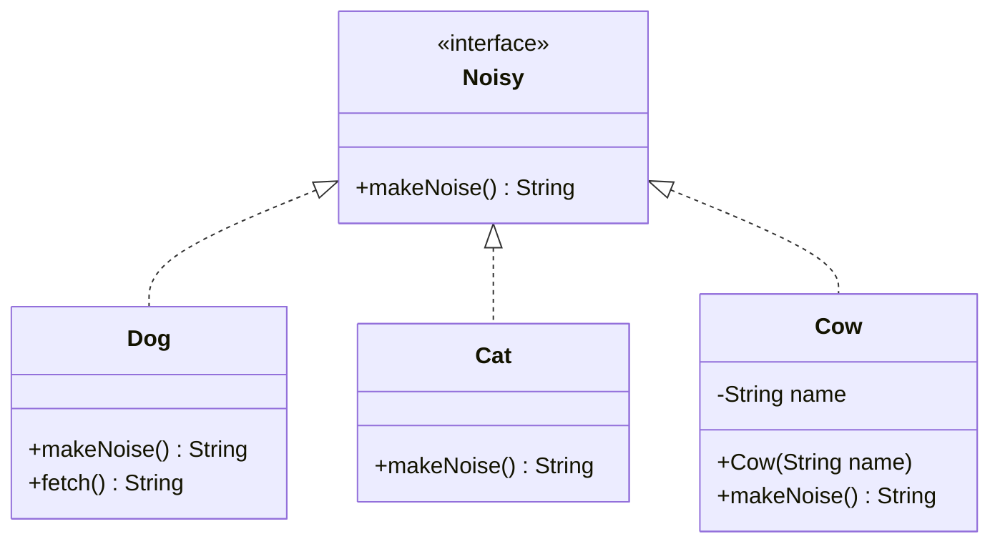
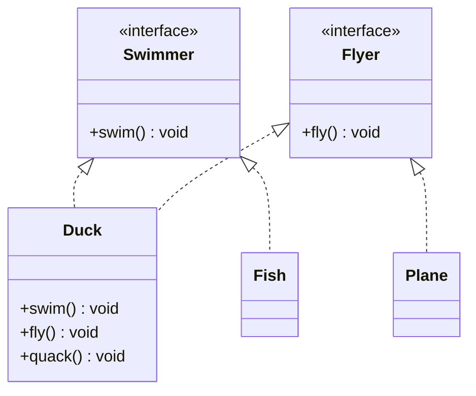
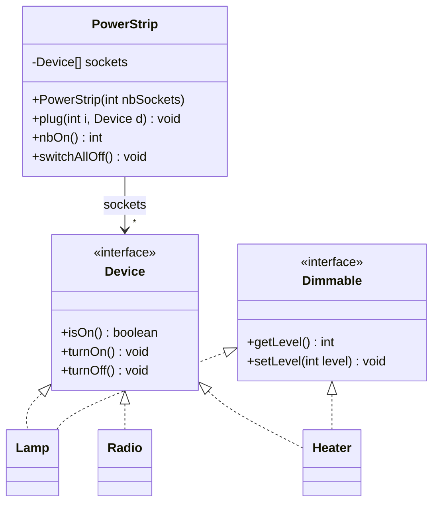
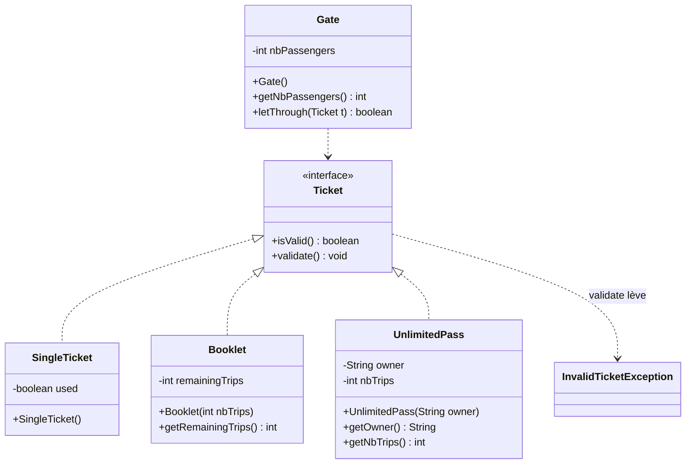

# 🏋️ 05 — Polymorphisme et interfaces : exercices d'entraînement

> 🎯 **Objectifs** : définir une interface et plusieurs implémentations, manipuler des objets par le **type de l'interface**, prévoir le **late binding**, distinguer **type de la référence** et **classe de l'objet**, upcast/downcast, default methods.
> 📚 Cours : [05 — Polymorphisme et interfaces](../../01-Cours/05-polymorphisme-et-interfaces.md)
> ✅ Corrigé : [./corrige.md](./corrige.md) — essaie d'abord seul !

## 🗺️ Les exercices

| N° | Titre | Niveau | Durée | Notions |
|---|---|---|---|---|
| 1 | La ferme qui fait du bruit | ⭐ | 15 min | `interface`, `implements`, tableau du type interface, boucle polymorphe |
| 2 | Le robot d'accueil | ⭐ | 10 min | « que s'affiche-t-il ? », late binding, références partagées |
| 3 | Canards, poissons et avions | ⭐⭐ | 15 min | « compile ou pas ? », upcast / downcast, `ClassCastException` |
| 4 | Les moyens de paiement | ⭐⭐ | 25 min | interface en paramètre, plusieurs implémentations, ajout d'une classe |
| 5 | La maison connectée | ⭐⭐ | 20 min | multi-implémentation, `Device` du cours |
| 6 | Le lecteur audio | ⭐⭐ | 20 min | default methods, `X.super.m()`, conflit |
| 7 | Les titres de transport (style DS) | ⭐⭐⭐ | 40 min | interface + exception + javadoc + tests |

---

## Exercice 1 — La ferme qui fait du bruit ⭐

Dans une application pour enfants, on touche un animal et il fait son bruit. Chaque animal fait un bruit **différent**, mais **tous** savent faire du bruit.



- [ ] **Q1.** Écris l'interface `exo1.Noisy` (avec sa javadoc).
- [ ] **Q2.** Écris `Dog` (`"Woof!"`, et `fetch()` renvoie `"the dog brings back the ball"`), `Cat` (`"Meow!"`) et `Cow` (`"Marguerite says Moo!"` pour une vache nommée Marguerite).
- [ ] **Q3.** Dans `exo1.Farm.main`, crée un tableau `farm` de 4 animaux (chien, chat, vache « Marguerite », chien) et affiche le bruit de chacun avec **une seule** boucle.
- [ ] **Q4.** Écris `public static String concert(Noisy[] animals)` qui renvoie tous les bruits séparés par un espace. Que renvoie-t-elle pour `{ new Duck(), new Duck(), new Dog() }` si un canard fait `"Quack!"` ?
- [ ] **Q5.** Pour ajouter le canard `Duck`, quelles classes existantes faut-il **modifier** ?
- [ ] **Q6.** `System.out.println(farm[0].fetch());` compile-t-il ? Et `((Dog) farm[1]).fetch()` avec `farm[1]` un chat ?

<details><summary>💡 Indice</summary>

- Le type `T` du tableau doit accepter **tous** les animaux **et** le message `makeNoise()` (cours § 1 et 5).
- Le **type de la référence** décide de ce qu'on a le droit d'envoyer.

</details>

---

## Exercice 2 — Le robot d'accueil ⭐

Un robot d'accueil salue les visiteurs. On peut lui changer sa façon de saluer. La version polie **compte** les personnes saluées.

```java
package exo2;

public interface Greeter {
    public String greet(String name);
}
```

```java
package exo2;

public class FrenchGreeter implements Greeter {
    public String greet(String name) {
        return "Bonjour " + name;
    }
}
```

```java
package exo2;

public class EnglishGreeter implements Greeter {
    public String greet(String name) {
        return "Hello " + name;
    }
}
```

```java
package exo2;

public class PoliteGreeter implements Greeter {
    private int count;

    public PoliteGreeter() {
        this.count = 0;
    }

    public String greet(String name) {
        this.count++;
        return "Good morning " + name + " (#" + this.count + ")";
    }
}
```

```java
package exo2;

public class Robot {
    private Greeter greeter;

    public Robot(Greeter greeter) {
        this.greeter = greeter;
    }

    public void setGreeter(Greeter greeter) {
        this.greeter = greeter;
    }

    public void welcome(String name) {
        System.out.println(this.greeter.greet(name));
    }
}
```

```java
package exo2;

public class RobotMain {
    public static void main(String[] args) {
        Greeter g1 = new FrenchGreeter();
        Greeter g2 = new PoliteGreeter();
        Robot robot = new Robot(g1);
        robot.welcome("Alice");                  // (1)
        robot.setGreeter(g2);
        robot.welcome("Bob");                    // (2)
        Greeter g3 = g2;
        System.out.println(g3.greet("Chloe"));   // (3)
        robot.welcome("Dan");                    // (4)
        g1 = new EnglishGreeter();
        robot.welcome("Eve");                    // (5)
        robot.setGreeter(g1);
        robot.welcome("Fred");                   // (6)
        Greeter[] team = { g1, g2, new PoliteGreeter() };
        for (int i = 0; i < team.length; i++) {
            System.out.println(team[i].greet("Gus"));   // (7)
        }
    }
}
```

- [ ] **Q1.** Qu'affiche `java -classpath classes exo2.RobotMain` ? (9 lignes)
- [ ] **Q2.** Combien d'objets `PoliteGreeter` sont créés ? Combien de références désignent le premier, juste après `Greeter g3 = g2;` ? Fais le schéma pile / tas.
- [ ] **Q3.** Pourquoi la ligne (5) n'affiche-t-elle **pas** `Hello Eve` ?
- [ ] **Q4.** Dans `welcome`, le compilateur sait-il **quelle** méthode `greet` sera exécutée ? Que vérifie-t-il ?

<details><summary>💡 Indice</summary>

- `g3 = g2` ne crée **pas** d'objet : deux références vers le **même** objet (donc le **même** compteur).
- `g1 = new EnglishGreeter();` change **la variable `g1`**, pas l'attribut `greeter` du robot.

</details>

---

## Exercice 3 — Canards, poissons et avions ⭐⭐

Un canard nage **et** vole, un poisson nage, un avion vole.



`swim()` affiche `duck swims` / `fish swims`, `fly()` affiche `duck flies` / `plane flies`, `quack()` affiche `Quack!`. On part **toujours** de :

```java
Duck donald = new Duck();
Swimmer s = donald;
Flyer f = donald;
Swimmer nemo = new Fish();
Flyer jet = new Plane();
```

- [ ] **Q1.** Pour **chaque** ligne ci-dessous (indépendamment des autres) : ❌ ne compile pas, ou ✅ compile ; dans ce cas, qu'affiche-t-elle **à l'exécution** (ou quelle exception) ?

| | Instruction |
|---|---|
| a | `s.swim();` |
| b | `s.fly();` |
| c | `f.quack();` |
| d | `Duck d = s;` |
| e | `Duck d = (Duck) s; d.quack();` |
| f | `((Flyer) s).fly();` |
| g | `((Flyer) nemo).fly();` |
| h | `((Duck) jet).quack();` |
| i | `Swimmer x = new Swimmer();` |
| j | `Plane p = (Plane) donald;` |
| k | `Flyer f2 = nemo;` |
| l | `Object o = donald; o.swim();` |
| m | `System.out.println(s == f);` |
| n | `Fish fi = (Fish) s;` |
| o | `f.fly(); jet.fly();` |

- [ ] **Q2.** Quels sont **tous** les types d'un objet `Duck` ? d'un objet `Fish` ?
- [ ] **Q3.** Parmi les lignes qui compilent, lesquelles sont des **upcasts**, lesquelles des **downcasts** ? Lesquels sont **sûrs** ?

<details><summary>💡 Indice</summary>

- Compilation : on ne regarde **que** le type des **références**. Exécution : on regarde la **classe de l'objet**.
- Un downcast `(X) ref` compile si l'objet **pourrait** être un `X` ; il est vérifié à l'exécution.
- `==` compare les **références** : désignent-elles le même objet ?

</details>

---

## Exercice 4 — Les moyens de paiement ⭐⭐

À la caisse d'un magasin, on peut payer en espèces, par carte bancaire ou avec une carte cadeau. La caisse ne veut **pas** savoir comment chaque moyen fonctionne : elle demande juste « paie ce montant ».

```java
package exo4;

public interface PaymentMethod {
    /** @return the name of this payment method */
    public String getName();

    /** tries to pay amount euros with this payment method
     * @return true if the payment is accepted, false otherwise
     */
    public boolean pay(int amount);
}
```

| Classe | Construction | `getName()` | `pay(amount)` accepte si… (et alors…) |
|---|---|---|---|
| `Cash` | `Cash(int inWallet)` | `"cash"` | `amount <= ` argent dans le porte-monnaie (qui diminue) |
| `CreditCard` | `CreditCard(int limit)` | `"credit card"` | total déjà dépensé + `amount <= limit` (le total dépensé augmente) |
| `GiftCard` | `GiftCard(String shop, int balance)` | `"gift card " + shop` | `amount <= ` solde de la carte (qui diminue) |

- [ ] **Q1.** Écris les trois classes.
- [ ] **Q2.** Écris la classe `Checkout` (la caisse) avec :
  - `public boolean checkout(PaymentMethod pm, int amount)` : paie et affiche `"15 euros paid by cash"` ou `"cash refused for 15 euros"` ;
  - `public String payWithFirstAccepted(PaymentMethod[] wallet, int amount)` : essaie les moyens **dans l'ordre** jusqu'au premier qui accepte, renvoie son nom (ou `null` si tous refusent).
- [ ] **Q3.** Qu'affiche ce `main` ?

```java
Checkout till = new Checkout();
PaymentMethod cash = new Cash(20);
PaymentMethod card = new CreditCard(100);
till.checkout(cash, 15);
till.checkout(cash, 15);
till.checkout(card, 15);
PaymentMethod[] wallet = { cash, new GiftCard("Fnac", 30), card };
System.out.println(till.payWithFirstAccepted(wallet, 25));
System.out.println(till.payWithFirstAccepted(wallet, 80));
System.out.println(till.payWithFirstAccepted(wallet, 10));
System.out.println(till.payWithFirstAccepted(wallet, 200));
```

- [ ] **Q4.** On ajoute les titres-restaurant `MealVoucher` : `getName()` → `"meal voucher"`, accepte tout paiement `<= 25` (constante `DAILY_MAX`). Écris la classe. Faut-il modifier `Checkout` ? Que donne `till.checkout(new MealVoucher(), 12);` ?

<details><summary>💡 Indice</summary>

- Dans `payWithFirstAccepted`, chaque essai **refusé** ne modifie rien, mais un essai **accepté** modifie l'objet (porte-monnaie, carte…). Suis l'état de chaque objet !
- `cash` est le **même** objet dans `checkout` et dans `wallet`.

</details>

---

## Exercice 5 — La maison connectée ⭐⭐

On reprend l'interface `Device` du cours (`isOn()`, `turnOn()`, `turnOff()`). Certains appareils sont en plus **réglables** (lampe : luminosité, radiateur : puissance) → nouvelle interface `Dimmable`.

```java
package exo5;

public interface Dimmable {
    /** @return the level of this object, between 0 and 100 */
    public int getLevel();

    /** sets the level of this object (0 if level < 0, 100 if level > 100) */
    public void setLevel(int level);
}
```



| Classe | Allumée ? | `turnOn()` / `turnOff()` | Réglage |
|---|---|---|---|
| `Lamp` | attribut `on` | `on` à `true` / `false` | `level` (100 au départ), **indépendant** de `on` |
| `Radio(double frequency)` | attribut `on` | `on` à `true` / `false` | pas réglable ; `getFrequency()` |
| `Heater` | `level > 0` | `level = 50` / `level = 0` | `level` (0 au départ) |

`setLevel` ramène la valeur à 0 si elle est négative et à 100 si elle dépasse 100.

- [ ] **Q1.** Écris `Lamp`, `Radio` et `Heater`.
- [ ] **Q2.** Quels sont les types d'un objet `Lamp` ? d'un objet `Radio` ?
- [ ] **Q3.** Écris `PowerStrip` (multiprise) : `plug` branche un appareil dans la prise `i` ; `nbOn()` compte les appareils **branchés** et allumés ; `switchAllOff()` éteint tout. ⚠️ Des prises peuvent être vides (`null`).
- [ ] **Q4.** **Compile ou pas ?** (a) `Dimmable[] dims = { new Lamp(), new Radio(99.0) };` (b) `Device d = new Lamp(); d.setLevel(10);` (c) `Dimmable dm = new Heater(); ((Device) dm).turnOn(); System.out.println(dm.getLevel());`
- [ ] **Q5.** Qu'affiche ce programme ?

```java
public static void dimAll(Dimmable[] dims, int level) {
    for (int i = 0; i < dims.length; i++) {
        dims[i].setLevel(level);
    }
}
// dans main :
Lamp lamp = new Lamp();
Radio radio = new Radio(99.0);
Heater heater = new Heater();
PowerStrip strip = new PowerStrip(4);
strip.plug(0, lamp);
strip.plug(1, radio);
strip.plug(3, heater);
lamp.turnOn();
heater.turnOn();
System.out.println(strip.nbOn());                                  // (1)
Dimmable[] dims = { lamp, heater };
dimAll(dims, 150);
System.out.println(lamp.getLevel() + " " + heater.getLevel());    // (2)
dimAll(dims, 0);
System.out.println(strip.nbOn() + " " + lamp.isOn());             // (3)
strip.switchAllOff();
System.out.println(strip.nbOn());                                  // (4)
```

<details><summary>💡 Indice</summary>

- `implements Device, Dimmable` : la classe doit fournir **toutes** les méthodes des **deux** interfaces.
- Dans `nbOn()`, teste `!= null` **avant** d'envoyer `isOn()`, sinon `NullPointerException`.
- (3) : même message `setLevel(0)`, mais comportements différents pour la lampe et le radiateur…

</details>

---

## Exercice 6 — Le lecteur audio ⭐⭐

Un lecteur audio affiche les morceaux et podcasts avec leur durée au format `minutes:secondes`. Ce calcul ne dépend que de `getDuration()` → on l'écrit **une seule fois**, dans l'interface.

```java
public interface Playable {
    public String getTitle();
    /** @return the duration in seconds */
    public int getDuration();
    // Q1 : default String durationString()
    // Q1 : default String describe()
}
```

- [ ] **Q1.** Ajoute à `Playable` deux **default methods** : `durationString()` (ex. `147` s → `"2:27"`, `183` s → `"3:03"`) et `describe()` qui renvoie `titre (durée)`, ex. `"Respect (2:27)"`.
- [ ] **Q2.** Écris `Song(String title, int duration)` **sans** redéfinir les default methods.
- [ ] **Q3.** Écris `Podcast(String title, int duration)` qui **redéfinit** `describe()` pour ajouter `"[podcast] "` devant la description par défaut, **sans recopier** son code.
- [ ] **Q4.** Une interface `Alarm` (réveil) existe aussi :

```java
public interface Alarm {
    public int getHour();
    public default String describe() {
        return "alarm at " + this.getHour() + "h";
    }
}
```

  On écrit `public class RadioAlarm implements Playable, Alarm` (titre `"France Inter"`, durée `1800`, heure donnée à la construction) **sans** méthode `describe()`. Compile-t-il ? Corrige pour que `describe()` renvoie `"alarm at 7h - France Inter (30:00)"`.
- [ ] **Q5.** Qu'affiche ce code ?

```java
Playable[] list = {
    new Song("Respect", 147),
    new Song("Imagine", 183),
    new Podcast("Les Pieds sur terre", 1805),
    new RadioAlarm(7)
};
int total = 0;
for (int i = 0; i < list.length; i++) {
    System.out.println(list[i].describe());
    total = total + list[i].getDuration();
}
System.out.println("total: " + total + " s");
Alarm a = new RadioAlarm(6);
System.out.println(a.describe());
```

- [ ] **Q6.** **Trouve l'erreur** : dans `Song`, on écrit `int getDuration() { return this.duration; }` (sans `public`). Et si on oublie complètement `getDuration()` ?

<details><summary>💡 Indice</summary>

- `/` et `%` sur des entiers : `147 / 60 = 2`, `147 % 60 = 27`. Attention aux secondes `< 10`.
- Pour appeler la version de l'interface depuis une classe : `Playable.super.describe()` (cours § 12.3).
- Late binding : `a.describe()` exécute le code de la **classe de l'objet**, même si `a` est de type `Alarm`.

</details>

---

## Exercice 7 — Les titres de transport (style DS) ⭐⭐⭐

> ⏱️ 40 min, comme en DS. Tests et javadoc **seulement** quand c'est demandé.

Au portique du métro, on peut valider un **ticket simple** (1 trajet), un **carnet** (n trajets) ou un **pass illimité**. Le portique s'ouvre si le titre est accepté.



| Méthode | Rôle |
|---|---|
| `isValid()` | `true` ssi le titre peut encore servir |
| `validate()` | utilise le titre pour **un** trajet ; lève `InvalidTicketException` s'il ne peut plus servir |
| `letThrough(Ticket t)` | valide `t` : si accepté, compte un passager et renvoie `true` ; sinon renvoie `false` (le portique ne plante pas !) |

Le pass illimité est **toujours** valide et compte ses trajets.

- [ ] **Q1.** Code de `InvalidTicketException` et de l'interface `Ticket` (avec javadoc).
- [ ] **Q2.** **Javadoc** de `validate()` dans `Booklet`.
- [ ] **Q3.** **Méthodes de test** de `Booklet` : un trajet décrémente ; après le dernier trajet le carnet n'est plus valide ; valider un carnet vide lève l'exception **et** laisse 0 trajet.
- [ ] **Q4.** Code de `SingleTicket`, `Booklet`, `UnlimitedPass` et `Gate`.
- [ ] **Q5.** Qu'affiche ce `main` ?

```java
Gate gate = new Gate();
Ticket single = new SingleTicket();
Ticket booklet = new Booklet(2);
Ticket pass = new UnlimitedPass("timoleon");
Ticket[] queue = { single, booklet, pass, single, booklet, booklet, pass };
for (int i = 0; i < queue.length; i++) {
    System.out.println(i + ": " + gate.letThrough(queue[i]));
}
System.out.println(gate.getNbPassengers() + " passengers");
System.out.println(((UnlimitedPass) pass).getNbTrips() + " trips with the pass");
```

- [ ] **Q6.** `UnlimitedPass.validate()` ne lance jamais d'exception. **Compile ou pas ?** (a) `UnlimitedPass p = new UnlimitedPass("x"); p.validate();` si `UnlimitedPass.validate()` est écrite **sans** `throws` ; (b) `Ticket t = new UnlimitedPass("x"); t.validate();` sans `try`/`catch`.

<details><summary>💡 Indice</summary>

- `Gate` ne connaît que l'interface `Ticket` : un `try`/`catch` autour de `t.validate()`.
- Pour le compilateur, seul compte le **type de la référence** : la signature de `validate()` **dans ce type** annonce-t-elle l'exception ?

</details>

---

🔗 Pour aller plus loin : [TD Othello](../../02-TD/TD-othello/enonce.md) · [TP Othello](../../03-TP/TP-othello/ENONCE.md)

🏠 [Sommaire des exercices](../README.md)
