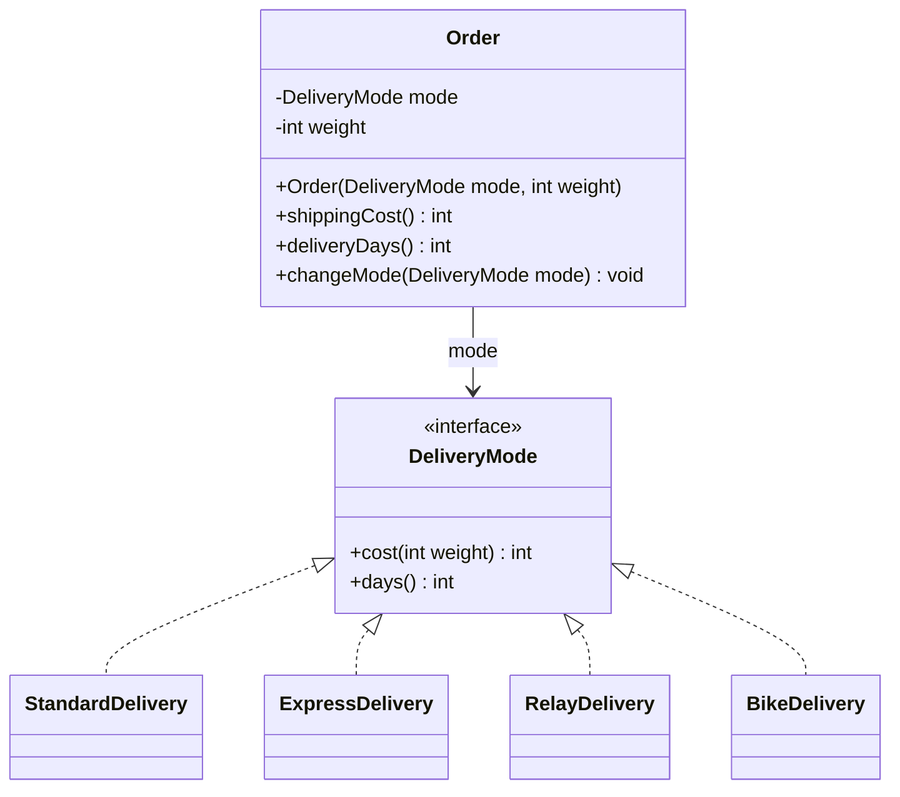

# ✅ 06 — Interfaces (suite) : corrigé

> ⚠️ Corrigé rédigé pour réviser : tout le code a été **compilé** et **exécuté** (Java 21) ; les affichages et messages d'erreur sont **réels** ; les tests JUnit 5 passent (**12 tests réussis**).
> 📄 [Retour à l'énoncé](./enonce.md) · 📚 [Cours 06 — Interfaces (suite)](../../01-Cours/06-interfaces-suite.md)

---

## Exercice 1 — Le classement de la classe ⭐

### Q1

```java
package exo1;

public class Student implements Comparable<Student> {
    private String name;
    private double average;

    public Student(String name, double average) {
        this.name = name;
        this.average = average;
    }

    public String getName() { return this.name; }
    public double getAverage() { return this.average; }

    /** students are compared by average: the lower average comes first */
    public int compareTo(Student other) {
        if (this.average < other.average) {
            return -1;
        } else if (this.average > other.average) {
            return 1;
        } else {
            return 0;
        }
    }

    public String toString() {
        return this.name + " (" + this.average + ")";
    }
}
```

💡 `implements Comparable<Student>` : c'est la **seule** condition pour que `BubbleSort` accepte un `Student[]`. Le paramètre de `compareTo` est un `Student` grâce à `<Student>`.

### Q2

```bash
Tom (9.75)
Hugo (12.0)
Ines (12.5)
Lina (14.5)
best: Lina
```

💡 Tri **croissant** : la meilleure moyenne est en **dernière** case (`group.length - 1`).

### Q3 — le piège du cast en `int`

```java
public int compareTo(BadStudent other) {
    return (int) (this.average - other.average);
}
```

Exécution réelle avec `{ Ines (12.5), Hugo (12.0) }` :

```bash
0
Ines (12.5)
Hugo (12.0)
```

💡 `12.5 - 12.0 = 0.5`, et `(int) 0.5` vaut **0** : Ines et Hugo sont considérés **égaux** → aucun échange, le tableau reste **mal trié**. Avec des `double`, on renvoie `-1` / `0` / `1` avec des `if`.

### Q4 — résultats réels

| | Compile ? | Message |
|---|---|---|
| (a) sans `<Student>` | ❌ | `Student is not abstract and does not override abstract method compareTo(Object) in Comparable` |
| (b) `BubbleSort.sort(marks)` avec `int[]` | ❌ | `method sort in class BubbleSort cannot be applied to given types; required: T[] found: int[]` |

💡 (a) sans `<Student>`, l'interface attend `compareTo(Object)` : notre `compareTo(Student)` ne la remplace pas. (b) `int` n'est pas un objet, donc pas un `Comparable` → utiliser `Integer[]`.

---

## Exercice 2 — Qui passe en premier ? ⭐

### Q1

| | Résultat réel | Signe | Explication |
|---|---|---|---|
| (a) | `-1` | négatif | `'a'` avant `'b'` (`'a' - 'b'`) |
| (b) | `15` | positif | `pea` commun, puis `'r'` après `'c'` (`'r' - 'c' = 15`) |
| (c) | `0` | nul | chaînes égales |
| (d) | `-1` | négatif | `"abc"` est le début de `"abcd"` : la plus courte d'abord |
| (e) | `-7` | négatif ⚠️ | `'Z'` (90) **avant** `'a'` (97) : majuscules avant minuscules |
| (f) | `1` | positif | 12 > 7 |

💡 Seul le **signe** compte dans la convention ; la valeur exacte dépend de la classe.

### Q2

```bash
Peach
apple
banana
pear
-3
7
7
42
100
Lou 2012
Papa 1980
Mamie 1950
```

💡 (g) `"Peach"` passe en **premier** à cause de sa majuscule. (h) tri numérique, les doublons restent côte à côte. (i) `Person` : plus vieux = plus grand → ordre croissant = du plus **jeune** au plus **vieux**.

### Q3

💡 `BubbleSort.sort` attend un tableau d'**objets** `Comparable`. `Integer` est une classe qui implémente `Comparable<Integer>` ; `int` est un type **primitif** (pas un objet).

---

## Exercice 3 — Le panier de courses ⭐⭐

### Q1

```java
package exo3;

public class Product implements Comparable<Product> {
    private String name;
    private int price;      // en centimes

    public Product(String name, int price) {
        this.name = name;
        this.price = price;
    }

    public String getName() { return this.name; }
    public int getPrice() { return this.price; }

    /** products are compared by price: the cheaper comes first */
    public int compareTo(Product other) {
        return this.price - other.price;
    }

    public String toString() {
        return this.name + " " + this.price + " cts";
    }
}
```

💡 Avec des `int`, la soustraction respecte la convention (négatif si moins cher).

### Q2

```java
package exo3;

public class Algos {

    /** @return the greatest element of elements (the first one if several are equal)
     * @throws IllegalArgumentException if elements is empty
     */
    public static <T extends Comparable<T>> T max(T[] elements) throws IllegalArgumentException {
        if (elements.length == 0) {
            throw new IllegalArgumentException("empty array");
        }
        T best = elements[0];
        for (int i = 1; i < elements.length; i++) {
            if (elements[i].compareTo(best) > 0) {
                best = elements[i];
            }
        }
        return best;
    }

    /** @return true if and only if elements is sorted in ascending order */
    public static <T extends Comparable<T>> boolean isSorted(T[] elements) {
        for (int i = 0; i < elements.length - 1; i++) {
            if (elements[i].compareTo(elements[i + 1]) > 0) {
                return false;
            }
        }
        return true;
    }
}
```

💡 Comme `BubbleSort`, ces algorithmes ne connaissent **que** `compareTo` : ils marchent pour `Product`, `String`, `Integer`, `Student`… On **manipule l'abstraction** `Comparable<T>`.

### Q3

```java
package exo3;

import static org.junit.jupiter.api.Assertions.*;
import org.junit.jupiter.api.*;

public class ProductTest {

    @Test
    public void compareToFollowsPrice() {
        Product bread = new Product("bread", 120);
        Product coffee = new Product("coffee", 459);
        Product baguette = new Product("baguette", 120);
        assertTrue(bread.compareTo(coffee) < 0);
        assertTrue(coffee.compareTo(bread) > 0);
        assertEquals(0, bread.compareTo(baguette));
    }

    @Test
    public void maxReturnsMostExpensiveProduct() {
        Product cheese = new Product("cheese", 735);
        Product[] basket = { new Product("bread", 120), cheese, new Product("milk", 109) };
        assertSame(cheese, Algos.max(basket));
    }

    @Test
    public void maxOfEmptyArrayThrowsException() {
        Product[] empty = new Product[0];
        assertThrows(IllegalArgumentException.class, () -> Algos.max(empty));
    }

    @Test
    public void sortedBasketIsSorted() {
        Product[] basket = { new Product("coffee", 459), new Product("bread", 120), new Product("milk", 109) };
        assertFalse(Algos.isSorted(basket));
        BubbleSort.sort(basket);
        assertTrue(Algos.isSorted(basket));
        assertEquals("milk", basket[0].getName());
    }
}
```

### Q4

```bash
cheese 735 cts
false
milk 109 cts
bread 120 cts
coffee 459 cts
cheese 735 cts
true
paris
18
```

💡 `println(objet)` appelle `toString()`. `"paris"` est le plus grand mot (ordre alphabétique : `lille` < `lyon` < `paris`).

---

## Exercice 4 — Les frais de livraison ⭐⭐

### Q1

💡 Défauts :
- **cascade de `if`** sur le mode, **répétée** dans chaque méthode (`shippingCost`, `deliveryDays`…) ;
- ajouter un mode ⇒ **modifier chaque méthode** (viole l'**OCP**) ;
- le mode est un `String` : une faute de frappe (`"expres"`) **compile** et n'est détectée **qu'à l'exécution** (`IllegalArgumentException`).

### Q2

```java
package exo4;

public interface DeliveryMode {
    /** @return the shipping cost in euros of a parcel of weight kg */
    public int cost(int weight);

    /** @return the number of days before delivery */
    public int days();
}
```

```java
package exo4;

public class StandardDelivery implements DeliveryMode {
    public int cost(int weight) {
        return 5 + weight;
    }

    public int days() {
        return 3;
    }
}
```

```java
package exo4;

public class ExpressDelivery implements DeliveryMode {
    public int cost(int weight) {
        return 12 + 2 * weight;
    }

    public int days() {
        return 1;
    }
}
```

```java
package exo4;

public class RelayDelivery implements DeliveryMode {
    public int cost(int weight) {
        return 4;
    }

    public int days() {
        return 5;
    }
}
```

💡 Chaque **bloc** de la cascade devient le corps d'une méthode dans **sa** classe.

### Q3

```java
package exo4;

public class Order {
    private DeliveryMode mode;
    private int weight;       // en kg

    public Order(DeliveryMode mode, int weight) {
        this.mode = mode;
        this.weight = weight;
    }

    /** @return the shipping cost in euros */
    public int shippingCost() {
        return this.mode.cost(this.weight);
    }

    /** @return the number of days before delivery */
    public int deliveryDays() {
        return this.mode.days();
    }

    public void changeMode(DeliveryMode mode) {
        this.mode = mode;
    }
}
```



💡 Plus aucun `if` : `this.mode.cost(...)` → **late binding**. Une faute de frappe (`new ExpresDelivery()`) est maintenant refusée **à la compilation** : `error: cannot find symbol ... symbol: class ExpresDelivery`.

### Q4 — OCP

```java
package exo4;

public class BikeDelivery implements DeliveryMode {
    public static final int MAX_WEIGHT = 10;

    /** @throws IllegalArgumentException if weight is greater than MAX_WEIGHT */
    public int cost(int weight) throws IllegalArgumentException {
        if (weight > BikeDelivery.MAX_WEIGHT) {
            throw new IllegalArgumentException("too heavy for a bike: " + weight + " kg");
        }
        return 8;
    }

    public int days() {
        return 0;
    }
}
```

💡 **Aucun** fichier existant modifié : on a seulement **ajouté** une classe. Module **ouvert** aux extensions, **fermé** aux modifications.

### Q5

```java
package exo4;

import static org.junit.jupiter.api.Assertions.*;
import org.junit.jupiter.api.*;

public class OrderTest {

    @Test
    public void standardDeliveryCosts5PlusWeight() {
        Order order = new Order(new StandardDelivery(), 3);
        assertEquals(8, order.shippingCost());
        assertEquals(3, order.deliveryDays());
    }

    @Test
    public void expressDeliveryCosts12PlusTwiceWeight() {
        Order order = new Order(new ExpressDelivery(), 3);
        assertEquals(18, order.shippingCost());
        assertEquals(1, order.deliveryDays());
    }

    @Test
    public void relayDeliveryCostsAlways4() {
        assertEquals(4, new Order(new RelayDelivery(), 1).shippingCost());
        assertEquals(4, new Order(new RelayDelivery(), 30).shippingCost());
    }

    @Test
    public void bikeDeliveryRefusesHeavyParcels() {
        Order light = new Order(new BikeDelivery(), BikeDelivery.MAX_WEIGHT);
        assertEquals(8, light.shippingCost());
        Order heavy = new Order(new BikeDelivery(), BikeDelivery.MAX_WEIGHT + 1);
        assertThrows(IllegalArgumentException.class, () -> heavy.shippingCost());
    }
}
```

💡 Ces tests donnent les **mêmes** valeurs que l'ancienne version (`8 3`, `18 1`, `4 5`) : le comportement est conservé.

### Q6

```bash
8 3
18 1
4 5
8 0
36
4
too heavy for a bike: 12 kg
```

💡 Le **même** objet `heavy` change de comportement quand on change son mode : `12 + 2 × 12 = 36`, puis forfait `4`, puis exception (12 kg > 10 kg), capturée dans le `main`.

---

## Exercice 5 — Le centre de notifications ⭐⭐

### Q1

```bash
SMS to 0601020304: your parcel has arrived
email to timoleon@univ-lille.fr: your parcel has arrived
Exception in thread "main" java.lang.IllegalArgumentException: unknown channel
	at exo5before.NotificationCenter.sendNotification(NotificationCenter.java:11)
	at exo5before.NotificationCenter.main(NotificationCenter.java:30)
```

💡 Le paramètre est de type `Object` : **n'importe quel** objet est accepté, même un `String`. L'erreur n'apparaît qu'**à l'exécution**.

### Q2

💡 1. **Cascade de `if` + `instanceof` + cast** dans chaque méthode : un nouveau canal ⇒ modifier `sendNotification` **et** `cost` (viole l'OCP). 2. **Perte du contrôle de typage** (`Object`) : `sendNotification("timoleon", ...)` compile.

### Q3

```java
package exo5;

public interface Channel {
    /** sends text through this channel */
    public void send(String text);

    /** @return the cost in cents of one notification */
    public int cost();
}
```

```java
package exo5;

public class SmsChannel implements Channel {
    private String phone;

    public SmsChannel(String phone) {
        this.phone = phone;
    }

    public void send(String text) {
        System.out.println("SMS to " + this.phone + ": " + text);
    }

    public int cost() {
        return 5;
    }
}
```

```java
package exo5;

public class EmailChannel implements Channel {
    private String address;

    public EmailChannel(String address) {
        this.address = address;
    }

    public void send(String text) {
        System.out.println("email to " + this.address + ": " + text);
    }

    public int cost() {
        return 0;
    }
}
```

```java
package exo5;

public class NotificationCenter {

    public void sendNotification(Channel channel, String text) {
        channel.send(text);
    }

    public int cost(Channel channel) {
        return channel.cost();
    }

    /** sends text through all channels
     * @return the total cost in cents
     */
    public int broadcast(Channel[] channels, String text) {
        int total = 0;
        for (int i = 0; i < channels.length; i++) {
            channels[i].send(text);
            total = total + channels[i].cost();
        }
        return total;
    }

    public static void main(String[] args) {
        NotificationCenter center = new NotificationCenter();
        Channel[] channels = {
            new SmsChannel("0601020304"),
            new EmailChannel("timoleon@univ-lille.fr"),
            new PushChannel("MyParcel"),
            new SmsChannel("0705060708")
        };
        int total = center.broadcast(channels, "your parcel has arrived");
        System.out.println("total cost: " + total + " cents");
    }
}
```

💡 `sendSms` et `sendEmail` deviennent **une seule** méthode `send` (cours § 10.1). `NotificationCenter` ne contient plus aucun `if`.

### Q4

```java
package exo5;

public class PushChannel implements Channel {
    private String app;

    public PushChannel(String app) {
        this.app = app;
    }

    public void send(String text) {
        System.out.println("push on " + this.app + ": " + text);
    }

    public int cost() {
        return 1;
    }
}
```

💡 **Rien** n'est modifié dans `NotificationCenter` (OCP) : seulement le `main` qui crée un `PushChannel`.

### Q5

```bash
SMS to 0601020304: your parcel has arrived
email to timoleon@univ-lille.fr: your parcel has arrived
push on MyParcel: your parcel has arrived
SMS to 0705060708: your parcel has arrived
total cost: 11 cents
```

💡 `5 + 0 + 1 + 5 = 11`. Et `center.sendNotification("timoleon", "hello")` ne compile **plus** :

```bash
error: incompatible types: String cannot be converted to Channel
```

✅ Le typage est de nouveau **contrôlé** à la compilation.

---

## Exercice 6 — Compteurs en tout genre ⭐⭐⭐

### Q1

```java
package exo6;

public class StepIncrement implements IncrementFunction {
    private int step;

    public StepIncrement(int step) {
        this.step = step;
    }

    public int increment(int value) {
        return value + this.step;
    }
}
```

```java
package exo6;

public class BoundedIncrement implements IncrementFunction {
    private int max;

    public BoundedIncrement(int max) {
        this.max = max;
    }

    public int increment(int value) {
        if (value >= this.max) {
            return this.max;
        }
        return value + 1;
    }
}
```

```java
package exo6;

public class CountdownIncrement implements IncrementFunction {
    public int increment(int value) {
        if (value <= 0) {
            return 0;
        }
        return value - 1;
    }
}
```

💡 Chaque classe ne contient **que** ce qui varie : la façon de calculer la valeur suivante. ⚠️ `return value + 1;` et pas `value++` (cf. piège du cours).

### Q2

```bash
23 0 1 
2
11
0 9
```

💡 (1) `22 → 23 → 0 → 1` (modulo 24, comme une horloge). (2) `0 → 1 → 2 → 2` (bloqué à 2). (3) `0 → 5 → 10`, puis incrément simple : `11`. (4) `a` : `2 → 1 → 0 → 0` ; `b` : `10 → 9`.

### Q3

```java
package exo6;

import static org.junit.jupiter.api.Assertions.*;
import org.junit.jupiter.api.*;

public class CounterTest {

    @Test
    public void boundedCounterStopsAtMax() {
        Counter counter = new Counter(0, new BoundedIncrement(2));
        counter.increment();
        assertEquals(1, counter.getCurrentValue());
        counter.increment();
        assertEquals(2, counter.getCurrentValue());
        counter.increment();
        assertEquals(2, counter.getCurrentValue());
    }

    @Test
    public void stepCounterAddsStep() {
        Counter counter = new Counter(1, new StepIncrement(5));
        counter.increment();
        counter.increment();
        assertEquals(11, counter.getCurrentValue());
    }

    @Test
    public void countdownStopsAtZero() {
        Counter counter = new Counter(1, new CountdownIncrement());
        counter.increment();
        assertEquals(0, counter.getCurrentValue());
        counter.increment();
        assertEquals(0, counter.getCurrentValue());
    }

    @Test
    public void changeIncrementChangesBehaviour() {
        Counter counter = new Counter(0, new StepIncrement(10));
        counter.increment();
        counter.changeIncrement(new ModularIncrement(7));
        counter.increment();
        assertEquals(4, counter.getCurrentValue());
    }
}
```

💡 Dernier test : `0 → 10` (pas de 10), puis `(10 + 1) % 7 = 4`.

### Q4

💡 En v1, il faudrait une classe `BoundedCounter implements Counter` avec attributs `value` et `max`, et **recopier** `getCurrentValue()` et `initValue()` (identiques dans toutes les classes). `changeIncrement` est impossible : la façon d'incrémenter est **figée** dans la classe de l'objet, qu'on ne peut pas changer. En v2, l'incrément est un **objet** référencé par un attribut → on peut le remplacer.

### Q5

💡 Pas de problème ici : `CountdownIncrement` n'a **aucun attribut** (pas d'état), il ne fait que calculer à partir de `value`. `a` et `b` gardent chacun **leur** valeur. Si l'objet partagé avait un état modifié par `increment` (comme le compteur de `PoliteGreeter` de l'exercice 2 du chapitre 05), les deux compteurs s'influenceraient.

---

## ⚠️ Erreurs fréquentes

| Erreur | Pourquoi c'est faux | Correction |
|---|---|---|
| `implements Comparable` sans `<Student>` | l'interface attend `compareTo(Object)` → ne compile pas | `implements Comparable<Student>` |
| `return (int) (this.average - other.average);` | `(int) 0.5 == 0` : des valeurs différentes deviennent « égales » | `if` avec `-1` / `0` / `1` |
| Échanger si `compareTo(...) < 0` | trie en ordre **décroissant** | échanger si `> 0` |
| `BubbleSort.sort(int[])` | `int` n'est pas un objet | `Integer[]` |
| Oublier que `"Z" < "a"` | `String.compareTo` suit les codes des caractères | en tenir compte (ou tout mettre en minuscules) |
| Attribut `String mode` + cascade de `if` | ajouter un mode = modifier chaque méthode ; fautes de frappe vues à l'exécution | interface + une classe par mode |
| Paramètre `Object` + `instanceof` + cast | cascade **et** perte du contrôle de typage | paramètre du type de l'**interface** |
| Ajouter un `if` dans `Order` pour le vélo | viole l'**OCP** | **nouvelle classe** `BikeDelivery` |
| `return value++;` dans un incrément | renvoie l'**ancienne** valeur | `return value + 1;` |
| Recopier `getCurrentValue()` dans chaque compteur | mauvaise abstraction (v1) | n'abstraire que ce qui varie (`IncrementFunction`) |

---

📄 [Retour à l'énoncé](./enonce.md)

🏠 [Sommaire des exercices](../README.md)
