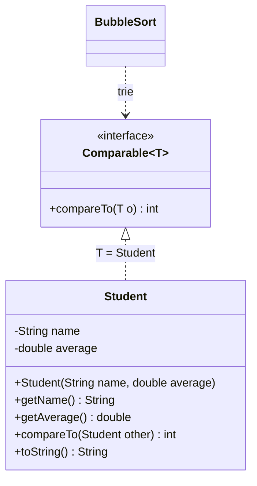

# 🏋️ 06 — Interfaces (suite) : exercices d'entraînement

> 🎯 **Objectifs** : implémenter `Comparable<T>` et utiliser un **tri générique**, remplacer une **cascade de `if`** (ou `instanceof`) par une **interface + des classes**, appliquer l'**OCP**, identifier la bonne **abstraction** (compteurs).
> 📚 Cours : [06 — Interfaces (suite)](../../01-Cours/06-interfaces-suite.md) · prérequis : [05](../../01-Cours/05-polymorphisme-et-interfaces.md)
> ✅ Corrigé : [./corrige.md](./corrige.md) — essaie d'abord seul !

## 🗺️ Les exercices

| N° | Titre | Niveau | Durée | Notions |
|---|---|---|---|---|
| 1 | Le classement de la classe | ⭐ | 15 min | `Comparable<Student>`, `compareTo` sur des `double`, `BubbleSort` |
| 2 | Qui passe en premier ? | ⭐ | 10 min | « que s'affiche-t-il ? » sur `compareTo` et le tri |
| 3 | Le panier de courses | ⭐⭐ | 20 min | `Comparable<Product>`, algorithmes génériques `max` / `isSorted`, tests |
| 4 | Les frais de livraison | ⭐⭐ | 25 min | cascade de `if` → polymorphisme, OCP |
| 5 | Le centre de notifications | ⭐⭐ | 20 min | `Object` + `instanceof` → interface, OCP |
| 6 | Compteurs en tout genre | ⭐⭐⭐ | 25 min | `IncrementFunction` du cours, nouvelles abstractions, tests |

Pour les exercices 1 à 3, on utilise la version **qui compile** du tri générique du cours (§ 4) :

```java
package exo1;

public class BubbleSort {
    public static <T extends Comparable<T>> void sort(T[] elements) {
        T tmp;
        for (int i = elements.length - 1; i > 0; i--) {
            for (int j = 0; j < i; j++) {
                if (elements[j].compareTo(elements[j + 1]) > 0) {
                    tmp = elements[j];
                    elements[j] = elements[j + 1];
                    elements[j + 1] = tmp;
                }
            }
        }
    }

    public static void display(Object[] array) {
        for (Object o : array) {
            System.out.println(o.toString());
        }
    }
}
```

---

## Exercice 1 — Le classement de la classe ⭐

En fin de semestre, on veut classer les étudiant·es par **moyenne** (un `double`), de la plus basse à la plus haute, avec le **même** `BubbleSort` que pour les `String`.



- [ ] **Q1.** Écris la classe `Student` (`toString()` renvoie par ex. `"Lina (14.5)"`), **triable** par `BubbleSort`.
- [ ] **Q2.** Qu'affiche ce code ?

```java
Student[] group = {
    new Student("Lina", 14.5),
    new Student("Tom", 9.75),
    new Student("Ines", 12.5),
    new Student("Hugo", 12.0)
};
BubbleSort.sort(group);
BubbleSort.display(group);
System.out.println("best: " + group[group.length - 1].getName());
```

- [ ] **Q3.** **Trouve l'erreur** : un camarade écrit `return (int) (this.average - other.average);`. Que renvoie son `compareTo` pour Ines (12.5) comparée à Hugo (12.0) ? Quel est le problème pour le tri ?
- [ ] **Q4.** **Compile ou pas ?** (a) `public class Student implements Comparable { ... compareTo(Student other) ... }` (sans `<Student>`) ; (b) `int[] marks = {12, 8, 15}; BubbleSort.sort(marks);`

<details><summary>💡 Indice</summary>

- Convention : `a.compareTo(b)` **< 0** si `a` avant `b`, **0** si égaux, **> 0** si `a` après.
- Avec des `double`, utilise des `if` qui renvoient `-1`, `0` ou `1`.
- `(int) 0.5` vaut `0`…

</details>

---

## Exercice 2 — Qui passe en premier ? ⭐

On utilise les `compareTo` déjà fournis par Java (`String`, `Integer`) et la classe `Person` du cours.

```java
package exo2;

public class Person implements Comparable<Person> {
    private String name;
    private int birthYear;

    public Person(String name, int birthYear) {
        this.name = name;
        this.birthYear = birthYear;
    }

    public int compareTo(Person other) {
        return -(this.birthYear - other.birthYear);
    }

    public String toString() {
        return this.name + " " + this.birthYear;
    }
}
```

- [ ] **Q1.** Pour (a) à (f), donne le **signe** du résultat (négatif, nul, positif). Bonus : la valeur exacte.

```java
System.out.println("apple".compareTo("banana"));         // (a)
System.out.println("pear".compareTo("peach"));           // (b)
System.out.println("cat".compareTo("cat"));              // (c)
System.out.println("abc".compareTo("abcd"));             // (d)
System.out.println("Zoe".compareTo("anna"));             // (e)
Integer twelve = 12;
System.out.println(twelve.compareTo(7));                 // (f)
```

- [ ] **Q2.** Qu'affichent (g), (h), (i) ?

```java
String[] fruits = {"pear", "Peach", "banana", "apple"};
BubbleSort.sort(fruits);
BubbleSort.display(fruits);                              // (g)
Integer[] numbers = {42, 7, 100, 7, -3};
BubbleSort.sort(numbers);
BubbleSort.display(numbers);                             // (h)
Person[] family = {
    new Person("Mamie", 1950),
    new Person("Lou", 2012),
    new Person("Papa", 1980)
};
BubbleSort.sort(family);
BubbleSort.display(family);                              // (i)
```

- [ ] **Q3.** Pourquoi peut-on trier un `Integer[]` mais pas un `int[]` ?

<details><summary>💡 Indice</summary>

- `String.compareTo` compare caractère par caractère (ordre des codes : majuscules **avant** minuscules) ; si l'une est le début de l'autre, la plus courte est « plus petite ».
- `Person` : plus vieux = « plus grand » (cours § 2).

</details>

---

## Exercice 3 — Le panier de courses ⭐⭐

Une appli de courses veut afficher les produits du moins cher au plus cher, et trouver le plus cher. Les prix sont en **centimes** (`int`).

- [ ] **Q1.** Écris `Product implements Comparable<Product>` (attributs `name`, `price` ; accesseurs ; `toString()` → `"bread 120 cts"`). Comparaison par prix.
- [ ] **Q2.** Écris une classe `Algos` avec deux méthodes **génériques**, sur le modèle de `BubbleSort.sort` :
  - `public static <T extends Comparable<T>> T max(T[] elements)` : le plus grand élément ; `IllegalArgumentException` si le tableau est vide ;
  - `public static <T extends Comparable<T>> boolean isSorted(T[] elements)` : `true` ssi le tableau est trié par ordre croissant.
- [ ] **Q3.** Écris des **méthodes de test** : `compareTo` (3 cas), `max` sur un panier, `max` d'un tableau vide, `isSorted` avant / après `BubbleSort.sort`.
- [ ] **Q4.** Qu'affiche ce code ?

```java
Product[] basket = {
    new Product("coffee", 459),
    new Product("bread", 120),
    new Product("cheese", 735),
    new Product("milk", 109)
};
System.out.println(Algos.max(basket));
System.out.println(Algos.isSorted(basket));
BubbleSort.sort(basket);
BubbleSort.display(basket);
System.out.println(Algos.isSorted(basket));
String[] words = {"lille", "paris", "lyon"};
System.out.println(Algos.max(words));
Integer[] numbers = {3, 18, 5};
System.out.println(Algos.max(numbers));
```

<details><summary>💡 Indice</summary>

- Avec des `int`, `this.price - other.price` respecte la convention (comme `Carrot` dans le cours).
- `max` : on garde le « meilleur » vu jusqu'ici, et on le remplace si `elements[i].compareTo(best) > 0`.
- `assertSame(attendu, obtenu)` vérifie que c'est **le même objet**.

</details>

---

## Exercice 4 — Les frais de livraison ⭐⭐

Un site de vente calcule les frais de livraison selon le **mode** choisi. Voici le code actuel :

```java
package exo4before;

public class Order {
    private String mode;      // "standard", "express" ou "relay"
    private int weight;       // en kg

    public Order(String mode, int weight) {
        this.mode = mode;
        this.weight = weight;
    }

    /** @return the shipping cost in euros */
    public int shippingCost() {
        if (this.mode.equals("standard")) {
            return 5 + this.weight;
        } else if (this.mode.equals("express")) {
            return 12 + 2 * this.weight;
        } else if (this.mode.equals("relay")) {
            return 4;
        } else {
            throw new IllegalArgumentException("unknown mode: " + this.mode);
        }
    }

    /** @return the number of days before delivery */
    public int deliveryDays() {
        if (this.mode.equals("standard")) {
            return 3;
        } else if (this.mode.equals("express")) {
            return 1;
        } else if (this.mode.equals("relay")) {
            return 5;
        } else {
            throw new IllegalArgumentException("unknown mode: " + this.mode);
        }
    }

    public static void main(String[] args) {
        Order o1 = new Order("standard", 3);
        Order o2 = new Order("express", 3);
        Order o3 = new Order("relay", 3);
        Order o4 = new Order("expres", 3);
        System.out.println(o1.shippingCost() + " " + o1.deliveryDays());
        System.out.println(o2.shippingCost() + " " + o2.deliveryDays());
        System.out.println(o3.shippingCost() + " " + o3.deliveryDays());
        System.out.println(o4.shippingCost() + " " + o4.deliveryDays());
    }
}
```

```bash
$ java -classpath classes exo4before.Order
8 3
18 1
4 5
Exception in thread "main" java.lang.IllegalArgumentException: unknown mode: expres
	at exo4before.Order.shippingCost(Order.java:21)
	at exo4before.Order.main(Order.java:46)
```

- [ ] **Q1.** Quels sont les **défauts** de cette conception ? Que faut-il modifier pour ajouter un mode ? Que montre l'erreur sur `"expres"` ?
- [ ] **Q2.** Applique la **recette** du cours (§ 10) : écris l'interface `DeliveryMode` (méthodes `int cost(int weight)` et `int days()`) et les classes `StandardDelivery`, `ExpressDelivery`, `RelayDelivery`.
- [ ] **Q3.** Réécris `Order` **sans aucun `if`** : constructeur `Order(DeliveryMode mode, int weight)`, `shippingCost()`, `deliveryDays()`, et `changeMode(DeliveryMode mode)`.
- [ ] **Q4.** 🆕 **OCP** : on ajoute la livraison **à vélo** `BikeDelivery` : 8 € quel que soit le poids, livrée le jour même (0 jour), mais `IllegalArgumentException` au-delà de `MAX_WEIGHT = 10` kg. Écris la classe. Quels fichiers existants as-tu modifiés ?
- [ ] **Q5.** Écris des **méthodes de test** pour `Order` (un test par mode).
- [ ] **Q6.** Qu'affiche ce code ?

```java
DeliveryMode[] modes = { new StandardDelivery(), new ExpressDelivery(), new RelayDelivery(), new BikeDelivery() };
for (int i = 0; i < modes.length; i++) {
    Order order = new Order(modes[i], 3);
    System.out.println(order.shippingCost() + " " + order.deliveryDays());
}
Order heavy = new Order(new ExpressDelivery(), 12);
System.out.println(heavy.shippingCost());
heavy.changeMode(new RelayDelivery());
System.out.println(heavy.shippingCost());
heavy.changeMode(new BikeDelivery());
try {
    System.out.println(heavy.shippingCost());
} catch (IllegalArgumentException e) {
    System.out.println(e.getMessage());
}
```

<details><summary>💡 Indice</summary>

- 3 « types » et 3 comportements → 3 classes + 1 interface (situation 2 du cours : un attribut qui code le type).
- `Order` garde une **référence** de type `DeliveryMode` et lui **délègue** le calcul (comme `Counter` v2 avec `IncrementFunction`).

</details>

---

## Exercice 5 — Le centre de notifications ⭐⭐

Une appli de suivi de colis prévient ses clients par SMS ou par e-mail. Le stagiaire a écrit :

```java
package exo5before;

public class SmsSender {
    private String phone;

    public SmsSender(String phone) {
        this.phone = phone;
    }

    public void sendSms(String text) {
        System.out.println("SMS to " + this.phone + ": " + text);
    }
}
```

(`EmailSender` est identique, avec un attribut `address`, une méthode `sendEmail(String text)` qui affiche `"email to " + address + ": " + text`.)

```java
package exo5before;

public class NotificationCenter {

    public void sendNotification(Object channel, String text) {
        if (channel instanceof SmsSender) {
            ((SmsSender) channel).sendSms(text);
        } else if (channel instanceof EmailSender) {
            ((EmailSender) channel).sendEmail(text);
        } else {
            throw new IllegalArgumentException("unknown channel");
        }
    }

    /** @return the cost in cents of one notification */
    public int cost(Object channel) {
        if (channel instanceof SmsSender) {
            return 5;
        } else if (channel instanceof EmailSender) {
            return 0;
        } else {
            throw new IllegalArgumentException("unknown channel");
        }
    }

    public static void main(String[] args) {
        NotificationCenter center = new NotificationCenter();
        center.sendNotification(new SmsSender("0601020304"), "your parcel has arrived");
        center.sendNotification(new EmailSender("timoleon@univ-lille.fr"), "your parcel has arrived");
        center.sendNotification("timoleon", "your parcel has arrived");
    }
}
```

- [ ] **Q1.** Qu'affiche ce `main` ? Pourquoi la 3e ligne **compile**-t-elle ?
- [ ] **Q2.** Cite les **deux** défauts de cette conception (cours § 7).
- [ ] **Q3.** Corrige : interface `Channel` (`send(String text)`, `int cost()`), classes `SmsChannel` (5 centimes) et `EmailChannel` (gratuit), et `NotificationCenter` avec `sendNotification(Channel channel, String text)`, `cost(Channel channel)` et `int broadcast(Channel[] channels, String text)` qui envoie sur tous les canaux et renvoie le coût total.
- [ ] **Q4.** 🆕 Ajoute les notifications **push** `PushChannel(String app)` : affiche `"push on " + app + ": " + text`, coûte 1 centime. Qu'as-tu modifié dans `NotificationCenter` ?
- [ ] **Q5.** Qu'affiche `broadcast` sur `{ SMS 0601020304, e-mail timoleon@univ-lille.fr, push MyParcel, SMS 0705060708 }` avec le texte `"your parcel has arrived"`, suivi de `"total cost: " + total + " cents"` ? Et `center.sendNotification("timoleon", "hello")` compile-t-il encore ?

<details><summary>💡 Indice</summary>

- Situation 1 du cours (§ 10.1) : des méthodes **différentes** (`sendSms`, `sendEmail`) qui font « la même chose » → **une** méthode commune `send` dans une interface.
- Un paramètre de type `Object` accepte **n'importe quoi**…

</details>

---

## Exercice 6 — Compteurs en tout genre ⭐⭐⭐

On reprend la **version 2** du compteur du cours : une seule classe `Counter`, qui **délègue** l'incrément à une `IncrementFunction`. On ajoute `changeIncrement` (comme `changeDevice` du `DeviceSwitch`).

```java
package exo6;

public interface IncrementFunction {
    public int increment(int value);
}
```

```java
package exo6;

public class Counter {
    private int value;
    private IncrementFunction incrementF;

    public Counter(int value, IncrementFunction incrementF) {
        this.value = value;
        this.incrementF = incrementF;
    }

    public int getCurrentValue() {
        return this.value;
    }

    public void increment() {
        this.value = this.incrementF.increment(this.value);
    }

    public void initValue(int init) {
        this.value = init;
    }

    public void changeIncrement(IncrementFunction incrementF) {
        this.incrementF = incrementF;
    }
}
```

`SimpleIncrement` (`value + 1`) et `ModularIncrement(int modulo)` (`(value + 1) % modulo`) sont ceux du cours.

| Situation de la vie quotidienne | Classe à écrire | `increment(value)` renvoie… |
|---|---|---|
| podomètre qui compte de 5 en 5 | `StepIncrement(int step)` | `value + step` |
| parking de `max` places : on ne dépasse pas `max` | `BoundedIncrement(int max)` | `value + 1`, mais **reste** à `max` |
| minuteur qui décompte jusqu'à 0 | `CountdownIncrement` | `value - 1`, mais **reste** à `0` |

- [ ] **Q1.** Écris les trois classes.
- [ ] **Q2.** Qu'affiche ce code ?

```java
Counter clock = new Counter(22, new ModularIncrement(24));
for (int i = 0; i < 3; i++) {
    clock.increment();
    System.out.print(clock.getCurrentValue() + " ");
}
System.out.println();                                        // (1)
Counter parking = new Counter(0, new BoundedIncrement(2));
parking.increment();
parking.increment();
parking.increment();
System.out.println(parking.getCurrentValue());              // (2)
Counter steps = new Counter(0, new StepIncrement(5));
steps.increment();
steps.increment();
steps.changeIncrement(new SimpleIncrement());
steps.increment();
System.out.println(steps.getCurrentValue());                // (3)
IncrementFunction shared = new CountdownIncrement();
Counter a = new Counter(2, shared);
Counter b = new Counter(10, shared);
a.increment();
a.increment();
a.increment();
b.increment();
System.out.println(a.getCurrentValue() + " " + b.getCurrentValue());   // (4)
```

- [ ] **Q3.** Écris des **méthodes de test** : compteur borné, compteur à pas, décompte, changement d'incrément en cours de route.
- [ ] **Q4.** En **version 1** du cours (`interface Counter` + une classe par compteur), qu'aurait-il fallu écrire pour le compteur de parking ? Quel code aurait été **recopié** ? Pourquoi `changeIncrement` est-il impossible en v1 ?
- [ ] **Q5.** (4) : `a` et `b` partagent le **même** objet `CountdownIncrement`. Est-ce un problème ? Et si on partageait un objet qui a un **état** qui change ?

<details><summary>💡 Indice</summary>

- (1) : `(23 + 1) % 24`…
- Q5 : regarde si `CountdownIncrement` a des **attributs** modifiés par `increment`.

</details>

---

🔗 Pour aller plus loin : [TD Othello](../../02-TD/TD-othello/enonce.md) · [TP Othello](../../03-TP/TP-othello/ENONCE.md) · tri selon d'autres critères : [07 — Collections](../../01-Cours/07-collections.md)

🏠 [Sommaire des exercices](../README.md)
