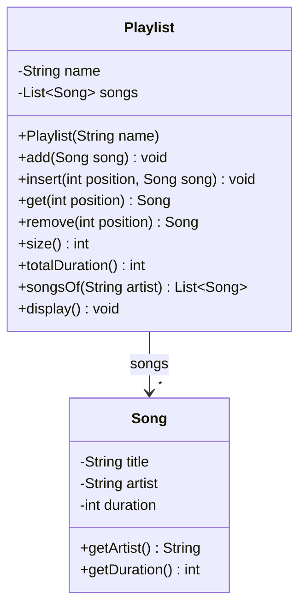
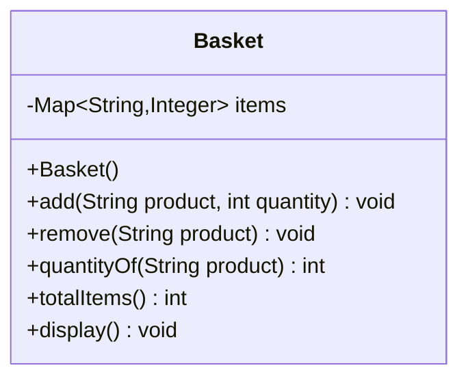
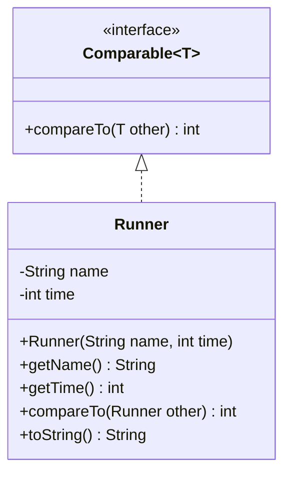
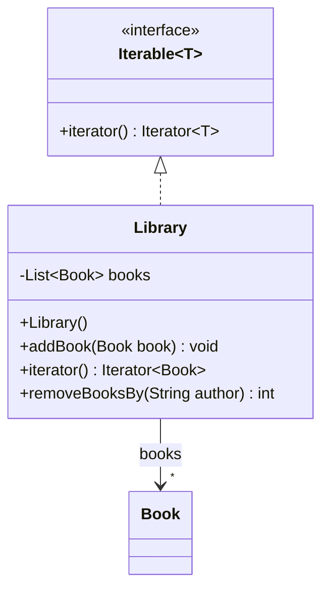
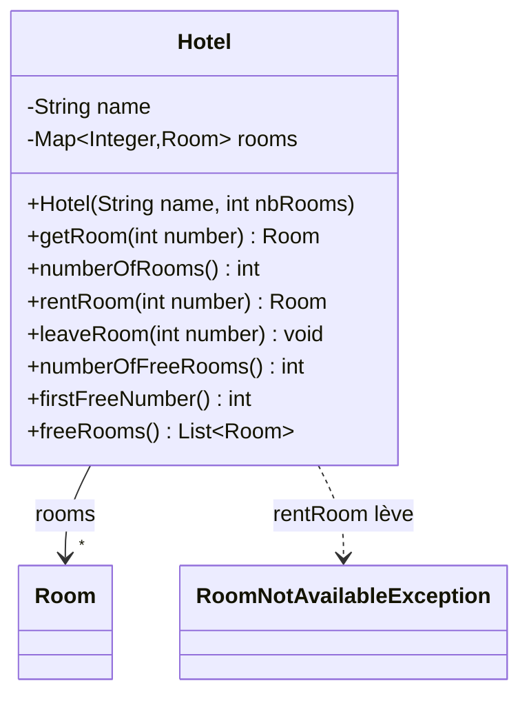

# 🏋️ 07 — Collections : exercices d'entraînement

> ✅ **Corrigé :** [./corrige.md](./corrige.md) — essaie d'abord seul !
> 🔗 **Cours :** [07 — Collections et tables de hachage](../../01-Cours/07-collections.md)
> 📌 Tout se trouve dans `java.util` : pense à `import java.util.*;` (ou aux imports précis).

## 🗺️ Les exercices

| n° | Titre | Niveau | Durée | Notions |
|---|---|---|---|---|
| 1 | Quelle collection choisir ? | ⭐ | 10 min | `List` / `Set` / `Map`, implémentations, autoboxing |
| 2 | Ma playlist | ⭐ | 20 min | `List`, `ArrayList`, positions, for-each |
| 3 | Liste d'invités sans doublon | ⭐⭐ | 20 min | `HashSet`, `equals` **et** `hashCode` |
| 4 | Compter des mots, remplir un panier | ⭐⭐ | 25 min | `Map`, `HashMap`, `TreeMap`, `entrySet()` |
| 5 | Rayer les articles achetés | ⭐⭐ | 20 min | `Iterator`, `it.remove()`, `ConcurrentModificationException` |
| 6 | Classement du marathon | ⭐⭐ | 20 min | `Comparable`, `Collections.sort`, `Comparator`, `TreeSet` |
| 7 | Une bibliothèque itérable | ⭐⭐⭐ | 25 min | `Iterable<T>`, `Collection<?>`, typage générique |
| 8 | L'hôtel du TP4 avec une `Map` (style DS) | ⭐⭐⭐ | 40 min | `TreeMap`, javadoc, tests JUnit, exceptions |

---

## Exercice 1 — Quelle collection choisir ? ⭐

> 🌍 Dans la vie, on ne range pas tout dans le même contenant : une liste de courses (ordonnée), une boîte de badges (pas de doublon), un répertoire (nom → numéro).

- [ ] **Q1.** Pour chaque situation, donne l'**interface** (`List`, `Set`, `Map`) puis l'**implémentation** la plus adaptée (`ArrayList`, `LinkedList`, `HashSet`, `TreeSet`, `HashMap`, `TreeMap`).

| | Situation | Interface ? | Implémentation ? |
|---|---|---|---|
| a | La liste de courses, dans l'ordre où on y pense (on peut noter deux fois « œufs ») | | |
| b | Les numéros déjà sortis au loto : on veut savoir **très vite** si un numéro est sorti | | |
| c | Le répertoire du téléphone : nom → numéro | | |
| d | La file d'attente de la boulangerie : on ajoute à la fin et on retire en tête, **très souvent** | | |
| e | Les inscrits au club, **sans doublon**, rangés par ordre alphabétique (on veut le premier et le dernier) | | |
| f | Une playlist dont on veut lire directement le 15ᵉ morceau | | |
| g | Le stock du magasin : produit → quantité, affiché par ordre alphabétique des produits | | |
| h | Les badges autorisés à entrer dans l'immeuble | | |

- [ ] **Q2.** Chaque ligne compile-t-elle ? Si non, corrige-la.

```java
List<int> grades = new ArrayList<int>();                  // (1)
List<Integer> grades = new ArrayList<Integer>();          // (2)
ArrayList<String> names = new List<String>();             // (3)
Set<String> badges = new HashSet<String>();               // (4)
Map<String> phoneBook = new HashMap<String>();            // (5)
Collection<String> members = new TreeSet<String>();       // (6)
```

- [ ] **Q3.** Pourquoi le cours recommande-t-il d'écrire `List<Song> songs = new ArrayList<Song>();` plutôt que `ArrayList<Song> songs = new ArrayList<Song>();` ?

<details><summary>💡 Indice</summary>

- Ordre + doublons possibles → `List` ; sans répétition → `Set` ; clé → valeur → `Map`.
- « Trié » → `Tree…` ; « rapide, ordre quelconque » → `Hash…` ; « accès par position » → `ArrayList` ; « ajouts/retraits en tête » → `LinkedList`.
- Une collection ne contient que des **objets**. Une interface ne s'instancie pas.

</details>

---

## Exercice 2 — Ma playlist ⭐

> 🌍 Une playlist de téléphone : les morceaux ont une **position** (1er, 2e…), on peut en insérer un en tête, en retirer un, et connaître la durée totale.

On donne la classe `Song` :

```java
// Fichier : Song.java
public class Song {
    private String title;
    private String artist;
    private int duration;   // en secondes

    public Song(String title, String artist, int duration) {
        this.title = title;
        this.artist = artist;
        this.duration = duration;
    }
    public String getTitle() { return this.title; }
    public String getArtist() { return this.artist; }
    public int getDuration() { return this.duration; }
    public String toString() { return this.title + " (" + this.artist + ")"; }
}
```



- [ ] **Q1.** Écris les attributs et le constructeur de `Playlist` (la playlist est vide à la création).
- [ ] **Q2.** Écris `add` (à la fin), `insert` (à une position donnée), `get`, `remove` et `size` en **déléguant** à la liste.
- [ ] **Q3.** Écris `totalDuration()` (somme des durées, en secondes) avec une boucle **for-each**.
- [ ] **Q4.** Écris `songsOf(String artist)` qui renvoie une **nouvelle** liste contenant les morceaux de cet artiste.
- [ ] **Q5.** Écris `display()` qui affiche `1. titre (artiste)`, `2. …` (numérotation à partir de 1).
- [ ] **Q6.** Que s'affiche-t-il ?

```java
Playlist p = new Playlist("Road trip");
Song a = new Song("Alors on danse", "Stromae", 206);
Song b = new Song("Papaoutai", "Stromae", 232);
Song c = new Song("Djadja", "Aya Nakamura", 171);
p.add(a);
p.add(b);
p.insert(0, c);
p.display();
System.out.println(p.get(1));
System.out.println(p.totalDuration());
System.out.println(p.songsOf("Stromae"));
p.remove(0);
System.out.println(p.size() + " " + p.get(0));
p.get(5);
```

- [ ] **Q7.** Un camarade écrit `totalDuration()` avec `for (int i = 0; i < this.songs.size(); i++) { … this.songs.get(i) … }`. Pourquoi est-ce déconseillé ?

<details><summary>💡 Indice</summary>

- `List<Song> songs = new ArrayList<Song>();` dans le constructeur.
- `add(int index, E e)`, `get(int index)`, `remove(int index)` existent déjà dans `List`.
- `System.out.println(uneListe)` affiche `[elt1, elt2]` en utilisant le `toString()` des éléments.
- Que fait `get` avec un indice ≥ `size()` ?

</details>

---

## Exercice 3 — Liste d'invités sans doublon ⭐⭐

> 🌍 Pour un mariage, on note les invités : si Tata Alice est notée deux fois, on ne veut **pas** deux chaises pour elle. Un `Set` refuse les doublons… à condition de savoir reconnaître « le même » invité !

```java
// Fichier : Guest.java
public class Guest {
    private String firstName;
    private String lastName;

    public Guest(String firstName, String lastName) {
        this.firstName = firstName;
        this.lastName = lastName;
    }
    public String toString() { return this.firstName + " " + this.lastName; }
}
```

- [ ] **Q1.** Que s'affiche-t-il ? **Explique** chaque ligne.

```java
Set<Guest> guests = new HashSet<Guest>();
Guest alice = new Guest("Alice", "Martin");
System.out.println(guests.add(alice));
System.out.println(guests.add(alice));
System.out.println(guests.add(new Guest("Alice", "Martin")));
System.out.println(guests.size());
System.out.println(guests.contains(new Guest("Alice", "Martin")));
```

- [ ] **Q2.** Redéfinis dans `Guest` les méthodes nécessaires pour que deux invités de mêmes prénom et nom soient considérés comme **le même** invité.
- [ ] **Q3.** Avec ta version de Q2, que s'affiche le code de Q1 ?
- [ ] **Q4.** **Trouve l'erreur.** Un camarade a écrit ceci (et garde ton `hashCode`). Le code de Q1 affiche toujours `2` pour `size()`. Pourquoi ?

```java
public boolean equals(Guest other) {
    return this.firstName.equals(other.firstName) && this.lastName.equals(other.lastName);
}
```

- [ ] **Q5.** Et si on redéfinit correctement `equals(Object o)` mais **pas** `hashCode()` ?

<details><summary>💡 Indice</summary>

- Sans redéfinition, `equals` et `hashCode` sont ceux d'`Object` : ils comparent les **références**.
- Un `HashSet` cherche d'abord l'alvéole avec `hashCode()`, puis compare avec `equals(Object)`.
- Pour `hashCode`, on peut combiner les `hashCode()` des deux `String` (ex. `31 * h1 + h2`).
- `equals(Guest)` ≠ `equals(Object)` : surcharge ou redéfinition ?

</details>

---

## Exercice 4 — Compter des mots, remplir un panier ⭐⭐

> 🌍 Un correcteur compte combien de fois chaque mot apparaît dans une rédaction ; une appli de courses associe à chaque produit une quantité. Dans les deux cas : **clé → valeur**.

### Partie A — Compter les occurrences

- [ ] **Q1.** Écris la méthode statique `public static Map<String,Integer> count(String[] words)` de la classe `WordCounter`, qui associe à chaque mot son nombre d'apparitions. Utilise `containsKey`, `get` et `put`.
- [ ] **Q2.** Que s'affiche-t-il ?

```java
String[] words = {"le", "chat", "mange", "le", "poisson", "le", "chat", "dort"};
Map<String,Integer> occ = WordCounter.count(words);
System.out.println(occ.get("le") + " " + occ.get("chat") + " " + occ.get("chien"));
System.out.println(occ.size());
```

- [ ] **Q3.** On veut afficher `mot : nombre`, **par ordre alphabétique**. Quelle **seule** ligne de `count` faut-il changer ? Écris l'affichage avec `entrySet()`.

### Partie B — Le panier



- [ ] **Q4.** Écris `Basket`. `add` **cumule** les quantités (ajouter 2 pommes puis 3 pommes → 5 pommes) ; `quantityOf` renvoie `0` pour un produit absent ; `totalItems` fait la somme de toutes les quantités (utilise `values()`) ; `display` affiche `produit x quantité` (utilise `entrySet()`).
- [ ] **Q5.** Que s'affiche-t-il ?

```java
Basket b = new Basket();
b.add("pomme", 3);
b.add("pain", 1);
b.add("pomme", 2);
System.out.println(b.quantityOf("pomme") + " " + b.quantityOf("lait"));
System.out.println(b.totalItems());
b.remove("pain");
System.out.println(b.totalItems());
```

- [ ] **Q6.** Que donnerait `quantityOf("pomme")` si `add` faisait simplement `this.items.put(product, quantity);` ?

<details><summary>💡 Indice</summary>

- `get` sur une clé absente renvoie `null`.
- `put` sur une clé **existante** **remplace** l'ancienne valeur.
- `TreeMap` = clés **triées** ; `HashMap` = aucun ordre garanti.
- `Map.Entry<String,Integer>` : `getKey()` et `getValue()`.

</details>

---

## Exercice 5 — Rayer les articles achetés ⭐⭐

> 🌍 Au supermarché, tu rayes de ta liste les articles déjà dans le caddie. En Java, « rayer pendant qu'on lit la liste » demande une précaution : passer par l'**itérateur**.

```java
// version naïve
public static void removeBoughtBad(List<String> shoppingList, Set<String> bought) {
    for (String item : shoppingList) {
        if (bought.contains(item)) {
            shoppingList.remove(item);
        }
    }
}
```

- [ ] **Q1.** La liste vaut `[pain, lait, oeufs, beurre, pommes]` et `bought` vaut `{lait}`. Que se passe-t-il à l'appel de `removeBoughtBad` ? Pourquoi ?
- [ ] **Q2.** Écris `removeBought` qui fait le travail correctement avec un `Iterator<String>`.
- [ ] **Q3.** **Trouve l'erreur.** Avec `bought = {lait, oeufs}`, que contient la liste après cette version ? Pourquoi est-ce faux ?

```java
public static void removeBoughtIndex(List<String> shoppingList, Set<String> bought) {
    for (int i = 0; i < shoppingList.size(); i++) {
        if (bought.contains(shoppingList.get(i))) {
            shoppingList.remove(i);
        }
    }
}
```

- [ ] **Q4.** (⭐⭐⭐) Avec la version naïve et `bought = {beurre}` (avant-dernier élément), aucune exception n'est levée ! Explique pourquoi, et pourquoi ce n'est **pas** une raison de garder cette version.

<details><summary>💡 Indice</summary>

- Le for-each utilise un itérateur caché. Un itérateur est **fail-fast**.
- `it.remove()` retire le dernier élément renvoyé par `it.next()`, **sans** corrompre l'itérateur.
- Après `remove(i)`, tous les éléments suivants **reculent** d'une position.
- L'exception est levée par `next()` : y a-t-il encore un `next()` après la suppression de `beurre` ?

</details>

---

## Exercice 6 — Classement du marathon ⭐⭐

> 🌍 À l'arrivée d'un marathon, on trie les coureurs par temps pour le podium… puis par nom pour la liste des diplômes.



- [ ] **Q1.** Écris `Runner` (temps en minutes) : `compareTo` classe du **plus rapide** au plus lent ; `toString` renvoie `nom (temps min)`.
- [ ] **Q2.** Que s'affiche-t-il ?

```java
List<Runner> runners = new ArrayList<Runner>();
runners.add(new Runner("Léa", 215));
runners.add(new Runner("Karim", 189));
runners.add(new Runner("Zoé", 240));
runners.add(new Runner("Tom", 189));
Collections.sort(runners);
System.out.println(runners);
System.out.println("Vainqueur : " + runners.get(0));
```

- [ ] **Q3.** Écris une classe `NameComparator implements Comparator<Runner>` et trie la liste par **nom**. Qu'affiche alors `System.out.println(runners)` ?
- [ ] **Q4.** (⭐⭐⭐) On range les 4 coureurs (dans le même ordre d'ajout) dans un `Set<Runner> set = new TreeSet<Runner>();`. Que vaut `set.size()` ? Qu'affiche `System.out.println(set)` ? Surprenant ?
- [ ] **Q5.** Si `Runner` n'implémentait **pas** `Comparable<Runner>`, `Collections.sort(runners);` compilerait-il ?

<details><summary>💡 Indice</summary>

- Convention : `a.compareTo(b)` **< 0** si `a` avant `b`, **0** si égaux, **> 0** sinon. Pour des entiers : une soustraction.
- `String` a déjà un `compareTo`.
- Un `TreeSet` décide qu'un élément « est déjà là » avec `compareTo`… que vaut `compareTo` entre deux temps égaux ?

</details>

---

## Exercice 7 — Une bibliothèque itérable ⭐⭐⭐

> 🌍 À la médiathèque, on veut pouvoir dire « pour chaque livre de la bibliothèque… » sans savoir comment les livres sont rangés sur les étagères. Comme `Agency` et ses voitures dans le cours.

```java
// Fichier : Book.java
public class Book {
    private String title;
    private String author;
    public Book(String title, String author) { this.title = title; this.author = author; }
    public String getTitle() { return this.title; }
    public String getAuthor() { return this.author; }
    public String toString() { return this.title + " de " + this.author; }
}
```



- [ ] **Q1.** Écris `Library` pour que `for (Book b : library) { … }` soit possible.
- [ ] **Q2.** Écris `removeBooksBy(String author)` qui retire tous les livres de cet auteur et renvoie le **nombre** de livres retirés.
- [ ] **Q3.** Que s'affiche-t-il ?

```java
Library lib = new Library();
lib.addBook(new Book("Le Hobbit", "Tolkien"));
lib.addBook(new Book("Dune", "Herbert"));
lib.addBook(new Book("Le Silmarillion", "Tolkien"));
System.out.println(lib.removeBooksBy("Tolkien"));
for (Book b : lib) {
    System.out.println(b);
}
```

- [ ] **Q4.** Avec `List<Book> books = new ArrayList<Book>();`, quelles lignes **compilent** ?

```java
Collection<Book> c1 = books;                 // (a)
Collection<Object> c2 = books;               // (b)
Collection<?> c3 = books;                    // (c)
c3.add(new Book("Dune", "Herbert"));         // (d)
Object first = c3.iterator().next();         // (e)
```

- [ ] **Q5.** Écris une méthode statique `printAll` qui affiche les éléments de **n'importe quelle** collection, et qu'on peut appeler aussi bien avec une `List<Book>` qu'avec un `Set<String>`.

<details><summary>💡 Indice</summary>

- `implements Iterable<Book>` + `public Iterator<Book> iterator()` qui **délègue** à la liste interne.
- Dans `removeBooksBy`, utilise `this.iterator()` et `it.remove()`.
- `Collection<Book>` n'est **pas** un sous-type de `Collection<Object>`. Avec `Collection<?>`, le type exact est inconnu.

</details>

---

## Exercice 8 — L'hôtel du TP4 avec une `Map` (style DS) ⭐⭐⭐

> 🌍 À la réception d'un hôtel, on cherche une chambre par son **numéro** sur le tableau des clés : numéro → chambre. Plus besoin du décalage `rooms[number - 1]` du [TP4](../../03-TP/TP4-hotel/ENONCE.md) !

On donne `Room` et l'exception :

```java
// Fichier : Room.java
public class Room {
    private int number;
    private boolean free;
    public Room(int number) { this.number = number; this.free = true; }
    public int getNumber() { return this.number; }
    public boolean isFree() { return this.free; }
    public void rent() { this.free = false; }
    public void leave() { this.free = true; }
    public String toString() { return "chambre " + this.number; }
}
```

```java
// Fichier : RoomNotAvailableException.java
public class RoomNotAvailableException extends Exception {
    public RoomNotAvailableException(String msg) { super(msg); }
}
```



**Spécification :**
- le constructeur crée les chambres numérotées de `1` à `nbRooms` ;
- `getRoom(n)` renvoie la chambre n° `n`, ou `null` si ce numéro n'existe pas ;
- `rentRoom(n)` loue la chambre et la renvoie ; lève `RoomNotAvailableException` si le numéro n'existe pas **ou** si la chambre est déjà louée ;
- `leaveRoom(n)` libère la chambre (sans effet si le numéro n'existe pas) ;
- `firstFreeNumber()` renvoie le plus petit numéro libre, `0` s'il n'y en a pas ;
- `freeRooms()` renvoie la liste des chambres libres **par numéro croissant**.

- [ ] **Q1.** Quelle implémentation de `Map` choisir pour que `firstFreeNumber()` et `freeRooms()` parcourent les chambres **dans l'ordre des numéros** ? Écris les attributs et le constructeur.
- [ ] **Q2.** Écris la **javadoc** de `rentRoom`.
- [ ] **Q3.** Écris une classe de test `HotelTest` (JUnit 5) avec au moins 6 méthodes de test couvrant `getRoom`, `rentRoom` (cas normal **et** les deux cas d'exception), `leaveRoom`, `firstFreeNumber` et `freeRooms`.
- [ ] **Q4.** Écris toutes les méthodes de `Hotel`. Tous tes tests doivent passer.
- [ ] **Q5.** Donne deux avantages de la `Map` par rapport au tableau `Room[]` du TP4.

<details><summary>💡 Indice</summary>

- `TreeMap` garde les clés triées : `values()` est alors parcourue par numéro croissant.
- `get` sur une clé absente renvoie `null` : plus besoin de capturer `ArrayIndexOutOfBoundsException`.
- Pour tester une exception : `assertThrows(RoomNotAvailableException.class, () -> hotel.rentRoom(3));`
- Une méthode qui peut lever une exception **contrôlée** doit la déclarer (`throws`) ; une méthode de test aussi.

</details>

---

✅ [Voir le corrigé](./corrige.md) · 🔗 [Cours 07](../../01-Cours/07-collections.md)

🏠 [Sommaire des exercices](../README.md)
