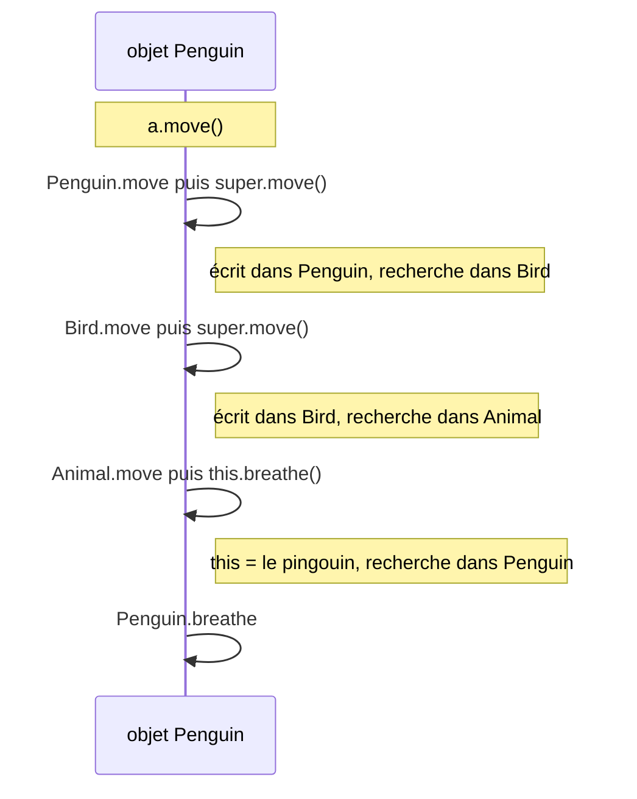

# ✅ 08 — Héritage : corrigé

> ⬅️ **Énoncé :** [./enonce.md](./enonce.md) · 🔗 **Cours :** [08 — Héritage](../../01-Cours/08-heritage.md)
> 📌 Tout le code ci-dessous a été compilé (Java 21) et exécuté ; les affichages, erreurs de compilation et exceptions indiqués sont ceux obtenus réellement. Les classes fournies dans l'énoncé ne sont pas recopiées.

---

## Exercice 1 — Le garage : véhicules et constructeurs

### Q1 et Q2

```java
// Fichier : Car.java
public class Car extends Vehicle {
    private static final int NB_WHEELS = 4;

    public Car(String brand) {
        super(brand, NB_WHEELS);      // 1re instruction : super-constructeur
    }
}
```

```java
// Fichier : Bicycle.java
public class Bicycle extends Vehicle {
    private static final int NB_WHEELS = 2;

    public Bicycle(String brand) {
        super(brand, NB_WHEELS);
    }
}
```

```java
// Fichier : Truck.java
public class Truck extends Vehicle {
    private int maxLoad;                          // extension

    public Truck(String brand, int nbWheels, int maxLoad) {
        super(brand, nbWheels);                   // ① partie héritée
        this.maxLoad = maxLoad;                   // ② partie ajoutée
    }

    public int getMaxLoad() { return this.maxLoad; }

    public String describe() {                    // spécialisation
        return super.describe() + " charge max : " + this.maxLoad + " kg";
    }
}
```

💡 Comme `LightParcel` dans le cours, le constructeur de `Car` a **moins** de paramètres que le super-constructeur : le nombre de roues est imposé. `super.describe()` réutilise le code de `Vehicle` : si la description d'un véhicule change, celle du camion suit.

### Q3

| Classe | Dérivation (hérité tel quel) | Extension (ajouté) | Spécialisation (redéfini) |
|---|---|---|---|
| `Car`, `Bicycle` | `getBrand`, `getNbWheels`, `describe` (et les attributs) | rien | rien |
| `Truck` | `getBrand`, `getNbWheels` | attribut `maxLoad`, `getMaxLoad()` | `describe()` |

### Q4

| | Erreur de compilation obtenue | Explication |
|---|---|---|
| (a) | `call to super must be first statement in constructor` | `super(...)` doit être la **1re** instruction : inverser les deux lignes |
| (b) | `constructor Vehicle in class Vehicle cannot be applied to given types` **et** `brand has private access in Vehicle` | pas de `super(...)` ⇒ `super()` implicite, qui n'existe pas ; et les attributs `private` hérités ne sont pas accessibles |
| (c) | `constructor Vehicle in class Vehicle cannot be applied to given types` | même problème : `Vehicle` n'a pas de constructeur sans paramètre |

💡 Correction de (a) et (b) : `public Car(String brand) { super(brand, 4); }` (on peut afficher le message **après** `super`).

### Q5

```java
// Fichier : GarageMain.java
public class GarageMain {
    public static void main(String[] args) {
        Vehicle v = new Truck("Renault", 6, 12000);
        System.out.println(v.describe());
        System.out.println(new Bicycle("Btwin").describe());
        System.out.println(new Car("Peugeot").getNbWheels());
    }
}
```

Affichage obtenu :

```text
Renault (6 roues) charge max : 12000 kg
Btwin (2 roues)
4
```

💡 `v` est de type `Vehicle` mais référence un `Truck` : le lookup part de `Truck` ⇒ `Truck.describe()` (late binding).

### Q6

```java
// Fichier : VillaMain.java
public class VillaMain {
    public static void main(String[] args) {
        new VillaWithPool();
    }
}
```

Affichage obtenu :

```text
1. fondations (Building)
2. murs (House)
3. piscine (VillaWithPool)
```

💡 Construction **en cascade** : chaque constructeur commence par appeler celui de sa super-classe (`super()` implicite dans `House`). L'attribut `pool` est initialisé **après** le retour de `super()` et **avant** le reste du constructeur (étapes 3, 4, 5 du cours) : il vaut déjà `"piscine"` à l'affichage.

---

## Exercice 2 — La paie des employés

### Q1 à Q4

```java
// Fichier : Manager.java
public class Manager extends Employee {
    private int bonus;

    public Manager(String name, int baseSalary, int bonus) {
        super(name, baseSalary);
        this.bonus = bonus;
    }

    public int salary() {
        return super.salary() + this.bonus;
    }
}
```

```java
// Fichier : Salesperson.java
public class Salesperson extends Employee {
    private static final int RATE = 5;   // en %
    private int sales;

    public Salesperson(String name, int baseSalary, int sales) {
        super(name, baseSalary);
        this.sales = sales;
    }

    public int salary() {
        return super.salary() + this.sales * RATE / 100;
    }
}
```

```java
// Fichier : Intern.java
public class Intern extends Employee {
    private static final int ALLOWANCE = 650;

    public Intern(String name) {
        super(name, 0);
    }

    public int salary() {
        return ALLOWANCE;           // redéfinition complète, sans super
    }
}
```

```java
// Fichier : Payroll.java
import java.util.ArrayList;
import java.util.List;

public class Payroll {
    private List<Employee> staff;

    public Payroll() {
        this.staff = new ArrayList<Employee>();
    }

    public void hire(Employee e) {          // accepte tout sous-type d'Employee
        this.staff.add(e);
    }

    public List<Employee> getStaff() { return this.staff; }

    public int totalSalaries() {
        int total = 0;
        for (Employee e : this.staff) {
            total = total + e.salary();     // late binding
        }
        return total;
    }
}
```

💡 `Payroll` ne connaît **que** `Employee` : ajouter un nouveau type d'employé ne la modifie pas (OCP).

### Q5

```java
// Fichier : PayrollMain.java
public class PayrollMain {
    public static void main(String[] args) {
        Payroll payroll = new Payroll();
        payroll.hire(new Employee("Inès", 2000));
        payroll.hire(new Manager("Hugo", 3000, 500));
        payroll.hire(new Salesperson("Maya", 1800, 20000));
        payroll.hire(new Intern("Léo"));
        for (Employee e : payroll.getStaff()) {
            System.out.println(e);
        }
        System.out.println("Total : " + payroll.totalSalaries());
    }
}
```

Affichage obtenu :

```text
Inès gagne 2000 €
Hugo gagne 3500 €
Maya gagne 2800 €
Léo gagne 650 €
Total : 8950
```

💡 `toString()` est héritée de `Employee` par tous, mais `this.salary()` relance un **lookup depuis la classe de l'objet** : `Manager.salary()` pour Hugo (3000 + 500), `Salesperson.salary()` pour Maya (1800 + 20000 × 5 / 100 = 2800), `Intern.salary()` pour Léo.

### Q6

```java
// Fichier : BadManager.java
public class BadManager extends Employee {
    private int bonus;

    public BadManager(String name, int baseSalary, int bonus) {
        super(name, baseSalary);
        this.bonus = bonus;
    }

    public int salary() {
        return this.salary() + this.bonus;   // ⚠️ s'appelle lui-même
    }
}
```

```java
// Fichier : BadManagerMain.java
public class BadManagerMain {
    public static void main(String[] args) {
        try {
            System.out.println(new BadManager("Hugo", 3000, 500).salary());
        } catch (StackOverflowError e) {
            System.out.println("StackOverflowError !");
        }
    }
}
```

Affichage obtenu :

```text
StackOverflowError !
```

💡 `this.salary()` part de la classe de l'objet, `BadManager`… qui a `salary()` : la méthode s'appelle **elle-même** à l'infini, jusqu'au débordement de la pile (`StackOverflowError`). Il faut `super.salary()`, qui commence la recherche dans `Employee`.

### Q7

Avec `super.salary()`, le manager suit **automatiquement** toute évolution du calcul de base (ex. une prime d'ancienneté ajoutée dans `Employee.salary()`), comme `ExpressParcel` qui double `super.deliveryCost()`. Avec `getBaseSalary()`, il faudrait penser à modifier `Manager` **et** `Salesperson`.

---

## Exercice 3 — Quelle méthode est appelée ?

```java
// Fichier : ZooMain.java
public class ZooMain {
    public static void main(String[] args) {
        System.out.println("--- a");
        Animal a = new Animal();
        a.present();
        System.out.println("--- b");
        a = new Bird();
        a.present();
        System.out.println("--- c");
        a = new Penguin();
        a.present();
        System.out.println("--- d");
        a.move();
        System.out.println("--- e");
        Bird b = new Penguin();
        b.breathe();
        System.out.println("--- Q2");
        ((Penguin) a).swim();
    }
}
```

Affichage obtenu :

```text
--- a
Animal.present
Animal.cry
Animal.move
Animal.breathe
--- b
Animal.present
Bird.cry
Bird.move
Animal.move
Animal.breathe
--- c
Penguin.present
Animal.present
Bird.cry
Penguin.move
Bird.move
Animal.move
Penguin.breathe
--- d
Penguin.move
Bird.move
Animal.move
Penguin.breathe
--- e
Penguin.breathe
--- Q2
Penguin.swim
```

### Q1

| | Affichage | Points clés |
|---|---|---|
| a | Animal.present · Animal.cry · Animal.move · Animal.breathe | tout est dans `Animal` |
| b | Animal.present · **Bird.cry** · Bird.move · Animal.move · Animal.breathe | `present` absente de `Bird` → `Animal` ; `this.cry()` repart de **Bird** |
| c | Penguin.present · Animal.present · Bird.cry · Penguin.move · Bird.move · Animal.move · **Penguin.breathe** | `super.present()` (écrit dans `Penguin`) → `Bird` (absente) → `Animal` ; `this.breathe()` dans `Animal.move` repart de **Penguin** |
| d | Penguin.move · Bird.move · Animal.move · Penguin.breathe | chaîne de `super.move()` |
| e | Penguin.breathe | référence `Bird`, objet `Penguin` |



### Q2

- `a.swim();` ❌ ne compile pas (`cannot find symbol … method swim()`) : la référence est de type `Animal`, qui ne connaît pas `swim()`.
- `((Penguin) a).swim();` ✅ compile (downcast explicite) et s'exécute (`Penguin.swim`) car l'objet **est** un `Penguin`.

### Q3

💡 `super.m()` ne part **pas** de la super-classe de l'objet, mais de la super-classe de la classe **où est écrit** l'appel. Le `super.move()` écrit dans `Bird` cherche donc dans `Animal`, quel que soit l'objet. (Sinon on bouclerait à l'infini sur `Bird.move`.)

---

## Exercice 4 — Compile ? Exécute ? (transtypage)

### Q1

| n° | Compile ? | Exécution ? | Explication |
|---|---|---|---|
| 1 | ✅ | ✅ | upcast `Truck` → `Vehicle`, toujours légal |
| 2 | ❌ `incompatible types: Vehicle cannot be converted to Car` | — | un véhicule n'est pas forcément une voiture |
| 3 | ✅ | ✅ affiche `Tesla (4 roues) électrique 50%` | `describe()` existe dans `Car` (héritée) |
| 4 | ❌ `cannot find symbol … method recharge()` | — | le type de la **référence** (`Car`) ne connaît pas `recharge()` |
| 5 | ✅ | ✅ | downcast : l'objet **est** une `ElectricCar` |
| 6 | ✅ | ❌ `ClassCastException` | le compilateur accepte (un `Vehicle` *peut* être une `ElectricCar`), mais l'objet est une simple `Car` |
| 7 | ✅ | ❌ `ClassCastException` | idem : l'objet est une `Car`, pas un `Truck` |
| 8 | ❌ `incompatible types: Car cannot be converted to Bicycle` | — | `Car` et `Bicycle` sont « sœurs » : aucune `Car` ne peut être un `Bicycle` |
| 9 | ✅ | ✅ `true` | une `ElectricCar` est une `Car`, donc un `Vehicle` |
| 10 | ✅ | ✅ `false` | `v` référence une `Car` « simple » |

💡 **Compilation** = type des **références** ; **exécution** = classe de **l'objet**. Le cast ne transforme pas l'objet : il change seulement le type de la référence, et la JVM vérifie.

### Q2 et Q3

```java
// Fichier : Parking.java
import java.util.List;

public class Parking {
    public static void rechargeAll(List<Vehicle> parking) {
        for (Vehicle v : parking) {
            if (v instanceof ElectricCar) {          // teste la classe de l'OBJET
                ((ElectricCar) v).recharge();        // downcast sûr
            }
        }
    }
}
```

```java
// Fichier : CastMain.java
import java.util.ArrayList;
import java.util.List;

public class CastMain {
    public static void main(String[] args) {
        Vehicle v = new Car("Peugeot");
        Car c = new ElectricCar("Tesla");
        System.out.println(c.describe());                 // ligne 3
        System.out.println(c instanceof Vehicle);         // ligne 9
        System.out.println(v instanceof ElectricCar);     // ligne 10
        try {
            ((ElectricCar) v).recharge();                 // ligne 6
        } catch (ClassCastException e) {
            System.out.println("ligne 6 : ClassCastException");
        }
        List<Vehicle> parking = new ArrayList<Vehicle>();
        parking.add(v);
        parking.add(c);
        parking.add(new Bicycle("Btwin"));
        Parking.rechargeAll(parking);
        for (Vehicle x : parking) {
            System.out.println(x.describe());
        }
    }
}
```

Affichage obtenu :

```text
Tesla (4 roues) électrique 50%
true
false
ligne 6 : ClassCastException
Peugeot (4 roues)
Tesla (4 roues) électrique 100%
Btwin (2 roues)
```

💡 Ligne 3 : `c` est de type `Car` mais l'objet est une `ElectricCar` ⇒ lookup ⇒ `ElectricCar.describe()`, qui complète `super.describe()`.
⚠️ `instanceof` + downcast fonctionne, mais si on en écrit beaucoup (un par type), c'est le signe qu'il faudrait une méthode redéfinie : voir l'exercice 8.

---

## Exercice 5 — La boutique : `toString` et `equals`

### Q1

```java
// Fichier : ShopMain1.java
public class ShopMain1 {
    public static void main(String[] args) {
        System.out.println(new Product("301", "Lait", 1.2));
    }
}
```

Affichage obtenu (le nombre change d'une exécution à l'autre) :

```text
Product@4517d9a3
```

💡 `println` appelle `toString()`. `Product` ne la redéfinit pas ⇒ lookup ⇒ celle d'**`Object`** : nom de la classe + `@` + un code en hexadécimal. Pas très parlant !

### Q2 à Q4 — `Product` complet

```java
// Fichier : Product.java
public class Product {
    protected String barcode;
    protected String name;
    protected double price;

    public Product(String barcode, String name, double price) {
        this.barcode = barcode;
        this.name = name;
        this.price = price;
    }

    // Q2
    public String description() {
        return this.name;
    }

    public String toString() {
        return this.description() + " : " + this.price + " €";
    }

    // Q4
    public boolean equals(Object o) {
        if (!(o instanceof Product)) {
            return false;
        }
        Product other = (Product) o;
        return this.barcode.equals(other.barcode);
    }

    public int hashCode() {
        return this.barcode.hashCode();
    }
}
```

```java
// Fichier : FoodProduct.java
public class FoodProduct extends Product {
    private String expiryDate;

    public FoodProduct(String barcode, String name, double price, String expiryDate) {
        super(barcode, name, price);
        this.expiryDate = expiryDate;
    }

    // Q3 : on ne redéfinit QUE la partie qui change
    public String description() {
        return super.description() + " (à consommer avant le " + this.expiryDate + ")";
    }
}
```

💡 Q3 : comme `description()` des colis dans le cours, `toString()` reste écrite **une seule fois** dans `Product` ; `this.description()` y est résolue par lookup.
💡 Q4 : paramètre de type **`Object`** (sinon c'est une surcharge, ignorée par `contains`) ; et on redéfinit `hashCode()` avec `equals` (indispensable dès qu'on met des produits dans un `HashSet` ou comme clés d'une `HashMap`).

```java
// Fichier : ShopMain.java
import java.util.ArrayList;
import java.util.List;

public class ShopMain {
    public static void main(String[] args) {
        Product p1 = new Product("301", "Pâte à tartiner", 3.5);
        Product p2 = new Product("301", "Pâte à tartiner", 3.5);
        Product milk = new FoodProduct("302", "Lait", 1.2, "12/11");
        System.out.println(p1 == p2);
        System.out.println(p1.equals(p2));
        List<Product> cart = new ArrayList<Product>();
        cart.add(p1);
        cart.add(milk);
        System.out.println(cart.contains(p2));
        System.out.println(cart);
    }
}
```

Affichage obtenu :

```text
false
true
true
[Pâte à tartiner : 3.5 €, Lait (à consommer avant le 12/11) : 1.2 €]
```

💡 `==` compare les **références** (deux objets distincts ⇒ `false`) ; `equals` compare les codes-barres. `contains` utilise `equals` ⇒ `true`. Pour `milk`, `toString()` de `Product` appelle la `description()` de `FoodProduct`.

### Q5

Version fautive :

```java
// Fichier : Product.java
public class Product {
    protected String barcode;
    protected String name;
    protected double price;
    protected double vat = 0.20;

    public Product(String barcode, String name, double price) {
        this.barcode = barcode;
        this.name = name;
        this.price = price;
    }

    public double priceWithVat() {
        return this.price * (1 + this.vat);
    }

    public String description() {
        return this.name;
    }

    public String toString() {
        return this.description() + " : " + this.price + " €";
    }

    public boolean equals(Object o) {
        if (!(o instanceof Product)) {
            return false;
        }
        Product other = (Product) o;
        return this.barcode.equals(other.barcode);
    }

    public int hashCode() {
        return this.barcode.hashCode();
    }
}
```

```java
// Fichier : FoodProduct.java
public class FoodProduct extends Product {
    protected double vat = 0.05;          // ⚠️ « redéfinition » d'attribut
    private String expiryDate;

    public FoodProduct(String barcode, String name, double price, String expiryDate) {
        super(barcode, name, price);
        this.expiryDate = expiryDate;
    }

    public String description() {
        return super.description() + " (à consommer avant le " + this.expiryDate + ")";
    }
}
```

```java
// Fichier : VatMain.java
public class VatMain {
    public static void main(String[] args) {
        System.out.println(new FoodProduct("303", "Pain", 2.0, "03/11").priceWithVat());
    }
}
```

Affichage obtenu : `2.4` (TVA à 20 %, et non 5 % !)

💡 Le pain a **deux** attributs `vat` : celui de `Product` (0.20) et celui de `FoodProduct` (0.05). Le lookup ne concerne **que les méthodes** : `priceWithVat()` est écrite dans `Product`, donc `this.vat` y désigne l'attribut de `Product`. C'est le piège `Mammal` / `Cetacean` du cours.

Correction : **ne pas redéclarer** l'attribut, mais initialiser l'attribut hérité (`protected`) dans le constructeur.

```java
// Fichier : FoodProduct.java
public class FoodProduct extends Product {
    private static final double FOOD_VAT = 0.05;
    private String expiryDate;

    public FoodProduct(String barcode, String name, double price, String expiryDate) {
        super(barcode, name, price);
        this.vat = FOOD_VAT;              // attribut hérité, protected
        this.expiryDate = expiryDate;
    }

    public String description() {
        return super.description() + " (à consommer avant le " + this.expiryDate + ")";
    }
}
```

Affichage obtenu avec la correction : `2.1`.

---

## Exercice 6 — Le distributeur de boissons

### Q1

```java
// Fichier : VendingException.java
public class VendingException extends Exception {
    public VendingException(String msg) { super(msg); }
}
```

```java
// Fichier : NotEnoughMoneyException.java
public class NotEnoughMoneyException extends VendingException {
    public NotEnoughMoneyException(String msg) { super(msg); }
}
```

```java
// Fichier : OutOfStockException.java
public class OutOfStockException extends VendingException {
    public OutOfStockException(String msg) { super(msg); }
}
```

💡 Ce sont des classes **comme les autres** : elles héritent de `Exception` (directement ou non) et passent le message au super-constructeur.

### Q2

```java
// Fichier : VendingMachine.java
import java.util.HashMap;
import java.util.Map;

public class VendingMachine {
    public static final int PRICE = 2;
    private Map<String,Integer> stock;

    public VendingMachine() {
        this.stock = new HashMap<String,Integer>();
        this.stock.put("café", 1);
        this.stock.put("thé", 0);
    }

    public void buy(String drink, int coins) throws VendingException {
        if (!this.stock.containsKey(drink)) {
            throw new VendingException("boisson inconnue : " + drink);
        }
        if (coins < PRICE) {
            throw new NotEnoughMoneyException("pas assez d'argent");
        }
        if (this.stock.get(drink) == 0) {
            throw new OutOfStockException(drink);
        }
        this.stock.put(drink, this.stock.get(drink) - 1);
    }
}
```

💡 Déclarer `throws VendingException` suffit : les deux sous-classes **sont des** `VendingException`.

### Q3

```java
// Fichier : VendingMain.java
public class VendingMain {
    public static void tryToBuy(VendingMachine m, String drink, int coins) {
        try {
            m.buy(drink, coins);
            System.out.println("Voici votre " + drink);
        } catch (OutOfStockException e) {
            System.out.println("Rupture : " + e.getMessage());
        } catch (VendingException e) {
            System.out.println("Problème : " + e.getMessage());
        }
    }

    public static void main(String[] args) {
        VendingMachine m = new VendingMachine();
        tryToBuy(m, "café", 2);
        tryToBuy(m, "chocolat", 2);
        tryToBuy(m, "thé", 1);
        tryToBuy(m, "café", 2);
    }
}
```

Affichage obtenu :

```text
Voici votre café
Problème : boisson inconnue : chocolat
Problème : pas assez d'argent
Rupture : café
```

💡 3ᵉ appel : la `NotEnoughMoneyException` n'est **pas** une `OutOfStockException` ⇒ 1er `catch` ignoré ; c'est une `VendingException` ⇒ 2ᵉ `catch`. (L'argent est vérifié avant le stock, d'où « pas assez d'argent » pour le thé.) 4ᵉ appel : le seul café a été vendu au 1er appel.

### Q4

❌ Ne compile pas : `exception OutOfStockException has already been caught`. Le `catch (VendingException e)` capturerait déjà **toutes** les `OutOfStockException` : le second `catch` serait inutile, Java le refuse. Règle : du **plus spécifique** au **plus général**.

### Q5

| | Compile ? | Pourquoi |
|---|---|---|
| (a) `throws OutOfStockException` | ✅ | affinage : sous-classe de l'exception d'origine |
| (b) `throws Exception` | ❌ `overridden method does not throw Exception` | on ne peut pas **élargir** les exceptions |
| (c) sans `throws` | ✅ | « aucune exception » est encore plus précis |

💡 Logique : un client qui utilise une `VendingMachine` s'est préparé à des `VendingException` ; une sous-classe ne doit pas lui envoyer une exception à laquelle il ne s'attend pas.

---

## Exercice 7 — Comptes bancaires (style DS)

### Q1 et Q2

```java
// Fichier : InsufficientFundsException.java
public class InsufficientFundsException extends Exception {
    public InsufficientFundsException(String msg) { super(msg); }
}
```

```java
// Fichier : Account.java
public class Account {
    public static final int OVERDRAFT = 100;
    protected String owner;
    protected int balance;

    public Account(String owner) {
        this.owner = owner;
        this.balance = 0;
    }

    public String getOwner() { return this.owner; }
    public int getBalance() { return this.balance; }

    /**
     * Adds money to this account.
     * @param amount the amount to deposit
     * @throws IllegalArgumentException if amount is not positive
     */
    public void deposit(int amount) {
        if (amount <= 0) {
            throw new IllegalArgumentException("amount must be positive");
        }
        this.balance = this.balance + amount;
    }

    /**
     * @param amount an amount of money
     * @return true if amount can be withdrawn (overdraft limited to OVERDRAFT)
     */
    public boolean canWithdraw(int amount) {
        return this.balance - amount >= -OVERDRAFT;
    }

    /**
     * Withdraws money from this account, if allowed by canWithdraw.
     * The balance is not modified if the withdrawal is refused.
     * @param amount the amount to withdraw
     * @throws InsufficientFundsException if canWithdraw(amount) is false
     */
    public void withdraw(int amount) throws InsufficientFundsException {
        if (!this.canWithdraw(amount)) {
            throw new InsufficientFundsException("cannot withdraw " + amount);
        }
        this.balance = this.balance - amount;
    }

    public String toString() {
        return this.owner + " : " + this.balance + " €";
    }
}
```

### Q3

```java
// Fichier : SavingsAccount.java
public class SavingsAccount extends Account {
    private int rate;   // en %

    public SavingsAccount(String owner, int rate) {
        super(owner);                // initialise owner et balance
        this.rate = rate;
    }

    public int getRate() { return this.rate; }

    public void addInterest() {
        this.balance = this.balance + this.balance * this.rate / 100;   // balance est protected
    }

    public boolean canWithdraw(int amount) {   // redéfinition : pas de découvert
        return amount <= this.balance;
    }

    public String toString() {
        return super.toString() + " (livret " + this.rate + " %)";
    }
}
```

### Q4

```java
// Fichier : SavingsAccountTest.java
import org.junit.jupiter.api.Test;
import static org.junit.jupiter.api.Assertions.*;

public class SavingsAccountTest {

    @Test
    public void accountIsEmptyAtCreation() {
        SavingsAccount account = new SavingsAccount("Ada", 3);
        assertEquals(0, account.getBalance());
        assertEquals(3, account.getRate());
        assertEquals("Ada : 0 € (livret 3 %)", account.toString());
    }

    @Test
    public void addInterestAddsRatePercent() {
        SavingsAccount account = new SavingsAccount("Ada", 3);
        account.deposit(1000);
        account.addInterest();
        assertEquals(1030, account.getBalance());
    }

    @Test
    public void withdrawIsPossibleUpToTheBalance() throws InsufficientFundsException {
        SavingsAccount account = new SavingsAccount("Ada", 3);
        account.deposit(200);
        account.withdraw(200);
        assertEquals(0, account.getBalance());
    }

    @Test
    public void withdrawMoreThanBalanceThrowsExceptionAndKeepsBalance() {
        SavingsAccount account = new SavingsAccount("Ada", 3);
        account.deposit(200);
        assertFalse(account.canWithdraw(250));
        assertThrows(InsufficientFundsException.class, () -> account.withdraw(250));
        assertEquals(200, account.getBalance());
    }

    @Test
    public void depositOfNegativeAmountThrowsException() {
        SavingsAccount account = new SavingsAccount("Ada", 3);
        assertThrows(IllegalArgumentException.class, () -> account.deposit(-5));
        assertThrows(IllegalArgumentException.class, () -> account.deposit(0));
        assertEquals(0, account.getBalance());
    }
}
```

```java
// Fichier : AccountTest.java
import org.junit.jupiter.api.Test;
import static org.junit.jupiter.api.Assertions.*;

public class AccountTest {

    @Test
    public void overdraftIsAllowedUpToTheLimit() throws InsufficientFundsException {
        Account account = new Account("Bob");
        account.deposit(50);
        account.withdraw(150);
        assertEquals(-100, account.getBalance());
    }

    @Test
    public void overdraftBeyondTheLimitThrowsException() {
        Account account = new Account("Bob");
        assertThrows(InsufficientFundsException.class, () -> account.withdraw(101));
        assertEquals(0, account.getBalance());
    }

    @Test
    public void savingsAccountSeenAsAccountKeepsItsBehaviour() {
        Account account = new SavingsAccount("Ada", 3);     // upcast
        account.deposit(100);
        assertThrows(InsufficientFundsException.class, () -> account.withdraw(150));
        assertEquals("Ada : 100 € (livret 3 %)", account.toString());
    }
}
```

Résultat obtenu :

```text
[         8 tests successful      ]
[         0 tests failed          ]
```

### Q5

💡 Dans `withdraw`, `this.canWithdraw(amount)` relance un **lookup depuis la classe de l'objet** : pour un `SavingsAccount`, c'est la version redéfinie (`amount <= balance`) qui est exécutée. `withdraw` est écrite **une fois** et s'adapte à chaque type de compte (même idée que `description()`).

### Q6

| | Compile ? | Pourquoi |
|---|---|---|
| (a) dans `SavingsAccount` | ✅ | sous-classe ⇒ accès `protected` |
| (b) dans `Bank` (même paquetage) | ✅ ⚠️ | `protected` ouvre aussi l'accès au **même paquetage** |
| (c) dans `Hacker` (autre paquetage) | ❌ `balance has protected access in Account` | ni sous-classe, ni même paquetage |
| (d) dans `Hacker` | ✅ | `deposit` est `public` |

💡 Vérifié avec `Account` dans le paquetage `bank`, `Bank` dans `bank` et `Hacker` dans un paquetage `other`.

---

## Exercice 8 — La médiathèque : chasser les `instanceof`

### Q1

```java
// Fichier : Comic.java
public class Comic extends Book {
    public Comic(String title) { super(title); }
}
```

```java
// Fichier : MediaLibrary.java
import java.util.ArrayList;
import java.util.List;

public class MediaLibrary {
    private List<Item> items = new ArrayList<Item>();

    public void add(Item item) { this.items.add(item); }

    public int loanDuration(Item item) {
        if (item instanceof Comic) {          // AVANT Book !
            return 10;
        } else if (item instanceof Book) {
            return 21;
        } else if (item instanceof Dvd) {
            return 7;
        } else if (item instanceof Magazine) {
            return 3;
        } else {
            return 14;
        }
    }

    public void displayAll() {
        for (Item item : this.items) {
            System.out.println(item.getTitle() + " : " + this.loanDuration(item) + " jours");
        }
    }
}
```

💡 Il faut **modifier** `MediaLibrary`, et placer le test `Comic` **avant** `Book`. Placé après, il ne serait jamais atteint : une `Comic` **est un** `Book` (`instanceof Book` vrai) ⇒ 21 jours (vérifié).

### Q2

Le principe **ouvert/fermé (OCP)** : chaque nouveau type de document oblige à modifier `MediaLibrary`, et l'ordre des tests est fragile.

### Q3 et Q4

```java
// Fichier : Item.java
public class Item {
    public static final int DEFAULT_DURATION = 14;
    protected String title;

    public Item(String title) { this.title = title; }
    public String getTitle() { return this.title; }

    public int loanDuration() { return DEFAULT_DURATION; }

    // Q5
    public String description() { return "document : " + this.title; }

    public String toString() {
        return this.description() + " - " + this.loanDuration() + " jours";
    }
}
```

```java
// Fichier : Book.java
public class Book extends Item {
    public Book(String title) { super(title); }
    public int loanDuration() { return 21; }
}
```

```java
// Fichier : Dvd.java
public class Dvd extends Item {
    public Dvd(String title) { super(title); }
    public int loanDuration() { return 7; }
    public String description() { return "DVD : " + this.title; }   // Q5
}
```

```java
// Fichier : Magazine.java
public class Magazine extends Item {
    public Magazine(String title) { super(title); }
    public int loanDuration() { return 3; }
}
```

```java
// Fichier : MediaLibrary.java
import java.util.ArrayList;
import java.util.List;

public class MediaLibrary {
    private List<Item> items = new ArrayList<Item>();

    public void add(Item item) { this.items.add(item); }

    public List<Item> getItems() { return this.items; }

    public void displayAll() {
        for (Item item : this.items) {
            System.out.println(item.getTitle() + " : " + item.loanDuration() + " jours");   // lookup
        }
    }
}
```

```java
// Fichier : Comic.java
public class Comic extends Book {           // Q4 : rien à changer ailleurs
    public Comic(String title) { super(title); }
    public int loanDuration() { return 10; }
}
```

💡 Méthode du cours : 1) une méthode `loanDuration()` dans les documents, 2) `MediaLibrary` l'invoque, 3) **le lookup choisit**. Ajouter `Comic` = une nouvelle classe, **zéro** modification de `MediaLibrary` (OCP). Plus de problème d'ordre : le lookup part toujours de la classe la plus précise (l'objet).

### Q5

```java
// Fichier : MediaMain.java
public class MediaMain {
    public static void main(String[] args) {
        MediaLibrary lib = new MediaLibrary();
        lib.add(new Book("Le Hobbit"));
        lib.add(new Dvd("Le Roi lion"));
        lib.add(new Magazine("Géo"));
        lib.add(new Comic("Astérix"));
        lib.displayAll();
        for (Item item : lib.getItems()) {
            System.out.println(item);
        }
    }
}
```

Affichage obtenu :

```text
Le Hobbit : 21 jours
Le Roi lion : 7 jours
Géo : 3 jours
Astérix : 10 jours
document : Le Hobbit - 21 jours
DVD : Le Roi lion - 7 jours
document : Géo - 3 jours
document : Astérix - 10 jours
```

💡 `toString()` n'existe que dans `Item`, mais ses deux appels `this.description()` et `this.loanDuration()` sont résolus **depuis la classe de l'objet** : on sépare ce qui change (`description`, `loanDuration`) de ce qui ne change pas (la mise en forme).

---

## ⚠️ Erreurs fréquentes

| Erreur | Pourquoi c'est faux | Correction |
|---|---|---|
| Instruction avant `super(...)` | `call to super must be first statement in constructor` | `super(...)` en 1re ligne |
| Oublier `super(...)` quand la super-classe n'a pas de constructeur sans paramètre | le `super()` implicite n'existe pas | appeler `super(param…)` explicitement |
| `this.brand = …` dans la sous-classe (attribut `private`) | `private` hérité mais inaccessible | `super(...)`, ou `protected` |
| `this.salary()` dans la redéfinition de `salary()` | récursion infinie ⇒ `StackOverflowError` | `super.salary()` |
| Croire que `super.m()` part de la super-classe de l'**objet** | elle part de la super-classe de la classe **où est écrit** l'appel | dérouler le lookup pas à pas |
| Appeler une méthode absente du type de la **référence** | erreur de compilation | downcast contrôlé par `instanceof`… ou mieux, une méthode redéfinie |
| Downcast sans vérifier | `ClassCastException` à l'exécution | `if (x instanceof T)` avant `(T) x` |
| Redéclarer un attribut hérité (`vat`) | deux attributs ; pas de lookup sur les attributs | initialiser l'attribut `protected` hérité dans le constructeur |
| `equals(Product p)` | surcharge, ignorée par `contains` / `HashSet` | `equals(Object o)` **et** `hashCode()` |
| `catch` général avant `catch` spécifique | `exception … has already been caught` | du plus spécifique au plus général |
| Redéfinir en ajoutant `throws Exception` | `overridden method does not throw Exception` | mêmes exceptions ou sous-classes (ou aucune) |
| Croire que `protected` = sous-classes seulement | ouvert aussi au **même paquetage** | en tenir compte dans la conception |
| Cascade de `instanceof` chez le client | à modifier pour chaque nouveau type (OCP), ordre fragile | méthode redéfinie + lookup |

---

⬅️ [Retour à l'énoncé](./enonce.md) · 🔗 [Cours 08](../../01-Cours/08-heritage.md)

🏠 [Sommaire des exercices](../README.md)
