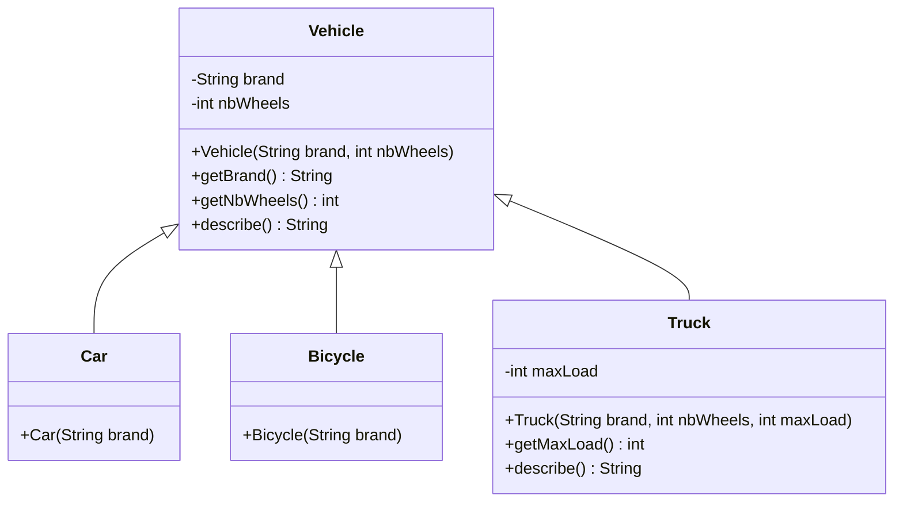
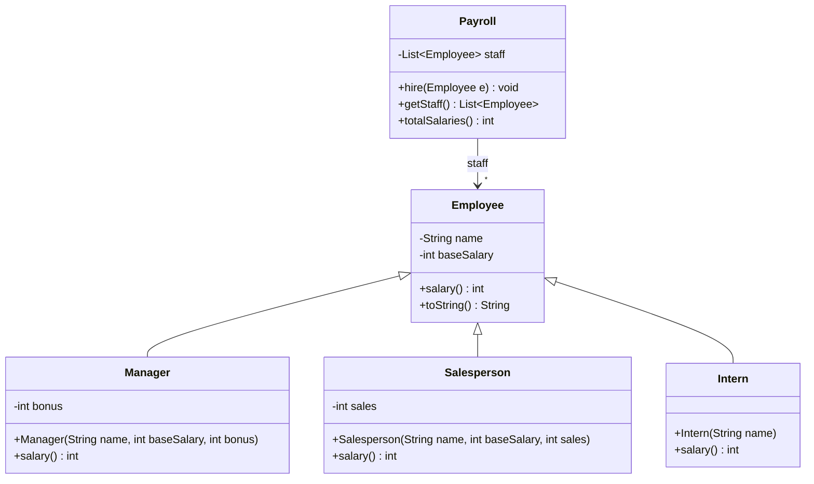
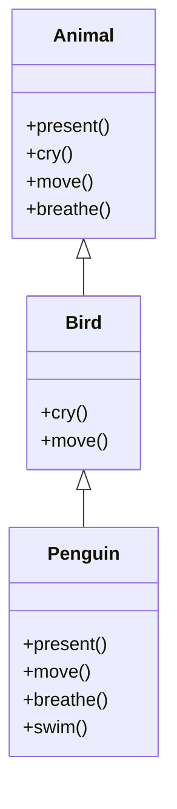
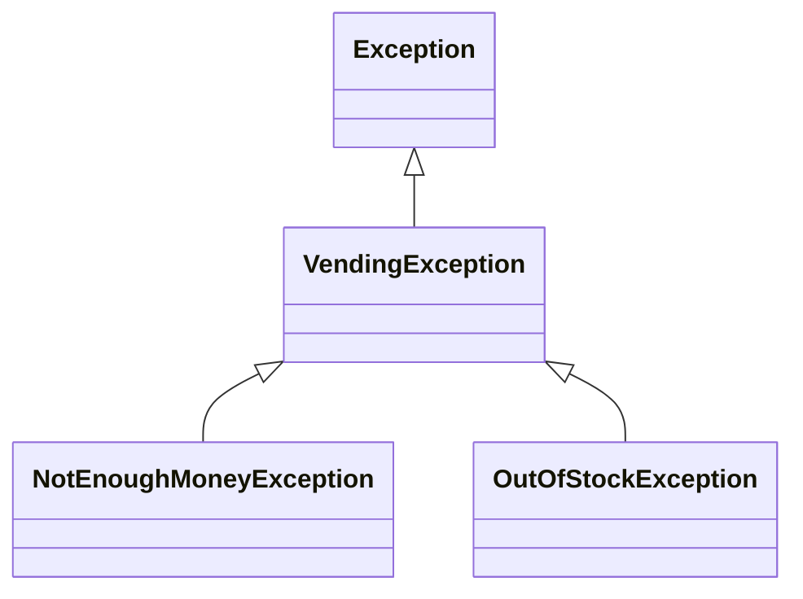
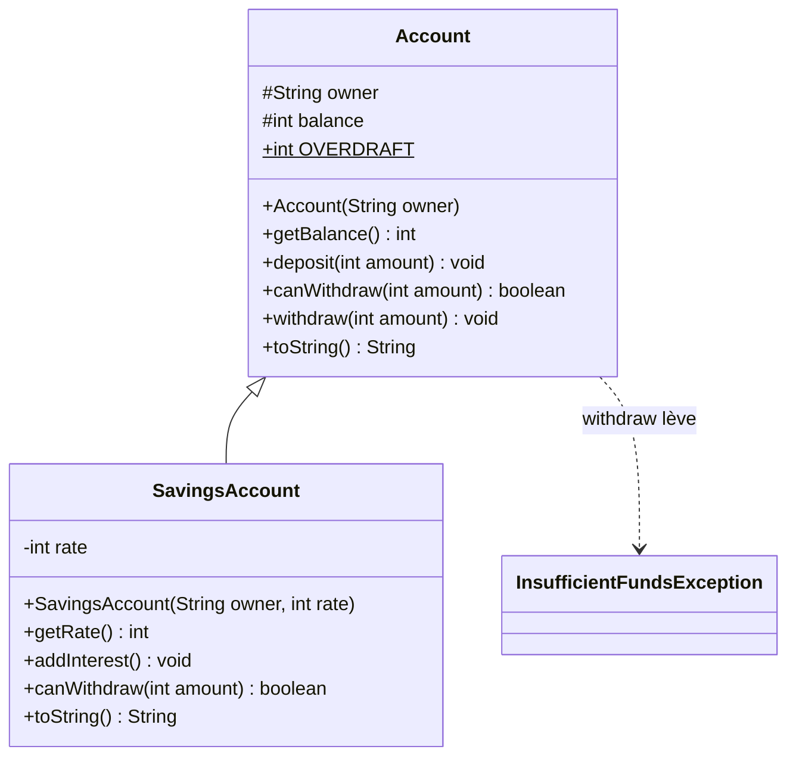

# 🏋️ 08 — Héritage : exercices d'entraînement

> ✅ **Corrigé :** [./corrige.md](./corrige.md) — essaie d'abord seul !
> 🔗 **Cours :** [08 — Héritage](../../01-Cours/08-heritage.md)
> 📌 Pour les « que s'affiche-t-il ? », **déroule le lookup sur papier** avant de regarder le corrigé : c'est exactement ce qu'on demande en DS.

## 🗺️ Les exercices

| n° | Titre | Niveau | Durée | Notions |
|---|---|---|---|---|
| 1 | Le garage : véhicules et constructeurs | ⭐ | 20 min | `extends`, `super(...)`, dérivation / extension / spécialisation |
| 2 | La paie des employés | ⭐ | 20 min | redéfinition, `super.m()`, late binding, `List<Employee>` |
| 3 | Quelle méthode est appelée ? | ⭐⭐ | 20 min | lookup, `this.m()`, `super.m()` |
| 4 | Compile ? Exécute ? (transtypage) | ⭐⭐ | 15 min | upcast, downcast, `instanceof`, `ClassCastException` |
| 5 | La boutique : `toString` et `equals` | ⭐⭐ | 25 min | `Object`, `toString`, `equals`, attribut « redéfini » |
| 6 | Le distributeur de boissons | ⭐⭐ | 25 min | hiérarchie d'exceptions, ordre des `catch`, `throws` et redéfinition |
| 7 | Comptes bancaires (style DS) | ⭐⭐⭐ | 40 min | `protected`, `super(...)`, redéfinition, javadoc, JUnit |
| 8 | La médiathèque : chasser les `instanceof` | ⭐⭐⭐ | 25 min | OCP, lookup, `description()` |

---

## Exercice 1 — Le garage : véhicules et constructeurs ⭐

> 🌍 Au garage, une voiture, un vélo et un camion sont tous des **véhicules** : une marque, un nombre de roues… Mais le camion a **en plus** une charge maximale.

```java
// Fichier : Vehicle.java
public class Vehicle {
    private String brand;
    private int nbWheels;

    public Vehicle(String brand, int nbWheels) {
        this.brand = brand;
        this.nbWheels = nbWheels;
    }
    public String getBrand() { return this.brand; }
    public int getNbWheels() { return this.nbWheels; }
    public String describe() { return this.brand + " (" + this.nbWheels + " roues)"; }
}
```



- [ ] **Q1.** Écris `Car` (toujours 4 roues) et `Bicycle` (toujours 2 roues).
- [ ] **Q2.** Écris `Truck` : il ajoute l'attribut `maxLoad` (en kg) et redéfinit `describe()` pour ajouter `" charge max : 12000 kg"` à la description d'un véhicule, **sans recopier** son code.
- [ ] **Q3.** Pour chaque classe, indique ce qui relève de la **dérivation**, de l'**extension** et de la **spécialisation**.
- [ ] **Q4.** **Trouve l'erreur** dans chacun de ces constructeurs (ils compilent tous… ou pas ?).

```java
// (a) dans Car
public Car(String brand) {
    System.out.println("Nouvelle voiture");
    super(brand, 4);
}
// (b) dans Car
public Car(String brand) {
    this.brand = brand;
    this.nbWheels = 4;
}
// (c) dans Bicycle
public Bicycle() { }
```

- [ ] **Q5.** Que s'affiche-t-il ?

```java
Vehicle v = new Truck("Renault", 6, 12000);
System.out.println(v.describe());
System.out.println(new Bicycle("Btwin").describe());
System.out.println(new Car("Peugeot").getNbWheels());
```

- [ ] **Q6.** On construit une maison comme un objet : d'abord les fondations, puis les murs, puis la piscine. Que s'affiche-t-il à l'exécution de `new VillaWithPool();` ?

```java
// Fichier : Building.java
public class Building {
    public Building() { System.out.println("1. fondations (Building)"); }
}
```

```java
// Fichier : House.java
public class House extends Building {
    public House() { System.out.println("2. murs (House)"); }
}
```

```java
// Fichier : VillaWithPool.java
public class VillaWithPool extends House {
    private String pool = "piscine";
    public VillaWithPool() {
        super();
        System.out.println("3. " + this.pool + " (VillaWithPool)");
    }
}
```

<details><summary>💡 Indice</summary>

- `super(...)` appelle un constructeur de la super-classe ; c'est la **première** instruction.
- `brand` et `nbWheels` sont `private` dans `Vehicle`.
- `Vehicle` n'a **pas** de constructeur sans paramètre : quel est le `super()` implicite ?
- Dans `Truck.describe()` : `super.describe()`.
- Q6 : `House` n'écrit pas `super();`… mais il est là quand même.

</details>

---

## Exercice 2 — La paie des employés ⭐

> 🌍 Dans une entreprise, chacun a un salaire de base. Le manager touche **en plus** une prime, le commercial une commission sur ses ventes, le stagiaire une gratification fixe.

```java
// Fichier : Employee.java
public class Employee {
    private String name;
    private int baseSalary;

    public Employee(String name, int baseSalary) {
        this.name = name;
        this.baseSalary = baseSalary;
    }
    public String getName() { return this.name; }
    public int getBaseSalary() { return this.baseSalary; }
    public int salary() { return this.baseSalary; }
    public String toString() { return this.name + " gagne " + this.salary() + " €"; }
}
```



- [ ] **Q1.** Écris `Manager` : salaire = salaire d'un employé **+** prime. Utilise `super.salary()`.
- [ ] **Q2.** Écris `Salesperson` : salaire = salaire d'un employé + 5 % des ventes (calcul en entiers : `sales * 5 / 100`).
- [ ] **Q3.** Écris `Intern` : salaire de base 0, mais `salary()` renvoie toujours la gratification `650`.
- [ ] **Q4.** Écris `Payroll` (la paie) avec `hire` et `totalSalaries()`.
- [ ] **Q5.** Que s'affiche-t-il ? Quelle méthode `salary()` est appelée dans `toString()` ?

```java
Payroll payroll = new Payroll();
payroll.hire(new Employee("Inès", 2000));
payroll.hire(new Manager("Hugo", 3000, 500));
payroll.hire(new Salesperson("Maya", 1800, 20000));
payroll.hire(new Intern("Léo"));
for (Employee e : payroll.getStaff()) {
    System.out.println(e);
}
System.out.println("Total : " + payroll.totalSalaries());
```

- [ ] **Q6.** **Trouve l'erreur.** Un camarade écrit dans `Manager` : `public int salary() { return this.salary() + this.bonus; }`. Que se passe-t-il à l'exécution ?
- [ ] **Q7.** Pourquoi `super.salary() + this.bonus` est-il préférable à `this.getBaseSalary() + this.bonus` ?

<details><summary>💡 Indice</summary>

- `toString()` n'est écrite **que** dans `Employee`, mais `this.salary()` relance un lookup depuis la classe de **l'objet**.
- `this.salary()` dans `Manager.salary()` : par où commence la recherche ?
- Imagine qu'on ajoute une prime d'ancienneté dans `Employee.salary()`.

</details>

---

## Exercice 3 — Quelle méthode est appelée ? ⭐⭐

> 🌍 Au zoo, le soigneur dit à chaque animal « présente-toi ! ». Chacun répond **à sa façon**, en reprenant parfois ce que fait son espèce « parente ».

```java
// Fichier : Animal.java
public class Animal {
    public void present() { System.out.println("Animal.present"); this.cry(); this.move(); }
    public void cry() { System.out.println("Animal.cry"); }
    public void move() { System.out.println("Animal.move"); this.breathe(); }
    public void breathe() { System.out.println("Animal.breathe"); }
}
```

```java
// Fichier : Bird.java
public class Bird extends Animal {
    public void cry() { System.out.println("Bird.cry"); }
    public void move() { System.out.println("Bird.move"); super.move(); }
}
```

```java
// Fichier : Penguin.java
public class Penguin extends Bird {
    public void present() { System.out.println("Penguin.present"); super.present(); }
    public void move() { System.out.println("Penguin.move"); super.move(); }
    public void breathe() { System.out.println("Penguin.breathe"); }
    public void swim() { System.out.println("Penguin.swim"); }
}
```



- [ ] **Q1.** Complète le tableau (une méthode par ligne d'affichage).

| | Code | Affichage |
|---|---|---|
| a | `Animal a = new Animal(); a.present();` | |
| b | `a = new Bird(); a.present();` | |
| c | `a = new Penguin(); a.present();` | |
| d | `a.move();` (avec `a` toujours le pingouin) | |
| e | `Bird b = new Penguin(); b.breathe();` | |

- [ ] **Q2.** `Animal a = new Penguin(); a.swim();` compile-t-il ? Et `((Penguin) a).swim();` ?
- [ ] **Q3.** Dans `Penguin.move()`, `super.move()` appelle `Bird.move()`, qui contient lui-même `super.move()`. Pourquoi ce second `super.move()` n'appelle-t-il **pas** à nouveau `Bird.move()` (l'objet est pourtant un `Penguin`) ?

<details><summary>💡 Indice</summary>

- `this.m()` : on part de la classe de **l'objet** (ici `Penguin`) et on remonte.
- `super.m()` : on part de la super-classe de la classe **où est écrit** `super.m()`.
- Le type de la **référence** décide de ce qui compile ; la classe de **l'objet** décide de ce qui s'exécute.

</details>

---

## Exercice 4 — Compile ? Exécute ? (transtypage) ⭐⭐

> 🌍 Dans un parking, toute voiture électrique **est une** voiture, et toute voiture **est un** véhicule. Mais un véhicule pris au hasard n'est pas forcément une voiture électrique : avant de le brancher, on vérifie !

On reprend `Vehicle`, `Car`, `Bicycle` et `Truck` de l'exercice 1, et on ajoute :

```java
// Fichier : ElectricCar.java
public class ElectricCar extends Car {
    private int battery;   // en %

    public ElectricCar(String brand) {
        super(brand);
        this.battery = 50;
    }
    public int getBattery() { return this.battery; }
    public void recharge() { this.battery = 100; }
    public String describe() { return super.describe() + " électrique " + this.battery + "%"; }
}
```

- [ ] **Q1.** Avec les déclarations ci-dessous, pour **chaque** ligne (indépendamment des autres), dis si elle **compile**, puis si elle **s'exécute sans erreur**.

```java
Vehicle v = new Car("Peugeot");
Car c = new ElectricCar("Tesla");
```

| n° | Instruction | Compile ? | Exécution ? |
|---|---|---|---|
| 1 | `Vehicle v1 = new Truck("Volvo", 6, 10000);` | | |
| 2 | `Car c1 = new Vehicle("Fiat", 4);` | | |
| 3 | `System.out.println(c.describe());` | | |
| 4 | `c.recharge();` | | |
| 5 | `((ElectricCar) c).recharge();` | | |
| 6 | `((ElectricCar) v).recharge();` | | |
| 7 | `Truck t = (Truck) v;` | | |
| 8 | `Bicycle b = (Bicycle) c;` | | |
| 9 | `System.out.println(c instanceof Vehicle);` | | |
| 10 | `System.out.println(v instanceof ElectricCar);` | | |

- [ ] **Q2.** Écris une méthode statique `rechargeAll(List<Vehicle> parking)` qui recharge **uniquement** les voitures électriques, sans risque de `ClassCastException`.
- [ ] **Q3.** Que s'affiche la ligne 3 ? Pourquoi pas seulement `Tesla (4 roues)` ?

<details><summary>💡 Indice</summary>

- Compilation : on ne regarde que le **type des références** (et la hiérarchie).
- Exécution : on regarde la classe de **l'objet** réellement créé.
- Un cast vers une classe « sœur » (ni ancêtre, ni descendante) est refusé dès la compilation.
- `instanceof` : `true` pour la classe de l'objet **et toutes ses super-classes**.

</details>

---

## Exercice 5 — La boutique : `toString` et `equals` ⭐⭐

> 🌍 À la caisse, deux pots de pâte à tartiner identiques ont le **même code-barres** : pour la caisse, c'est **le même produit**, même si ce sont deux pots distincts dans le caddie.

```java
// Fichier : Product.java
public class Product {
    protected String barcode;
    protected String name;
    protected double price;

    public Product(String barcode, String name, double price) {
        this.barcode = barcode;
        this.name = name;
        this.price = price;
    }
}
```

- [ ] **Q1.** Sans rien ajouter à `Product`, à quoi ressemble l'affichage de `System.out.println(new Product("301", "Lait", 1.2));` ? D'où vient la méthode `toString()` utilisée ?
- [ ] **Q2.** Ajoute dans `Product` une méthode `description()` (renvoie le nom) et redéfinis `toString()` pour renvoyer `description() + " : " + prix + " €"`.
- [ ] **Q3.** Écris `FoodProduct extends Product` avec une date limite (`String expiryDate`) : sa description est `Lait (à consommer avant le 12/11)`. Ne redéfinis **que** `description()`.
- [ ] **Q4.** Redéfinis `equals` (et la méthode qui va avec !) : deux produits sont égaux s'ils ont le même code-barres. Que s'affiche-t-il ensuite ?

```java
Product p1 = new Product("301", "Pâte à tartiner", 3.5);
Product p2 = new Product("301", "Pâte à tartiner", 3.5);
Product milk = new FoodProduct("302", "Lait", 1.2, "12/11");
System.out.println(p1 == p2);
System.out.println(p1.equals(p2));
List<Product> cart = new ArrayList<Product>();
cart.add(p1);
cart.add(milk);
System.out.println(cart.contains(p2));
System.out.println(cart);
```

- [ ] **Q5.** **Trouve l'erreur.** On ajoute la TVA : 20 % en général, 5 % pour l'alimentaire. Que s'affiche-t-il ? Corrige.

```java
// dans Product
protected double vat = 0.20;
public double priceWithVat() { return this.price * (1 + this.vat); }

// dans FoodProduct
protected double vat = 0.05;

// dans un main
System.out.println(new FoodProduct("303", "Pain", 2.0, "03/11").priceWithVat());
```

<details><summary>💡 Indice</summary>

- Toute classe hérite de `Object`, qui a déjà `toString()` et `equals(Object)`.
- `toString()` de `Product` appelle `this.description()` : lookup depuis la classe de l'objet.
- `contains` utilise `equals(Object)`. Qui redéfinit `equals` redéfinit `hashCode`.
- Q5 : **on ne redéfinit pas les attributs**. Dans `Product`, `this.vat` désigne l'attribut de `Product`.

</details>

---

## Exercice 6 — Le distributeur de boissons ⭐⭐

> 🌍 Un distributeur peut refuser une vente pour plusieurs raisons : boisson inconnue, pas assez de pièces, rupture de stock. Ce sont toutes des « erreurs de vente », certaines plus précises que d'autres.



- [ ] **Q1.** Écris les trois classes d'exception (chacune avec un constructeur prenant un message).
- [ ] **Q2.** Écris `VendingMachine` : un stock `Map<String,Integer>` initialisé à `café → 1` et `thé → 0`, un prix unique `PRICE = 2` (pièces), et la méthode `public void buy(String drink, int coins) throws VendingException` qui, **dans cet ordre** :
  1. lève `VendingException("boisson inconnue : " + drink)` si la boisson n'est pas dans le stock ;
  2. lève `NotEnoughMoneyException("pas assez d'argent")` si `coins < PRICE` ;
  3. lève `OutOfStockException(drink)` si le stock est à 0 ;
  4. sinon décrémente le stock.
- [ ] **Q3.** Que s'affiche-t-il ?

```java
public static void tryToBuy(VendingMachine m, String drink, int coins) {
    try {
        m.buy(drink, coins);
        System.out.println("Voici votre " + drink);
    } catch (OutOfStockException e) {
        System.out.println("Rupture : " + e.getMessage());
    } catch (VendingException e) {
        System.out.println("Problème : " + e.getMessage());
    }
}
// dans main :
VendingMachine m = new VendingMachine();
tryToBuy(m, "café", 2);
tryToBuy(m, "chocolat", 2);
tryToBuy(m, "thé", 1);
tryToBuy(m, "café", 2);
```

- [ ] **Q4.** On inverse les deux `catch` (d'abord `VendingException`, puis `OutOfStockException`). Compile ?
- [ ] **Q5.** `CoffeeMachine extends VendingMachine` redéfinit `buy`. Quelles en-têtes compilent ?

```java
public void buy(String drink, int coins) throws OutOfStockException { ... }   // (a)
public void buy(String drink, int coins) throws Exception { ... }             // (b)
public void buy(String drink, int coins) { ... }                              // (c)
```

<details><summary>💡 Indice</summary>

- Une `NotEnoughMoneyException` **est une** `VendingException` : quel `catch` la capture ?
- Les `catch` sont essayés **dans l'ordre** : du plus spécifique au plus général.
- En redéfinissant, on peut **affiner** les exceptions (sous-classes, ou aucune), jamais les élargir.

</details>

---

## Exercice 7 — Comptes bancaires (style DS) ⭐⭐⭐

> 🌍 À la banque, un compte courant autorise un **découvert** de 100 €. Un livret d'épargne, lui, rapporte des **intérêts**… mais on ne peut jamais y retirer plus que ce qu'il contient.



**Spécification** (montants entiers en euros) :
- un compte est créé avec un solde de 0 ;
- `deposit(amount)` ajoute `amount` ; lève `IllegalArgumentException` si `amount <= 0` ;
- `canWithdraw(amount)` : pour un `Account`, vrai si le solde après retrait reste ≥ `-OVERDRAFT` (100) ; pour un `SavingsAccount`, vrai si `amount <= balance` ;
- `withdraw(amount)` retire `amount` si `canWithdraw(amount)`, sinon lève `InsufficientFundsException` (contrôlée) ; `withdraw` n'est écrite **que** dans `Account` ;
- `addInterest()` ajoute `balance * rate / 100` (taux en %) ;
- `toString()` : `Ada : 150 €` pour un compte, `Ada : 150 € (livret 3 %)` pour un livret.

- [ ] **Q1.** Écris la **javadoc** de `withdraw`.
- [ ] **Q2.** Écris `InsufficientFundsException` et `Account`.
- [ ] **Q3.** Écris `SavingsAccount` : constructeur avec `super(...)`, `addInterest`, redéfinition de `canWithdraw` et de `toString` (avec `super.toString()`).
- [ ] **Q4.** Écris une classe de test `SavingsAccountTest` (JUnit 5) : au moins 5 tests (création, intérêts, retrait autorisé, retrait refusé **sans** modifier le solde, dépôt invalide).
- [ ] **Q5.** Pourquoi `withdraw`, écrite seulement dans `Account`, refuse-t-elle un découvert sur un livret ?
- [ ] **Q6.** `balance` est `protected`. Lesquelles de ces lignes compilent ? (`Bank` est dans le **même paquetage** que `Account`, `Hacker` dans un **autre** paquetage et n'hérite pas d'`Account`.)

```java
// dans SavingsAccount : this.balance = this.balance + 10;       (a)
// dans Bank :           account.balance = 1000000;              (b)
// dans Hacker :         account.balance = 1000000;              (c)
// dans Hacker :         account.deposit(10);                    (d)
```

<details><summary>💡 Indice</summary>

- Dans `withdraw`, appelle `this.canWithdraw(amount)` : le lookup choisira la bonne version.
- Pour `addInterest`, `balance` est `protected` : accessible directement dans la sous-classe.
- Test d'exception : `assertThrows(InsufficientFundsException.class, () -> account.withdraw(500));`
- `protected` = sous-classes **et** même paquetage.

</details>

---

## Exercice 8 — La médiathèque : chasser les `instanceof` ⭐⭐⭐

> 🌍 À la médiathèque, chaque document a sa durée d'emprunt : 21 jours pour un livre, 7 pour un DVD, 3 pour un magazine. Le bibliothécaire ne devrait pas avoir à apprendre un nouveau règlement à chaque nouveau type de document !

```java
// Fichier : Item.java
public class Item {
    protected String title;
    public Item(String title) { this.title = title; }
    public String getTitle() { return this.title; }
}
```

```java
// Fichier : Book.java
public class Book extends Item {
    public Book(String title) { super(title); }
}
```

```java
// Fichier : Dvd.java
public class Dvd extends Item {
    public Dvd(String title) { super(title); }
}
```

```java
// Fichier : Magazine.java
public class Magazine extends Item {
    public Magazine(String title) { super(title); }
}
```

```java
// Fichier : MediaLibrary.java
import java.util.ArrayList;
import java.util.List;

public class MediaLibrary {
    private List<Item> items = new ArrayList<Item>();

    public void add(Item item) { this.items.add(item); }

    public int loanDuration(Item item) {           // ⚠️ à améliorer
        if (item instanceof Book) {
            return 21;
        } else if (item instanceof Dvd) {
            return 7;
        } else if (item instanceof Magazine) {
            return 3;
        } else {
            return 14;
        }
    }

    public void displayAll() {
        for (Item item : this.items) {
            System.out.println(item.getTitle() + " : " + this.loanDuration(item) + " jours");
        }
    }
}
```

- [ ] **Q1.** On veut ajouter les bandes dessinées : `Comic extends Book`, empruntables **10 jours**. Que faut-il modifier dans `MediaLibrary` ? Où faut-il placer le nouveau test, et que se passe-t-il si on le place à la fin ?
- [ ] **Q2.** Quel principe du cours ce code viole-t-il ?
- [ ] **Q3.** Réécris le code pour que `MediaLibrary` n'ait **plus aucun** `instanceof` : la responsabilité est déplacée vers les documents.
- [ ] **Q4.** Ajoute `Comic` (10 jours) **sans toucher** à `MediaLibrary`.
- [ ] **Q5.** On ajoute dans `Item` : `public String toString() { return this.description() + " - " + this.loanDuration() + " jours"; }` avec `description()` qui renvoie `"document : " + titre`. Redéfinis `description()` dans `Dvd` (`"DVD : " + titre`) et ajoute à `MediaLibrary` un accesseur `getItems()`. Que s'affiche-t-il ?

```java
MediaLibrary lib = new MediaLibrary();
lib.add(new Book("Le Hobbit"));
lib.add(new Dvd("Le Roi lion"));
lib.add(new Magazine("Géo"));
lib.add(new Comic("Astérix"));
lib.displayAll();
for (Item item : lib.getItems()) {
    System.out.println(item);
}
```

<details><summary>💡 Indice</summary>

- Méthode du cours : 1) créer une méthode dans les classes de documents, 2) l'invoquer, 3) **laisser le lookup agir**.
- `Item.loanDuration()` donne la valeur par défaut (14), chaque sous-classe la redéfinit.
- Une `Comic` **est un** `Book` : `instanceof Book` est vrai pour elle.

</details>

---

✅ [Voir le corrigé](./corrige.md) · 🔗 [Cours 08](../../01-Cours/08-heritage.md)

🏠 [Sommaire des exercices](../README.md)
