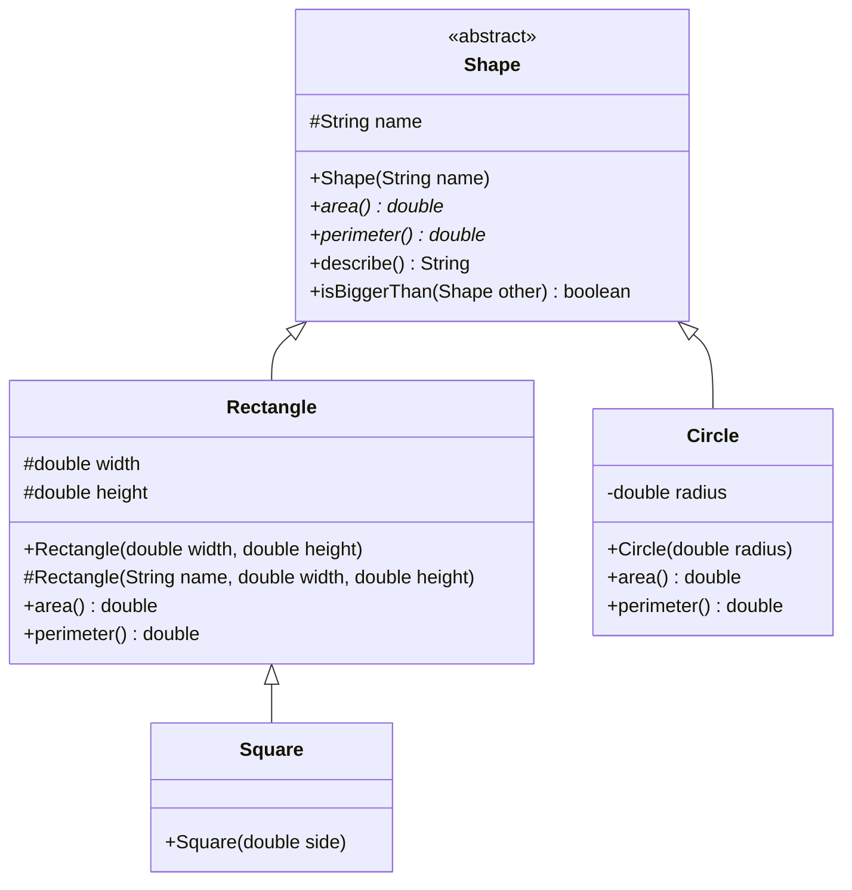
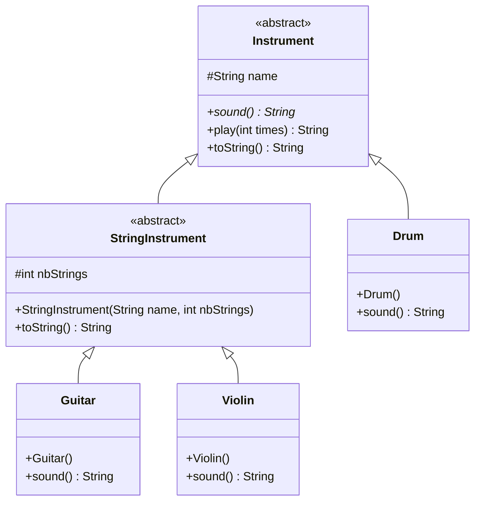
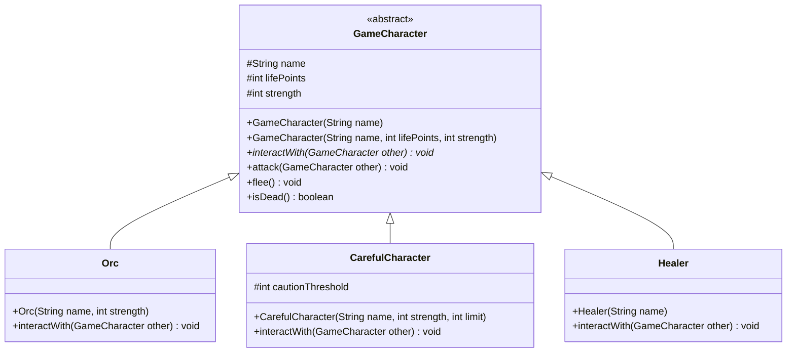
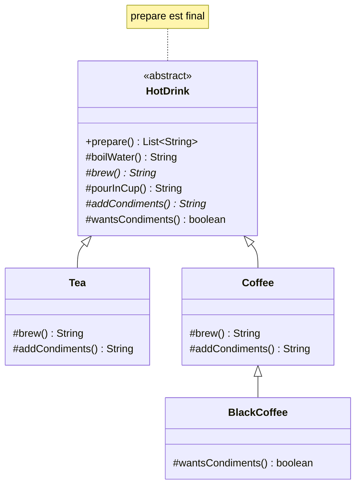
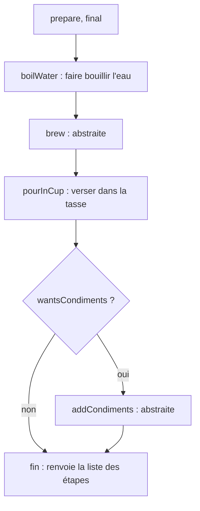
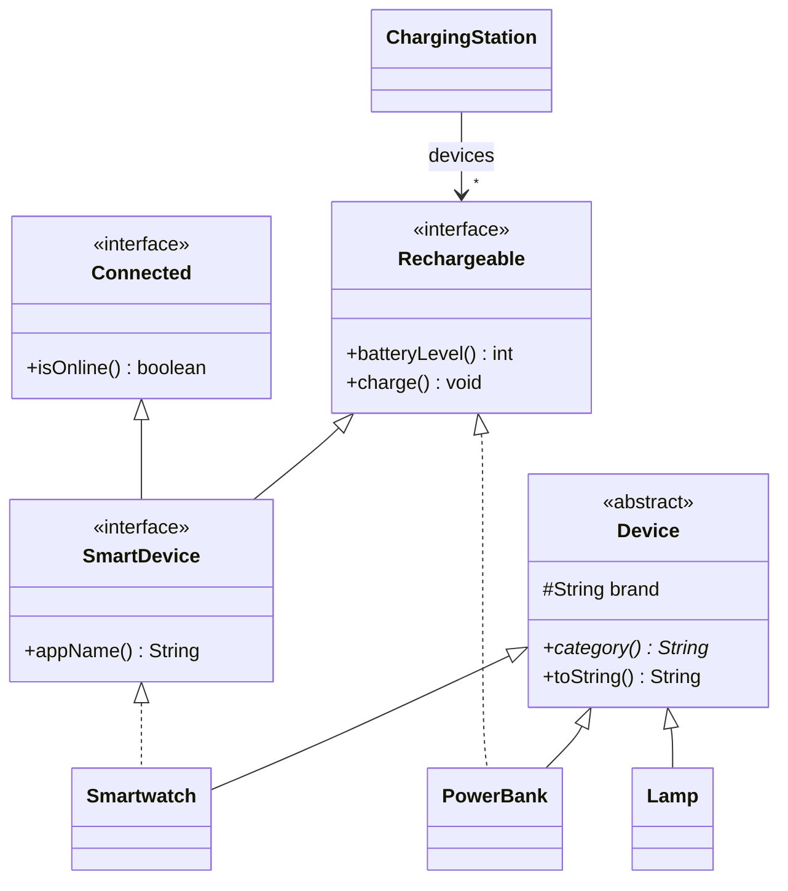

# 🏋️ 09 — Classes abstraites et `final` : exercices d'entraînement

> ✅ **Corrigé :** [./corrige.md](./corrige.md) — essaie d'abord seul !
> 🔗 **Cours :** [09 — Classes abstraites et final](../../01-Cours/09-classes-abstraites.md) · prérequis : [08 — Héritage](../../01-Cours/08-heritage.md)

## 🗺️ Les exercices

| n° | Titre | Niveau | Durée | Notions |
|---|---|---|---|---|
| 1 | Interface, classe abstraite ou classe concrète ? | ⭐ | 15 min | choix de conception, vrai / faux |
| 2 | Formes géométriques | ⭐ | 25 min | `abstract`, méthode concrète qui utilise des méthodes abstraites, OCP |
| 3 | L'orchestre | ⭐⭐ | 20 min | classe abstraite intermédiaire, trouve l'erreur |
| 4 | Personnages de jeu | ⭐⭐ | 25 min | constructeurs d'une classe abstraite, `super(...)`, late binding |
| 5 | `final` : compile ou pas ? | ⭐⭐ | 15 min | classe, méthode, attribut `final` |
| 6 | La machine à boissons chaudes (style DS) | ⭐⭐⭐ | 35 min | patron de méthode, méthode `final`, JUnit |
| 7 | Objets connectés | ⭐⭐⭐ | 25 min | classe abstraite + interfaces, héritage multiple d'interfaces |

---

## Exercice 1 — Interface, classe abstraite ou classe concrète ? ⭐

> 🌍 Un **contrat** de location (interface) dit *ce que* tu dois faire ; un **kit de meuble à finir** (classe abstraite) fournit des pièces toutes prêtes et en laisse quelques-unes à fabriquer ; un **meuble monté** (classe concrète) est utilisable tout de suite.

- [ ] **Q1.** Pour chaque cas, choisis **interface**, **classe abstraite** ou **classe concrète**, et justifie en une ligne.

| | Cas | Choix ? |
|---|---|---|
| a | `Payable` : tout ce qu'on peut payer (facture, amende, abonnement) doit fournir `amount()` ; ces objets n'ont rien d'autre en commun | |
| b | `Shape` : toutes les formes ont un nom et une méthode `describe()` identique, mais l'aire ne peut pas se calculer pour une forme « quelconque » | |
| c | `Circle` : on sait tout calculer, on veut créer des cercles | |
| d | `Instrument` : un nom, une méthode `play()` commune qui utilise le `sound()` propre à chaque instrument | |
| e | `Comparable<T>` : « être comparable à un autre `T` » | |
| f | `Hotel` du TP4 | |
| g | `GameCharacter` du cours | |
| h | Un véhicule amphibie doit pouvoir être manipulé à la fois comme un `LandVehicle` et comme un `Boat` | |

- [ ] **Q2.** Vrai ou faux ?
  1. Une classe abstraite peut avoir un constructeur.
  2. Si une classe abstraite n'a **aucune** méthode abstraite, on peut faire `new` dessus.
  3. Une classe qui contient une méthode abstraite doit être déclarée `abstract`.
  4. Une classe abstraite doit contenir au moins une méthode abstraite.
  5. Une interface peut étendre plusieurs interfaces.
  6. Une classe peut étendre deux classes abstraites.
  7. On peut déclarer une référence dont le type est une classe abstraite.
  8. Une méthode abstraite peut être `private`.

<details><summary>💡 Indice</summary>

- Code ou attributs communs à factoriser ? Non → interface. Oui → certaines méthodes impossibles à écrire au niveau général ? Oui → abstraite, non → concrète.
- Une classe n'a **qu'une** super-classe ; elle peut implémenter **plusieurs** interfaces.
- Une méthode abstraite **doit** être redéfinie par les sous-classes : peuvent-elles la voir si elle est `private` ?

</details>

---

## Exercice 2 — Formes géométriques ⭐

> 🌍 Un logiciel de devis pour un carreleur : il calcule la surface (pour le carrelage) et le périmètre (pour les plinthes) de pièces de formes variées. Le calcul **dépend** de la forme, mais la présentation du devis est **toujours la même**.



- [ ] **Q1.** Écris `Shape` : `area()` et `perimeter()` sont abstraites ; `describe()` renvoie par exemple `rectangle : aire = 12.0, périmètre = 14.0` ; `isBiggerThan(other)` compare les aires.
- [ ] **Q2.** Écris `Rectangle` (nom `"rectangle"`), `Square` (nom `"carré"`, réutilise `Rectangle` grâce au constructeur `protected`) et `Circle` (nom `"cercle"`, utilise `Math.PI`).
- [ ] **Q3.** Ces lignes compilent-elles ?

```java
Shape s1 = new Shape("forme");              // (a)
Shape s2 = new Square(2);                   // (b)
Rectangle r = new Square(3);                // (c)
Square sq = new Rectangle(3, 3);            // (d)
```

- [ ] **Q4.** Que s'affiche-t-il ?

```java
List<Shape> shapes = new ArrayList<Shape>();
shapes.add(new Rectangle(3, 4));
shapes.add(new Square(5));
shapes.add(new Circle(1));
for (Shape s : shapes) {
    System.out.println(s.describe());
}
System.out.println(shapes.get(1).isBiggerThan(shapes.get(0)));
```

- [ ] **Q5.** Ajoute `RightTriangle` (triangle rectangle de côtés `a` et `b` autour de l'angle droit : aire `a * b / 2`, périmètre `a + b + Math.sqrt(a * a + b * b)`). Quelles classes as-tu dû modifier ? Quel principe est respecté ?

<details><summary>💡 Indice</summary>

- `public abstract double area();` : pas de corps, un `;`.
- Dans `describe()`, `this.area()` est résolue par **late binding** : c'est l'aire de la vraie forme.
- `Square(double side)` : `super("carré", side, side);`.
- Une classe abstraite ne s'instancie **jamais**, même si elle a un constructeur.

</details>

---

## Exercice 3 — L'orchestre ⭐⭐

> 🌍 Le chef d'orchestre dit « jouez 2 fois ! » à tous les musiciens : chacun joue **à sa façon**. Les instruments à cordes ont en commun un nombre de cordes.

```java
// Fichier : Instrument.java
public abstract class Instrument {
    protected String name;

    public Instrument(String name) { this.name = name; }

    public abstract String sound();

    public String play(int times) {
        String result = this.name + " :";
        for (int i = 0; i < times; i++) {
            result = result + " " + this.sound();
        }
        return result;
    }

    public String toString() { return this.name; }
}
```



- [ ] **Q1.** Écris `StringInstrument` (abstraite) : elle ajoute `nbStrings` et redéfinit `toString()` (`guitare (6 cordes)`), mais **ne définit pas** `sound()`. Pourquoi peut-elle s'en passer ?
- [ ] **Q2.** Écris `Guitar` (6 cordes, `"Gling"`), `Violin` (4 cordes, `"Vziii"`) et `Drum` (`"Boum"`).
- [ ] **Q3.** Que s'affiche-t-il ?

```java
List<Instrument> orchestra = new ArrayList<Instrument>();
orchestra.add(new Guitar());
orchestra.add(new Violin());
orchestra.add(new Drum());
for (Instrument i : orchestra) {
    System.out.println(i + " -> " + i.play(2));
}
```

- [ ] **Q4.** **Trouve l'erreur** dans chacun de ces extraits (chacun est indépendant).

```java
// (a)
public class Instrument {
    public abstract String sound();
}
// (b) dans Instrument
public abstract String sound() { return "..."; }
// (c)
public class Piano extends Instrument {
    public Piano() { super("piano"); }
}
// (d)
StringInstrument s = new StringInstrument("harpe", 47);
```

<details><summary>💡 Indice</summary>

- Une sous-classe qui ne concrétise pas toutes les méthodes abstraites… doit rester abstraite.
- `play` appelle `this.sound()` : lookup depuis la classe de l'objet.
- `toString()` de `StringInstrument` peut réutiliser `super.toString()`.

</details>

---

## Exercice 4 — Personnages de jeu ⭐⭐

> 🌍 Dans un jeu de rôle, tous les personnages ont des points de vie, une force, savent attaquer ou fuir… mais chacun **réagit à sa façon** quand il en croise un autre. On reprend `GameCharacter` du cours, avec un nom en plus.

```java
// Fichier : GameCharacter.java
public abstract class GameCharacter {
    protected static final int DEFAULT_LIFEPOINTS = 12;
    protected static final int DEFAULT_STRENGTH = 8;
    protected String name;
    protected int lifePoints;
    protected int strength;

    public GameCharacter(String name) {
        this(name, GameCharacter.DEFAULT_LIFEPOINTS, GameCharacter.DEFAULT_STRENGTH);
    }
    public GameCharacter(String name, int lifePoints, int strength) {
        this.name = name;
        this.lifePoints = lifePoints;
        this.strength = strength;
    }

    public abstract void interactWith(GameCharacter other);   // dépend du personnage

    public boolean isDead() { return this.lifePoints <= 0; }
    public int removeLifePoints(int lp) { return this.lifePoints -= lp; }
    public int strength() { return this.strength; }
    public void attack(GameCharacter other) {
        System.out.println(this.name + " attaque " + other.name);
        other.removeLifePoints(this.strength);
    }
    public void flee() { System.out.println(this.name + " s'enfuit"); }
    public String toString() { return this.name + " (" + this.lifePoints + " PV)"; }
}
```



- [ ] **Q1.** Écris `Orc` : 10 points de vie, force donnée ; il attaque toujours (« moi vois, moi tue »).
- [ ] **Q2.** Écris `CarefulCharacter` : points de vie par défaut ; il fuit si la force de l'autre dépasse la sienne de **plus** de `cautionThreshold`, sinon il attaque.
- [ ] **Q3.** Écris `Healer` : valeurs par défaut (utilise le constructeur à un paramètre) ; il **soigne** l'autre de 3 points de vie en affichant `Elrond soigne Bilbo`.
- [ ] **Q4.** Que s'affiche-t-il ?

```java
GameCharacter orc = new Orc("Grishnak", 9);
GameCharacter careful = new CarefulCharacter("Bilbo", 5, 3);
GameCharacter healer = new Healer("Elrond");
orc.interactWith(careful);
careful.interactWith(orc);
healer.interactWith(careful);
careful.interactWith(healer);
System.out.println(orc + " " + careful + " " + healer);
orc.interactWith(careful);
System.out.println(careful.isDead());
```

- [ ] **Q5.** `GameCharacter` possède deux constructeurs. `new GameCharacter("Gollum")` compile-t-il ? À quoi servent alors ces constructeurs ?

<details><summary>💡 Indice</summary>

- `super(name, ORC_LIFEPOINTS, strength)` appelle le constructeur de la classe abstraite.
- Soigner de 3 points = retirer `-3` points de vie.
- `careful.interactWith(orc)` : `9 - 5 = 4`, et `4 > 3`…

</details>

---

## Exercice 5 — `final` : compile ou pas ? ⭐⭐

> 🌍 Un document signé chez le notaire est **définitif** (`final`) : on ne peut plus le modifier. Mais attention : une boîte scellée à une étagère (référence `final`) peut encore voir son **contenu** changer !

- [ ] **Q1.** Pour chaque extrait (indépendant), dis s'il **compile**. Sinon, explique pourquoi.

```java
// (1)
public final class Euro { }
public class Cent extends Euro { }

// (2)
public class Poll { public final void vote() { } }
public class Referendum extends Poll { public void vote() { } }

// (3)
public class Poll { public final void vote() { } }
public class Referendum extends Poll {
    public void start() { this.vote(); }
}

// (4)
public class Card {
    private final String number;
    public Card(String number) { this.number = number; }
    public void change(String number) { this.number = number; }
}

// (5)
public class Card {
    private final String number;
    public Card() { }
}

// (6)
public abstract final class Shape { }

// (7)
public abstract class Shape {
    public final abstract double area();
}

// (8)
public class Config {
    public static final int MAX = 10;
    public void increase() { MAX = 20; }
}

// (9) dans une méthode
final List<String> names = new ArrayList<String>();
names.add("Ada");
```

- [ ] **Q2.** Dans le cours, pourquoi `vote` est-elle `final` dans `Poll` ? Donne un autre exemple de la vie courante où une méthode devrait être `final`.

<details><summary>💡 Indice</summary>

- `final` classe ⇒ pas de sous-classe ; `final` méthode ⇒ pas de redéfinition (mais elle est **héritée**) ; `final` attribut ⇒ une seule affectation, obligatoire.
- `abstract` veut dire « à compléter par une sous-classe » : compatible avec `final` ?
- (9) : qu'est-ce qui est `final`, la référence ou l'objet ?

</details>

---

## Exercice 6 — La machine à boissons chaudes (style DS) ⭐⭐⭐

> 🌍 Thé ou café, la recette suit **toujours le même plan** : faire bouillir l'eau, préparer la boisson, verser dans la tasse, ajouter les suppléments. Seules certaines étapes changent… et personne ne doit pouvoir changer l'**ordre** des étapes (sinon on verse avant d'avoir fait bouillir !).

C'est le **patron de méthode** : une méthode `final` fixe l'algorithme et appelle des méthodes (souvent abstraites) que les sous-classes complètent. Comme `vote` dans `Poll`.





**Spécification :** `prepare()` renvoie la **liste des étapes** réalisées (des `String`) :
- `Tea` : `faire infuser le thé`, puis `ajouter du citron` ;
- `Coffee` : `passer le café`, puis `ajouter du sucre` ;
- `BlackCoffee` : un `Coffee` **sans** suppléments.

- [ ] **Q1.** Écris la **javadoc** de `prepare()`.
- [ ] **Q2.** Écris `HotDrink` : `prepare()` est `public final` ; `boilWater()` et `pourInCup()` sont concrètes ; `brew()` et `addCondiments()` sont abstraites ; `wantsCondiments()` renvoie `true` par défaut (méthode « crochet » qu'une sous-classe **peut** redéfinir).
- [ ] **Q3.** Écris `Tea`, `Coffee` et `BlackCoffee`.
- [ ] **Q4.** Écris `HotDrinkTest` (JUnit 5) : au moins 4 tests (étapes du thé, du café, du café noir, et « la première étape est toujours de faire bouillir l'eau »).
- [ ] **Q5.** Que s'affiche-t-il ?

```java
List<HotDrink> order = new ArrayList<HotDrink>();
order.add(new Tea());
order.add(new BlackCoffee());
for (HotDrink d : order) {
    System.out.println(d.prepare());
}
```

- [ ] **Q6.** Un collègue écrit `public List<String> prepare() { … }` dans `Tea` pour verser le thé **avant** de faire bouillir l'eau. Que se passe-t-il ? Pourquoi est-ce une bonne chose ?

<details><summary>💡 Indice</summary>

- `prepare()` : une `List<String>` locale, et `steps.add(this.brew())`, etc.
- Les méthodes appelées dans `prepare()` sont résolues par lookup depuis la classe de l'objet.
- `BlackCoffee` ne redéfinit **que** `wantsCondiments()`.
- Pour comparer des listes en test : construire la liste attendue et `assertEquals(expected, tea.prepare())`.

</details>

---

## Exercice 7 — Objets connectés ⭐⭐⭐

> 🌍 Dans une maison connectée : une montre connectée est un **appareil** (marque, catégorie) **et** elle est **rechargeable** **et** **connectée**. Une batterie externe est rechargeable mais pas connectée ; une lampe classique n'est ni l'un ni l'autre.

```java
// Fichier : Rechargeable.java
public interface Rechargeable {
    public int batteryLevel();
    public void charge();
}
```

```java
// Fichier : Connected.java
public interface Connected {
    public boolean isOnline();
}
```

```java
// Fichier : SmartDevice.java
public interface SmartDevice extends Rechargeable, Connected {
    public String appName();
}
```

```java
// Fichier : Device.java
public abstract class Device {
    protected String brand;
    public Device(String brand) { this.brand = brand; }
    public String getBrand() { return this.brand; }
    public abstract String category();
    public String toString() { return this.category() + " " + this.brand; }
}
```



- [ ] **Q1.** Combien de méthodes, **au minimum**, `Smartwatch extends Device implements SmartDevice` doit-elle définir ? Lesquelles ?
- [ ] **Q2.** Écris `Smartwatch` (catégorie `"montre"`, batterie à 20 % à la création, `charge()` la met à 100, toujours en ligne, application `"WatchApp"`), `PowerBank` (catégorie `"batterie"`, 50 % à la création) et `Lamp` (catégorie `"lampe"`).
- [ ] **Q3.** Écris `ChargingStation` : une liste de `Rechargeable`, une méthode `plug(Rechargeable r)` et `chargeAll()`.
- [ ] **Q4.** Quelles lignes compilent ? (`station` est une `ChargingStation`.)

```java
Device d = new Device("Ikea");                     // (a)
Rechargeable r = new Smartwatch("Garmin");         // (b)
r.isOnline();                                      // (c)
SmartDevice s = new PowerBank("Anker");            // (d)
Connected c = new Smartwatch("Garmin");            // (e)
station.plug(new Lamp("Ikea"));                    // (f)
station.plug(new PowerBank("Anker"));              // (g)
```

- [ ] **Q5.** Que s'affiche-t-il ?

```java
Smartwatch watch = new Smartwatch("Garmin");
PowerBank bank = new PowerBank("Anker");
ChargingStation station = new ChargingStation();
station.plug(watch);
station.plug(bank);
System.out.println(watch + " " + watch.batteryLevel() + "% / " + bank + " " + bank.batteryLevel() + "%");
station.chargeAll();
System.out.println(watch.batteryLevel() + " " + bank.batteryLevel() + " " + watch.isOnline());
System.out.println(new Lamp("Ikea"));
```

- [ ] **Q6.** Pourquoi `Device` ne peut-elle pas être une interface, et pourquoi `Rechargeable` ne peut-elle pas être une classe abstraite (pense à `Smartwatch`) ?

<details><summary>💡 Indice</summary>

- `SmartDevice` hérite des méthodes de `Rechargeable` **et** de `Connected`.
- `extends` une seule classe, puis `implements` une ou plusieurs interfaces : `class Smartwatch extends Device implements SmartDevice`.
- Le type de la **référence** limite les méthodes appelables.

</details>

---

✅ [Voir le corrigé](./corrige.md) · 🔗 [Cours 09](../../01-Cours/09-classes-abstraites.md)

🏠 [Sommaire des exercices](../README.md)
