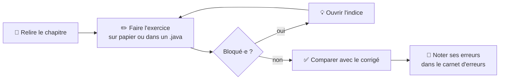

# 🏋️ Exercices d'entraînement

> Pour **chaque chapitre** : une fiche d'exercices progressifs (⭐ facile → ⭐⭐⭐ niveau DS) et son **corrigé dans un fichier séparé**.
> Tout le code des corrigés a été **compilé et testé**.

## 🧭 Méthode conseillée

> ⚠️ Ouvre le corrigé **seulement après** avoir vraiment essayé : c'est l'effort de chercher qui fait retenir.

## 📚 Les fiches

| # | Chapitre | Exercices | Corrigé | Cours |
|---|---|---|---|---|
| 01 | Classes et objets | [énoncé](./01-classes-et-objets/enonce.md) | [corrigé](./01-classes-et-objets/corrige.md) | [cours](../01-Cours/01-classes-et-objets.md) |
| 02 | static et enum | [énoncé](./02-static-et-enum/enonce.md) | [corrigé](./02-static-et-enum/corrige.md) | [cours](../01-Cours/02-static-et-enum.md) |
| 03 | Tests unitaires | [énoncé](./03-tests/enonce.md) | [corrigé](./03-tests/corrige.md) | [cours](../01-Cours/03-tests.md) |
| 04 | Exceptions | [énoncé](./04-exceptions/enonce.md) | [corrigé](./04-exceptions/corrige.md) | [cours](../01-Cours/04-exceptions.md) |
| 05 | Polymorphisme et interfaces | [énoncé](./05-polymorphisme-et-interfaces/enonce.md) | [corrigé](./05-polymorphisme-et-interfaces/corrige.md) | [cours](../01-Cours/05-polymorphisme-et-interfaces.md) |
| 06 | Interfaces (suite) | [énoncé](./06-interfaces-suite/enonce.md) | [corrigé](./06-interfaces-suite/corrige.md) | [cours](../01-Cours/06-interfaces-suite.md) |
| 07 | Collections | [énoncé](./07-collections/enonce.md) | [corrigé](./07-collections/corrige.md) | [cours](../01-Cours/07-collections.md) |
| 08 | Héritage | [énoncé](./08-heritage/enonce.md) | [corrigé](./08-heritage/corrige.md) | [cours](../01-Cours/08-heritage.md) |
| 09 | Classes abstraites et final | [énoncé](./09-classes-abstraites/enonce.md) | [corrigé](./09-classes-abstraites/corrige.md) | [cours](../01-Cours/09-classes-abstraites.md) |

## 🎯 Avant un DS
1. Les exercices ⭐⭐⭐ des chapitres 01 à 04 (ce sont les notions du DS1).
2. Les [annales du DS1](../04-Examens/README.md) en temps limité.
3. La [checklist de révision](../05-Fiches/checklist-revision.md).

---
🏠 [Retour à l'accueil](../README.md)
