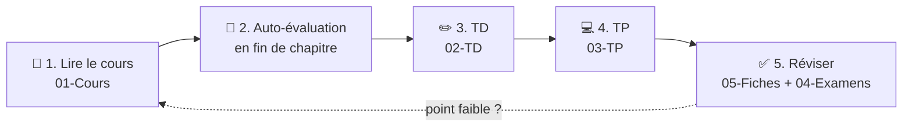

# 📘 POO — Programmation Orientée Objet en Java (L2 Informatique, Lille)

> Ton espace de travail pour **apprendre**, **pratiquer** et **réviser**.

## 🧭 Comment utiliser ce dossier

## 📂 Organisation

| Dossier | Contenu |
|---|---|
| [01-Cours/](./01-Cours/README.md) | 9 chapitres de cours, résumés et illustrés, avec quiz |
| [02-TD/](./02-TD/) | énoncés de TD + espace « Mes réponses » |
| [03-TP/](./03-TP/) | un dossier par TP : `ENONCE.md`, `README.md` (à rendre), `src/`, `test/` |
| [04-Examens/](./04-Examens/README.md) | 3 DS1 (2023-24, 2024-25, 2025-26) : sujets + corrigés testés + ce qui revient à chaque DS |
| [05-Fiches/](./05-Fiches/) | memento des commandes + checklist de révision |

## 🗺️ Programme et liens cours ↔ pratique

| # | Chapitre | TD | TP | Examen |
|---|---|---|---|---|
| 01 | [Classes et objets](./01-Cours/01-classes-et-objets.md) | [TD2 Intervalles](./02-TD/TD2-intervalles/enonce.md) | [TP1](./03-TP/TP1-tv-library/ENONCE.md) · [TP2](./03-TP/TP2-light/ENONCE.md) | DS1 |
| 02 | [static et enum](./01-Cours/02-static-et-enum.md) | [TD3 Tournois](./02-TD/TD3-tournois/enonce.md) | [TP3](./03-TP/TP3-member/ENONCE.md) | DS1 |
| 03 | [Tests unitaires](./01-Cours/03-tests.md) | [TD3 Tournois](./02-TD/TD3-tournois/enonce.md) | [TP4](./03-TP/TP4-hotel/ENONCE.md) | DS1 |
| 04 | [Exceptions](./01-Cours/04-exceptions.md) | [TD3](./02-TD/TD3-tournois/enonce.md) · [TD Othello](./02-TD/TD-othello/enonce.md) | [TP4](./03-TP/TP4-hotel/ENONCE.md) · [TP Othello](./03-TP/TP-othello/ENONCE.md) | DS1 |
| 05 | [Polymorphisme et interfaces](./01-Cours/05-polymorphisme-et-interfaces.md) | [TD Othello](./02-TD/TD-othello/enonce.md) | [TP Othello](./03-TP/TP-othello/ENONCE.md) | |
| 06 | [Interfaces (suite)](./01-Cours/06-interfaces-suite.md) | | [TP Othello](./03-TP/TP-othello/ENONCE.md) | |
| 07 | [Collections](./01-Cours/07-collections.md) | | [TP Othello](./03-TP/TP-othello/ENONCE.md) | |
| 08 | [Héritage](./01-Cours/08-heritage.md) | | | |
| 09 | [Classes abstraites et final](./01-Cours/09-classes-abstraites.md) | | | |

## 🚀 Accès rapides
- 🛠️ [Memento des commandes](./05-Fiches/memento-commandes.md) — `javac`, `java`, JUnit, `javadoc`, `jar`, `git`
- ✅ [Checklist de révision](./05-Fiches/checklist-revision.md)
- 📝 [Annales du DS1](./04-Examens/README.md) : [2023-24](./04-Examens/DS1-2023-2024/sujet.md) · [2024-25](./04-Examens/DS1-2024-2025/sujet.md) · [2025-26](./04-Examens/DS1-2025-2026/sujet.md)

> 💡 **Lire les schémas** : ils sont en **Mermaid**. Ils s'affichent sur GitHub/GitLab ; dans VS Code, installe l'extension *Markdown Preview Mermaid Support* puis ouvre l'aperçu (`Cmd+Shift+V`).
